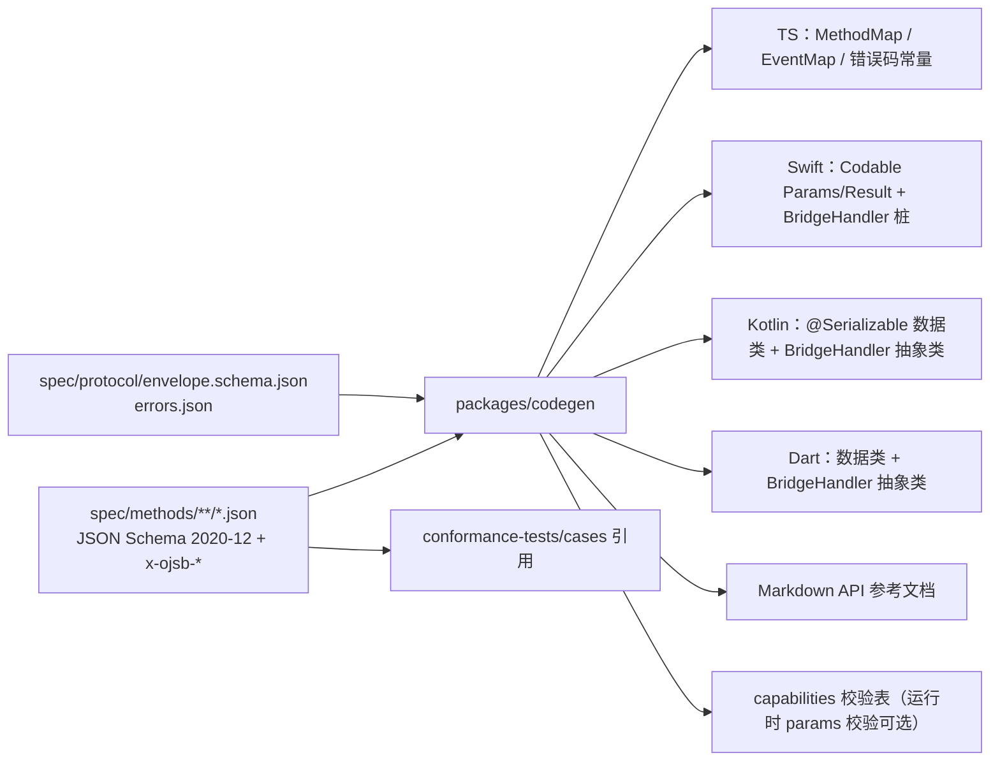
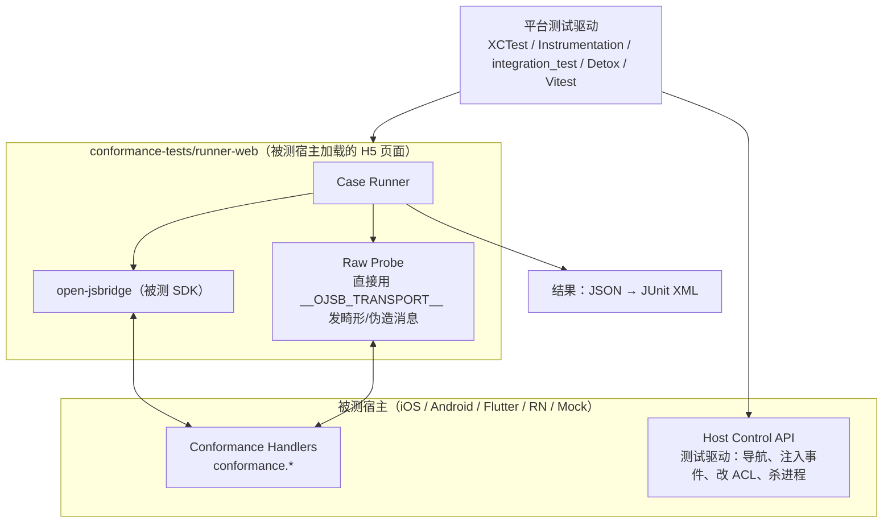

# 一致性测试套件与 Schema 单一事实来源

> 目标：保证 **Web SDK × {iOS, Android, Flutter, React Native, Mock}** 所有组合的行为完全一致。规则只有一条：**协议行为以 conformance 用例为准**；实现与用例冲突，要么修实现，要么改规范并同步改用例。

## 1. 单一事实来源（Single Source of Truth）



### 1.1 Method schema 格式

[`device.getInfo` Schema](../spec/methods/device/getInfo.json) 用 `params` 和 `result` 定义 v1 的参数与结果。事件用 `"x-ojsb-kind": "event"` 和 `payload`。查询和事件可以复用同一份 Schema，例如 [网络状态](../spec/schemas/network-status.json)。流式 method 可用 `x-ojsb-callbacks` 声明进度载荷。

`x-ojsb-*` 扩展关键字一览：

| 关键字 | 含义 |
|-------|------|
| `x-ojsb-kind` | `method` / `event` |
| `x-ojsb-version` | method 版本（整数），多版本用 `getInfo@2.json` 并存 |
| `x-ojsb-since` / `deprecated` / `x-ojsb-sunset` | 版本演进（protocol §15） |
| `x-ojsb-platforms` | 哪些宿主 MUST 实现（profile 内） |
| `x-ojsb-allow-degraded` | 是否允许在 degraded trust 会话中调用（protocol S2） |
| `x-ojsb-long-running` | 允许 `timeout: 0` |
| `x-ojsb-callbacks` | 允许流式回调及 chunk schema |
| `x-ojsb-concurrency(-policy)` | `parallel` / `serial` + `queue` / `reject` |
| `x-ojsb-throttle-ms` | 事件节流 |
| `x-ojsb-sensitive` | 字段级，日志掩码 |
| `x-ojsb-errors` | 该 method 可能返回的业务错误码 |

### 1.2 Codegen

```bash
npx ojsb-codegen --spec ./spec --target ts     --out packages/web-sdk/src/generated
npx ojsb-codegen --spec ./spec --target swift  --out ios/Sources/OpenJSBridge/Generated
npx ojsb-codegen --spec ./spec --target kotlin --out android/openjsbridge/src/main/kotlin/generated --package dev.openjsbridge.gen
npx ojsb-codegen --spec ./spec --target dart   --out flutter/lib/src/generated
```

生成的桩（以 Swift 为例），业务只实现 `handle`：

```swift
// GENERATED — DO NOT EDIT
public protocol DeviceGetInfoHandler: BridgeHandler where Params == DeviceGetInfoParams, Result == DeviceGetInfoResult {}
public extension DeviceGetInfoHandler {
    static var method: String { "device.getInfo" }
    static var versions: [Int] { [1] }
}
```

RN 宿主直接复用 TS 产物（`MethodMap` 同时约束 Web 调用方与 RN `HostHandler`）。

**CI 规则**：
1. schema 自身用 meta-schema 校验 + 自定义 lint（命名正则、保留命名空间、错误码段、版本号单调）。
2. 运行全部 codegen 后 `git diff --exit-code`，生成物必须入库且与 schema 一致。
3. 破坏性变更检测：对比 PR 前后 schema，删除字段/改类型/新增必填而未升 `x-ojsb-version` 时 CI 失败。

## 2. 测试架构



### 2.1 `conformance.*` 测试 method（每个宿主 MUST 实现，仅测试构建开启）

| method | 行为 |
|--------|------|
| `conformance.echo` | 原样返回 params |
| `conformance.delay` | `{ ms }` 后返回；支持取消（取消时记录 `cancelled=true`） |
| `conformance.fail` | `{ code, message, data }` 原样作为错误返回 |
| `conformance.throw` | handler 抛未分类异常（期望 -32603） |
| `conformance.emit` | `{ event, payload, count, intervalMs }` 推送事件 |
| `conformance.stream` | `{ n }` 发 n 条 callback 后返回 |
| `conformance.big` | `{ bytes }` 返回指定大小数据（inline 或 blob URL，按宿主能力） |
| `conformance.callWeb` | 让宿主反向调用页面注册的 handler，并返回其结果 |
| `conformance.lastCancel` | 查询某 id 是否被宿主侧感知取消 |
| `conformance.context` | 返回宿主看到的 `origin / isMainFrame / trust / sid`（用于安全断言） |
| `conformance.serial` | `x-ojsb-concurrency: serial`，用于并发策略测试 |

### 2.2 Host Control API

由平台测试驱动（不是页面）调用，用于制造页面无法自行制造的状况：`reload()`、`navigate(url)`、`setAcl(json)`、`emitEvent(name, payload)`、`killRenderProcess()`（平台支持时）、`loadInFrame(origin)`。

### 2.3 PR #1 审查回归用例

以下为用例契约。SDK 队列与入站规则以 Fake Transport 配合可控时钟验证。调用来源和 document 投递隔离以真实 WebView 验证。`SEC-ACL-ERROR-001` 适用于实现了可选规则扩展的宿主。

| 用例 | 驱动步骤 | 必须断言 |
|------|----------|----------|
| `SEC-ACL-ERROR-001` | 让测试权限规则抛出未分类异常，从已握手、原本允许调用的上下文发起请求 | 返回 `-32603`，业务 handler 调用数为零，响应不包含内部异常信息 |
| `SEC-JSI-DEFAULT-001` | 在无 WebMessageListener 的 Android WebView 上使用默认配置，导航后检测注入通道 | 不安装 `addJavascriptInterface`；握手判定为 bridge 不可用；不建立会话 |
| `HS-SID-001` | 在握手前或切换会话时送入旧会话消息，握手后送入缺失或不匹配 `sid` 的消息，最后送入当前会话消息 | 只有匹配当前会话的消息进业务分派。非当前握手 id、超时后迟到的 hello 响应均不能安装会话 |
| `LIFE-DOCUMENT-001` | 在旧 document 留下未完成的 handler 和待投递的结果，再导航到新 document；声明 iframe 时还要单独导航子 frame | 旧会话的 handler、订阅、媒体暂存和待发送结果被清理；在新 document 的 transport 接收层断言未收到旧 payload |
| `CALL-PRE-READY-001` | 延迟 hello，通过可控时钟使排队请求超时，然后完成握手 | 调用返回 `-32001`；transport 仅收到 hello，未收到该 request 或 cancel |
| `CALL-PRE-READY-002` | 延迟 hello，对排队请求触发 AbortSignal，然后完成握手 | 调用返回 `-32002`；transport 仅收到 hello，未收到该 request 或 cancel |
| `CALL-PRE-READY-003` | 延迟 hello，让宿主在调用 deadline 之前完成握手并声明 `cancel`，确认 request 发出后触发 AbortSignal | 发出的 request 使用剩余时长；`bridge.cancel` 通知的 `params.requestId` 指向原请求，外层 `meta.sid` 与原请求相同 |

并发回归用例用 `maxInflight: 1` 验证握手前后提交的请求按顺序发出。并发槽释放后才发下一笔。等待并发槽时触发超时或 abort 的请求只在本地结算。宿主声明 `cancel` 时，取消已发送的请求会先发取消通知。支持 Promise 回执的通道在批量取消时按收到的回执逐一释放槽位。 [Web SDK 用例](../conformance-tests/bridge.test.mjs)

事件用例验证订阅和调用共享并发槽，以及 `queueLimit: 0` 时仍会排队发送退订和 bfcache 恢复订阅。 [Web SDK 事件用例](../conformance-tests/web-events-sdk.test.mjs)

验收 `LIFE-DOCUMENT-001` 时，先在旧文档发出请求并在原生侧暂停应答。整页导航后让新文档完成握手，再释放旧应答。在新文档的传输边界检查应答投递，再验证新文档仍能完成调用。iOS 还验证失效请求的 WithReply 回调仅收到一次 `null` 传输回执。

Android 文档重新确认期间，从原文档路由到达的请求会等待确认。相同的文档标记与 reply proxy 保留会话并继续处理缓存请求。新文档或路由失效会清除缓存。

## 3. 用例格式

M1 原生宿主可从 [最小接入验收](native-host.md#验收) 开始。浏览器 Mock 和两端原生示例加载同一份 Web demo，并使用同一个 Web SDK 单例调用 `conformance.echo`。

### 3.1 M1 原始入站报文

- [wire.json](../conformance-tests/fixtures/wire.json) 是**信封形状**正反例，由 Node 测试验证 JSON Schema 与 TypeScript codec。形状合法不代表宿主可分派，例如信封允许 `meta.timeout: 0`，但短任务不允许用它。
- [host-inbound-raw.json](../conformance-tests/fixtures/host-inbound-raw.json) 是**宿主行为**用例，由 Node、Swift XCTest、Android JVM 直接送到 Mock、`WireHost`、`RpcSession` 的入站接口。不经过 Web SDK 或 WebView。每个 case 新建核心；`fresh` 不预握手，`active` 以 `bootstrap` 握手，`replaced` 用两个独立核心取得旧和当前 sid，只向后者发送测试报文，不模拟导航。

步骤的 `raw` 是原始字符串；只将完整的带引号 `$SID`、`$OLD_SID` 占位符替换为 JSON 编码后的 sid，不重新序列化输入。`accept` 列出允许的应答。`none`（无 RPC 应答）不等于 `rpc.id: null`（未关联的诊断）；期望中的 `sid: null` 表示 `meta.sid` 缺省。握手结果绑定非空 `result.sid`，重复握手须复用，`meta.sid` 如存在须与之相等。echo 结果按 JSON 值比较，不比较序列化顺序。

`bridge.hello` 与 `bridge.hello@1` 共用握手分支和 ID 集合；没有会话时丢弃 `@2`，有匹配 sid 时用原 ID 和当前 sid 返回 `-32601`。支持的握手方法收到不相交的主版本返回 `-32004` 和 `data.supported`。短任务 hello 和 echo 在登记 ID 后、分派前以 `-32602` 拒绝 `timeout: 0`；重复和旧 sid 仍静默。对于畸形 JSON、不可移植的数字或非法结构，只允许 [协议 §5](protocol.md#5-request--response-时序) 规定的安全诊断或静默，不允许成功应答。数值溢出不是 JSON 语法错误；无法安全关联时可静默，不要求返回 `-32700`。

在仓库根目录运行，无需 Web Demo、WebView 或模拟器：

```sh
npm test
swift test --package-path examples/native-ios --filter 'WireHostTests|RawHostConformanceTests'
./examples/native-android/gradlew -p examples/native-android :host:testDebugUnitTest
```

### 3.2 原生 Release WebView 回归

Conformance 工作流在 iPhone 模拟器和 Android Emulator 上启动各自的 Release 示例 App，并执行 `ReleaseIOSTests` 和 `ReleaseActivityTest`。用例验证 App 自己的 WebView 能调用 `device.getInfo` 和自定义业务方法，也验证 HTTPS 端口隔离和换页后的任务取消。两端通过真实 WebView 验证 `bridge.cancel` 可以结束原业务请求，并在并发槽满时允许紧随取消通知的请求继续执行。两端加载 App 内嵌的页面，无需启动 Web Demo。

两端也验证 App 注册的 `acme.app.configChanged`。订阅确认后，当前文档收到事件以及对应 JSON 值。用例覆盖未注册事件、退订和跨文档隔离。

出现失败时，在 GitHub Actions 运行详情页的 Artifacts 下载 `ios-release-webview-report` 或 `android-release-webview-report`。iOS 产物包含 `.xcresult` 和 `xcodebuild` 日志。Android 产物包含测试报告、Gradle 日志和模拟器诊断。若流程在测试开始前失败，查看产物中已经生成的启动和构建日志。

本地运行方式见 [iOS Release 测试](../examples/native-ios/README.md#测试) 和 [Android Release 测试](../examples/native-android/README.md#在模拟器验证)。

### 3.3 完整场景（计划）

更完整的宿主行为场景计划放在 `conformance-tests/cases/*.yaml`：

```yaml
id: CALL-TIMEOUT-001
title: 超时后 reject -32001，并发送 cancel，宿主感知取消
spec: [protocol#7 D2, protocol#7 D4]
requires: { features: [cancel] }
steps:
  - call: { method: conformance.delay, params: { ms: 2000 }, timeout: 200, as: p1 }
  - expectReject: { ref: p1, code: -32001, within: 500 }
  - wait: 300
  - call: { method: conformance.lastCancel, params: { id: "${p1.id}" }, as: c }
  - expectResolve: { ref: c, result: { cancelled: true } }
```

```yaml
id: SEC-ORIGIN-003
title: 前缀相似 origin 必须被拒绝
spec: [protocol#11.2 S3]
host:
  acl: { rules: [{ origins: ["https://example.com"], allow: ["conformance.*"] }], default: deny }
  loadRunnerAt: "https://example.com.evil.test/"
steps:
  - expectHandshake: { outcome: [unavailable, rejected] }     # 宿主可以不注入，或握手被拒
  - rawCall: { method: conformance.echo, params: {}, as: r, ifTransportPresent: true }
  - expectReject: { ref: r, code: -32003, optional: true }
```

用例分类与编号前缀：

| 前缀 | 覆盖 | 示例 |
|------|------|------|
| `ENV-` | JSON-RPC 信封解析、未知外层字段、畸形 JSON、重复 id | 安全路由内的畸形 JSON → `-32700`、`id: null`；重复 id 不执行、不结算原调用 |
| `HS-` | 握手、版本协商、幂等、降级 | 主版本无交集 → -32004 |
| `CALL-` | request/response、错误码、超时、取消、并发顺序 | 1000 并发调用无串号 |
| `CB-` | 流式 callback seq、最终 response | |
| `EVT-` | 订阅/退订、引用计数、只推送给订阅者、重新握手后恢复 | |
| `REV-` | Host→Web 反向调用 | Web 未注册 → -32601 |
| `BLOB-` | inline 上限、-32006、blob URL 可 fetch、过期失效 | |
| `SEC-` | origin 匹配反例、iframe、degraded trust、payload 伪造 origin 无效、限流 | |
| `LIFE-` | reload 迟到响应被丢弃、bfcache、进程崩溃、多 WebView 隔离 | |
| `OBS-` | traceId 透传、timing 字段 | |

## 4. 平台矩阵与能力声明

每个宿主在 `conformance-tests/hosts/<host>.yaml` 声明能力，runner 据此决定哪些用例 MUST 通过、哪些 SKIP（SKIP 必须对应协议允许的能力缺失，不能当作"已知失败"的遮羞布）：

| 宿主 | trust | iframe | 标准选图 | reply 通道 | 备注 |
|------|-------|--------|----------|-----------|------|
| `mock` | full（模拟） | 模拟 | 测试 transport | 可切换 | Web SDK 单测与 runner 自检 |
| `ios-wk`（iOS 14+） | full | M1 关闭，开放须通过 F5 | 按需启用 PHPicker | ✅ WithReply | 主 frame |
| `ios-wk-legacy`（iOS 13） | full | ❌ | 需验证 | ❌ | 验证 document 隔离后再启用 |
| `android-wml` | full | M1 关闭，开放须通过 F5 | 按需启用，要求设备提供系统 Photo Picker 或回移版本 | ❌ | 主 frame |
| `android-jsi` | degraded | ❌ | 待评估 | ❌ | 默认停用，仅在 S2 的受控配置下评估 |
| `flutter-inappwebview` | 由可信元数据决定 | 须通过 F5 | 视实现 | ✅ callHandler | 方案 A；无可信来源时按 S2 启用 |
| `flutter-webview_flutter` | degraded | ❌ | ❌ | ❌ | 须满足 S2 |
| `rn-webview` | degraded | ❌ | ❌ | ❌ | 方案 A，须满足 S2 |
| `rn-native`（方案 B） | full | 随原生宿主 | 随原生宿主 | 同 iOS/Android | 复用原生实现 |

所有宿主必须通过 `ENV-*`、`HS-*`、`CALL-*`、`LIFE-*` 的适用核心用例及相应的 `SEC-*` 用例。流式回调与事件用例分别随宿主声明的对应能力启用。启用降级通道的宿主还须验证 protocol S2 的来源与 frame 限制。

## 5. 运行方式

| 宿主 | 驱动 | 命令（示意） |
|------|------|------------|
| mock | Node test runner | 仓库根目录执行 `npm ci`、`npm test` |
| iOS | XCTest（宿主 App 加载 runner 页面，经 Host Control API 驱动） | `xcodebuild test -scheme ConformanceHost` |
| Android | Instrumentation | `./gradlew :openjsbridge-test:connectedAndroidTest` |
| Flutter | `integration_test` | `flutter test integration_test/conformance_test.dart` |
| React Native | Detox 或 Maestro | `pnpm -F rn-conformance e2e` |

runner 页面通过本地静态服务或宿主内置资源加载；需要多 origin 的用例由宿主测试驱动用"带 baseURL 加载 HTML"的方式（iOS `loadHTMLString(_:baseURL:)`、Android `loadDataWithBaseURL`，Flutter/RN 按插件能力）或本地 HTTPS 测试服务器构造。

结果统一为 JSON（每条用例：`id / status(pass|fail|skip) / durationMs / detail`），再转 JUnit XML 供 CI 展示；CI 生成一张 **用例 × 宿主** 的矩阵报告作为合入门槛。

## 6. 参考 Host 状态机

`host-core`（TS）是协议 Host 侧的**可执行参考实现**，同时被三处使用：

1. `open-jsbridge/mock`（浏览器 / 单测）；
2. React Native 方案 A 宿主；
3. 消息级"差分测试"：同一组输入消息序列分别喂给 host-core 与各平台 Core（通过 Fake transport），比较输出消息序列（忽略时间戳等非确定字段），用于快速发现 iOS/Android/Dart 实现与参考实现的偏差，不必每次都跑真机。

## 7. 规范变更流程

1. 提 RFC（`spec/rfcs/NNNN-title.md`），说明动机、兼容性影响、对各宿主的要求。
2. 同一 PR 内：改 `docs/protocol.md` / schema + 新增或修改 conformance 用例 + 至少 mock 与 host-core 实现。
3. 其它宿主实现可以在后续 PR 中跟进，期间对应用例在矩阵中标记 `pending`（有截止版本），不得标 `skip`。
