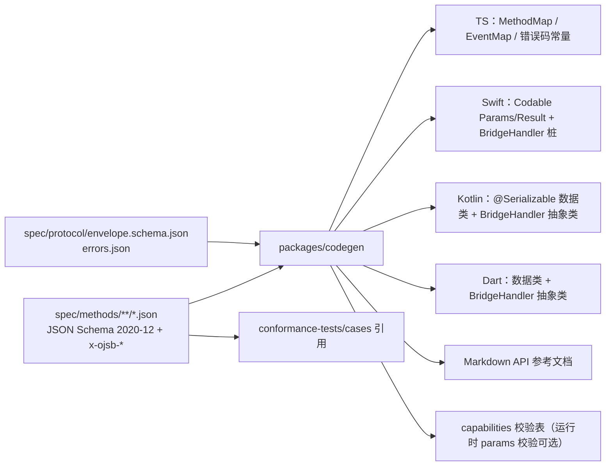
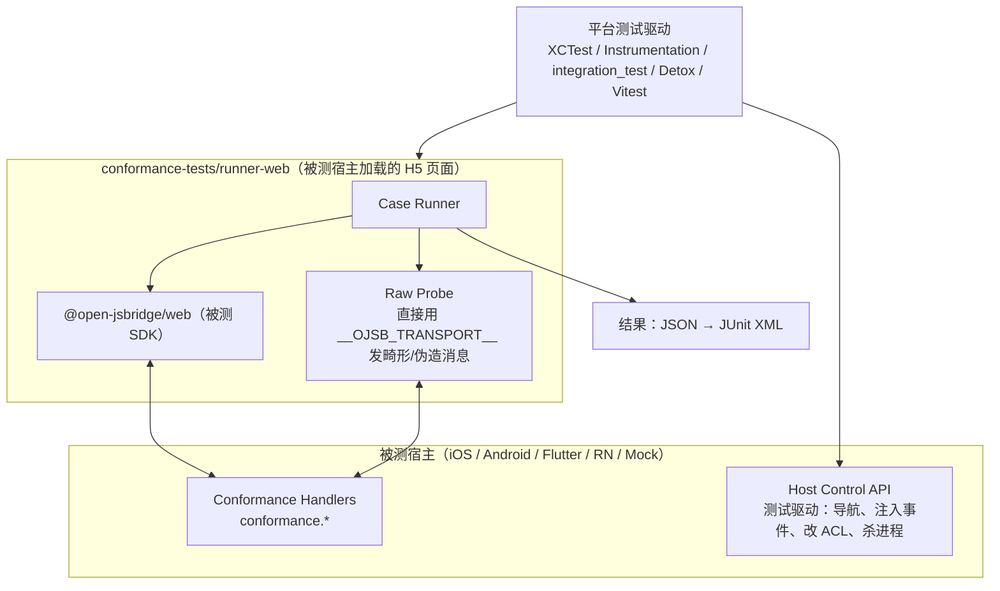

# 一致性测试套件与 Schema 单一事实来源

> 目标：保证 **Web SDK × {iOS, Android, Flutter, React Native, Mock}** 所有组合的行为完全一致。规则只有一条：**协议行为以 conformance 用例为准**；实现与用例冲突，要么修实现，要么改规范并同步改用例。

## 1. 单一事实来源（Single Source of Truth）



### 1.1 Method schema 格式

`spec/methods/device/getInfo.json`：

```json
{
  "$schema": "https://json-schema.org/draft/2020-12/schema",
  "$id": "ojsb:method/device.getInfo",
  "title": "device.getInfo",
  "description": "获取设备基础信息",
  "x-ojsb-kind": "method",
  "x-ojsb-version": 1,
  "x-ojsb-since": "1.0",
  "x-ojsb-platforms": ["ios", "android", "flutter", "rn"],
  "x-ojsb-allow-degraded": true,
  "x-ojsb-concurrency": "parallel",
  "x-ojsb-errors": [1001],
  "params": {
    "type": "object",
    "additionalProperties": false,
    "properties": {
      "fields": { "type": "array", "items": { "enum": ["os", "osVersion", "model", "locale"] } }
    }
  },
  "result": {
    "type": "object",
    "required": ["os", "osVersion"],
    "properties": {
      "os": { "enum": ["ios", "android"] },
      "osVersion": { "type": "string" },
      "model": { "type": "string" },
      "locale": { "type": "string" }
    }
  }
}
```

事件 schema 用 `"x-ojsb-kind": "event"` + `payload`；流式 method 额外声明 `"x-ojsb-callbacks": { ...chunk schema... }`。

`x-ojsb-*` 扩展关键字一览：

| 关键字 | 含义 |
|-------|------|
| `x-ojsb-kind` | `method` / `event` |
| `x-ojsb-version` | method 版本（整数），多版本用 `getInfo@2.json` 并存 |
| `x-ojsb-since` / `deprecated` / `x-ojsb-sunset` | 版本演进（protocol §15） |
| `x-ojsb-platforms` | 哪些宿主 MUST 实现（profile 内） |
| `x-ojsb-allow-degraded` | 是否允许在 degraded trust 会话中调用（protocol S2） |
| `x-ojsb-long-running` | 允许 `timeout: 0` |
| `x-ojsb-callbacks` | 允许流式回调及 chunk schema |
| `x-ojsb-concurrency(-policy)` | `parallel` / `serial` + `queue` / `reject` |
| `x-ojsb-throttle-ms` | 事件节流 |
| `x-ojsb-sensitive` | 字段级，日志掩码 |
| `x-ojsb-errors` | 该 method 可能返回的业务错误码 |

### 1.2 Codegen

```bash
npx ojsb-codegen --spec ./spec --target ts     --out packages/web-sdk/src/generated
npx ojsb-codegen --spec ./spec --target swift  --out ios/Sources/OpenJSBridge/Generated
npx ojsb-codegen --spec ./spec --target kotlin --out android/openjsbridge/src/main/kotlin/generated --package dev.openjsbridge.gen
npx ojsb-codegen --spec ./spec --target dart   --out flutter/lib/src/generated
```

生成的桩（以 Swift 为例），业务只实现 `handle`：

```swift
// GENERATED — DO NOT EDIT
public protocol DeviceGetInfoHandler: BridgeHandler where Params == DeviceGetInfoParams, Result == DeviceGetInfoResult {}
public extension DeviceGetInfoHandler {
    static var method: String { "device.getInfo" }
    static var versions: [Int] { [1] }
}
```

RN 宿主直接复用 TS 产物（`MethodMap` 同时约束 Web 调用方与 RN `HostHandler`）。

**CI 规则**：
1. schema 自身用 meta-schema 校验 + 自定义 lint（命名正则、保留命名空间、错误码段、版本号单调）。
2. 运行全部 codegen 后 `git diff --exit-code`，生成物必须入库且与 schema 一致。
3. 破坏性变更检测：对比 PR 前后 schema，删除字段/改类型/新增必填而未升 `x-ojsb-version` 时 CI 失败。

## 2. 测试架构



### 2.1 `conformance.*` 测试 method（每个宿主 MUST 实现，仅测试构建开启）

| method | 行为 |
|--------|------|
| `conformance.echo` | 原样返回 params |
| `conformance.delay` | `{ ms }` 后返回；支持取消（取消时记录 `cancelled=true`） |
| `conformance.fail` | `{ code, message, data }` 原样作为错误返回 |
| `conformance.throw` | handler 抛未分类异常（期望 -32603） |
| `conformance.emit` | `{ event, payload, count, intervalMs }` 推送事件 |
| `conformance.stream` | `{ n }` 发 n 条 callback 后返回 |
| `conformance.big` | `{ bytes }` 返回指定大小数据（inline 或 blob URL，按宿主能力） |
| `conformance.callWeb` | 让宿主反向调用页面注册的 handler，并返回其结果 |
| `conformance.lastCancel` | 查询某 id 是否被宿主侧感知取消 |
| `conformance.context` | 返回宿主看到的 `origin / isMainFrame / trust / sid`（用于安全断言） |
| `conformance.serial` | `x-ojsb-concurrency: serial`，用于并发策略测试 |

### 2.2 Host Control API

由平台测试驱动（不是页面）调用，用于制造页面无法自行制造的状况：`reload()`、`navigate(url)`、`setAcl(json)`、`emitEvent(name, payload)`、`killRenderProcess()`（平台支持时）、`loadInFrame(origin)`。

## 3. 用例格式

与平台无关，放在 `conformance-tests/cases/*.yaml`：

```yaml
id: CALL-TIMEOUT-001
title: 超时后 reject -32001，并发送 cancel，宿主感知取消
spec: [protocol#7 D2, protocol#7 D4]
requires: { features: [cancel] }
steps:
  - call: { method: conformance.delay, params: { ms: 2000 }, timeout: 200, as: p1 }
  - expectReject: { ref: p1, code: -32001, within: 500 }
  - wait: 300
  - call: { method: conformance.lastCancel, params: { id: "${p1.id}" }, as: c }
  - expectResolve: { ref: c, result: { cancelled: true } }
```

```yaml
id: SEC-ORIGIN-003
title: 前缀相似 origin 必须被拒绝
spec: [protocol#11.2 S3]
host:
  acl: { rules: [{ origins: ["https://example.com"], allow: ["conformance.*"] }], default: deny }
  loadRunnerAt: "https://example.com.evil.test/"
steps:
  - expectHandshake: { outcome: [unavailable, rejected] }     # 宿主可以不注入，或握手被拒
  - rawCall: { method: conformance.echo, params: {}, as: r, ifTransportPresent: true }
  - expectReject: { ref: r, code: -32003, optional: true }
```

用例分类与编号前缀：

| 前缀 | 覆盖 | 示例 |
|------|------|------|
| `ENV-` | 信封解析、未知字段忽略、畸形 JSON、重复 id | 畸形 JSON 无响应；重复 id → -32600 |
| `HS-` | 握手、版本协商、幂等、降级 | 主版本无交集 → -32004 |
| `CALL-` | request/response、错误码、超时、取消、并发顺序 | 1000 并发调用无串号 |
| `CB-` | 流式 callback seq、最终 response | |
| `EVT-` | 订阅/退订、引用计数、只推送给订阅者、重新握手后恢复 | |
| `REV-` | Host→Web 反向调用 | Web 未注册 → -32601 |
| `BLOB-` | inline 上限、-32006、blob URL 可 fetch、过期失效 | |
| `SEC-` | origin 匹配反例、iframe、degraded trust、payload 伪造 origin 无效、限流 | |
| `LIFE-` | reload 迟到响应被丢弃、bfcache、进程崩溃、多 WebView 隔离 | |
| `OBS-` | traceId 透传、timing 字段 | |

## 4. 平台矩阵与能力声明

每个宿主在 `conformance-tests/hosts/<host>.yaml` 声明能力，runner 据此决定哪些用例 MUST 通过、哪些 SKIP（SKIP 必须对应协议允许的能力缺失，不能当作"已知失败"的遮羞布）：

| 宿主 | trust | iframe | blob URL | reply 通道 | 备注 |
|------|-------|--------|----------|-----------|------|
| `mock` | full（模拟） | 模拟 | 模拟 | 可切换 | Web SDK 单测与 runner 自检 |
| `ios-wk`（iOS 14+） | full | ✅ | ✅ `WKURLSchemeHandler` | ✅ WithReply | |
| `ios-wk-legacy`（iOS 13） | full | ❌ | ✅ | ❌ | |
| `android-wml` | full | ✅ | ✅（下行） | ❌ | 上传走分片 |
| `android-jsi` | degraded | ❌ | ✅（下行） | ❌ | 回退通道 |
| `flutter-inappwebview` | full / degraded（取决于能否拿到可信 origin，需核实） | 视插件能力 | 视实现 | ✅ callHandler | 方案 A |
| `flutter-webview_flutter` | degraded | ❌ | ❌ | ❌ | |
| `rn-webview` | degraded | ❌ | ❌ | ❌ | 方案 A |
| `rn-native`（方案 B） | full | ✅ | ✅ | 同 iOS/Android | 复用原生实现 |

**所有宿主都必须通过**：`ENV-*`、`HS-*`、`CALL-*`、`CB-*`、`EVT-*`、`LIFE-*` 的核心用例，以及 `SEC-*` 中"degraded 会话拒绝非 allowDegraded method"等与 trust 等级相关的用例。

## 5. 运行方式

| 宿主 | 驱动 | 命令（示意） |
|------|------|------------|
| mock | Vitest + Playwright（Chromium/WebKit） | `pnpm -F conformance test:mock` |
| iOS | XCTest（宿主 App 加载 runner 页面，经 Host Control API 驱动） | `xcodebuild test -scheme ConformanceHost` |
| Android | Instrumentation | `./gradlew :openjsbridge-test:connectedAndroidTest` |
| Flutter | `integration_test` | `flutter test integration_test/conformance_test.dart` |
| React Native | Detox 或 Maestro | `pnpm -F rn-conformance e2e` |

runner 页面通过本地静态服务或宿主内置资源加载；需要多 origin 的用例由宿主测试驱动用"带 baseURL 加载 HTML"的方式（iOS `loadHTMLString(_:baseURL:)`、Android `loadDataWithBaseURL`，Flutter/RN 按插件能力）或本地 HTTPS 测试服务器构造。

结果统一为 JSON（每条用例：`id / status(pass|fail|skip) / durationMs / detail`），再转 JUnit XML 供 CI 展示；CI 生成一张 **用例 × 宿主** 的矩阵报告作为合入门槛。

## 6. 参考 Host 状态机

`@open-jsbridge/host-core`（TS）是协议 Host 侧的**可执行参考实现**，同时被三处使用：

1. `@open-jsbridge/mock`（浏览器 / 单测）；
2. React Native 方案 A 宿主；
3. 消息级"差分测试"：同一组输入消息序列分别喂给 host-core 与各平台 Core（通过 Fake transport），比较输出消息序列（忽略时间戳等非确定字段），用于快速发现 iOS/Android/Dart 实现与参考实现的偏差，不必每次都跑真机。

## 7. 规范变更流程

1. 提 RFC（`spec/rfcs/NNNN-title.md`），说明动机、兼容性影响、对各宿主的要求。
2. 同一 PR 内：改 `docs/protocol.md` / schema + 新增或修改 conformance 用例 + 至少 mock 与 host-core 实现。
3. 其它宿主实现可以在后续 PR 中跟进，期间对应用例在矩阵中标记 `pending`（有截止版本），不得标 `skip`。
