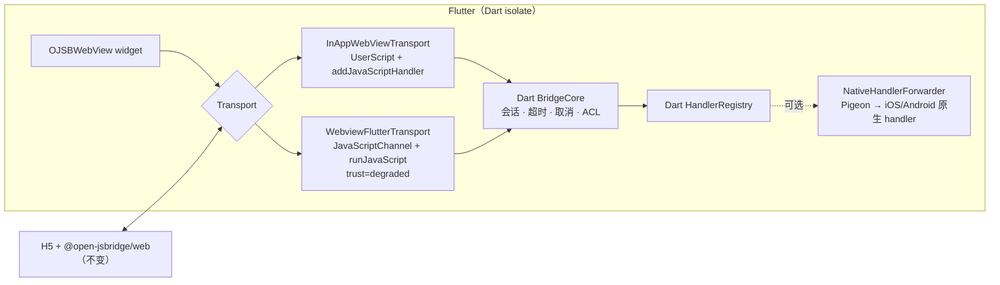

# Flutter 宿主实现（`open_jsbridge_flutter`）

> Flutter 在这里是 **WebView 宿主端**：Flutter App 内嵌 WebView 加载 H5，H5 使用**同一份** `@open-jsbridge/web`，**Web SDK 不做任何修改**。Flutter 侧只需实现 [protocol.md](protocol.md) 的 Host 职责并注入满足 [Host Shim 契约](protocol.md#2-host-shim-契约transport-层) 的 shim。
>
> 本文涉及 `webview_flutter`、`flutter_inappwebview` 两个第三方插件，API 名称以接入时所用版本的官方文档为准；文中标注"需核实"的点在 M2 实现前必须用 conformance 用例实测确认。

## 1. 两个 WebView 插件的取舍

| 维度 | `webview_flutter`（官方 flutter.dev 维护） | `flutter_inappwebview`（社区） |
|------|------------------------------------------|-------------------------------|
| Web→Dart 通道 | `controller.addJavaScriptChannel(name, onMessageReceived:)`；页面侧 `Name.postMessage(string)`；只传字符串，无返回值 | `controller.addJavaScriptHandler(handlerName:, callback:)`；页面侧 `window.flutter_inappwebview.callHandler(name, ...args)` 返回 Promise（callback 返回值即 resolve 值） |
| Dart→Web | `controller.runJavaScript(js)` | `controller.evaluateJavascript(source:)` 等 |
| document-start 注入 | 跨平台 API 中**没有**通用的 document-start user script（平台专属扩展是否提供需核实），通常只能在 `NavigationDelegate.onPageStarted` 里 `runJavaScript`，**不保证**早于页面脚本 | `UserScript(source:, injectionTime: UserScriptInjectionTime.AT_DOCUMENT_START, ...)`，可通过 `initialUserScripts` 在创建时注入 |
| 调用方 origin / frame | `JavaScriptMessage` 只有 `message` 字符串，**拿不到**发送方 origin 与 frame；只能退而读 `currentUrl()`（主 frame、有竞态） | 新版本的 handler 回调数据中提供 origin / 是否主 frame 等信息（字段与可用平台需核实）；另提供对应 Android `addWebMessageListener` 的封装（平台覆盖范围需核实） |
| 维护与体积 | 官方维护、API 稳定、体积小、能力少 | 能力全面（UserScript、WebMessage、拦截等），依赖面更大 |
| 结论 | 可用，但会话 **trust = degraded** | **推荐**作为默认 transport，在能拿到可信 origin 时 trust = full |



## 2. 架构方案：纯 Dart 核心 vs 复用原生实现

### 方案 A：纯 Dart 实现协议核心（**推荐默认**）

- Dart 实现 BridgeCore（握手、sid、ACL、超时、取消、事件订阅、callback），通过 `Transport` 抽象适配两个插件。
- Handler 用 Dart 写；需要原生能力时由业务用常规 Flutter 插件实现。
- 优点：
  - 不依赖、也不需要拿到插件内部的原生 WebView 实例；随插件升级成本低。
  - 与 Flutter 业务代码同语言，handler 可直接访问 Dart 状态（路由、登录态）。
  - 协议核心逻辑小（核心状态机千行量级），一致性由 conformance 套件兜底，而不是靠"共享代码"。
- 缺点：协议逻辑多维护一份（Dart）；消息经过 原生插件 → platform channel → Dart，比纯原生多一跳（对 bridge 典型调用频率影响可忽略，大数据走 blob URL）。

### 方案 B：复用 iOS/Android 原生 OJSB，经 MethodChannel / Pigeon 桥接到 Dart

- 原生 OJSB（native-ios.md / native-android.md）直接挂在 WebView 上，Dart 通过 **Pigeon** 生成的类型安全接口注册/实现 handler：
  - `@HostApi`（Dart→Native）：`register(method, versions)`、`emit(event, json)`、`setAcl(json)`。
  - `@FlutterApi`（Native→Dart）：`invoke(method, paramsJson, ctx) → resultJson`，`cancel(id)`。
- 难点：原生 OJSB 必须拿到并配置**原生 WebView 实例**（注入 shim、加 message handler、设置 `WKURLSchemeHandler` —— 后者必须在 WebView 创建前配置）。第三方 WebView 插件的原生实例由插件自己创建和持有，是否能以公开、稳定的方式拿到并在创建前配置，**需逐个插件核实**；稳妥做法是自己提供一个 PlatformView 插件（`open_jsbridge_webview`）来创建原生 WebView。
- 优点：协议行为与原生端**完全同一份代码**；已有大量原生 handler 的 App（add-to-app 场景）可以零改动复用。
- 缺点：要自己维护一个 WebView PlatformView（放弃插件生态里的 cookie、下载、文件选择等现成能力，或自己补齐）；Dart handler 每次调用多一次 Pigeon 往返；两端原生实现的发布节奏绑定 Flutter 插件。

### 推荐

**默认方案 A**（Dart 核心 + `flutter_inappwebview` transport），再加一个**可选的"原生 handler 转发器"**：

- 协议与 transport 在 Dart；但当某个 method 在 Dart registry 中不存在、而 App 的原生层已有 OJSB handler（复用 iOS/Android 的 `HandlerRegistry`）时，Dart 通过 Pigeon 把 `(method, params, ctx)` 转给原生 registry 执行。
- 这样复用的是**原生 handler（业务能力）**而不是原生 transport，避免了"必须拿到插件内部 WebView"的问题。
- 只有在"必须与原生端字节级一致 / 必须用原生专属通道能力（如 WKURLSchemeHandler 大文件）"时才选方案 B。

## 3. Shim（以 `flutter_inappwebview` 为例）

```js
(function () {
  if (window.__OJSB_TRANSPORT__) return;
  var buf = [], recv;
  function deliver(m) { recv ? recv(m) : (buf.length < 256 && buf.push(m)); }
  var t = Object.freeze({
    name: 'flutter', protocols: Object.freeze([1]),
    // callHandler 返回 Promise；Dart 侧返回的 response 字符串即 resolve 值（等价于 iOS 的 reply 通道）
    postMessage: function (s) { return window.flutter_inappwebview.callHandler('ojsb', s); }
  });
  Object.defineProperty(window, '__OJSB_TRANSPORT__', { value: t, writable: false, configurable: false });
  Object.defineProperty(window, '__OJSB_RECEIVE__', { configurable: false,
    get: function () { return deliver; },
    set: function (fn) { recv = fn; var q = buf; buf = []; q.forEach(function (m) { fn(m); }); } });
  window.dispatchEvent(new CustomEvent('ojsb:transportready'));
})();
```

注意：`window.flutter_inappwebview.callHandler` 可能在 shim 执行时尚未就绪，插件提供了"平台就绪"事件（事件名需按版本核实）。shim 在 `postMessage` 内部 MUST 等待该就绪信号再调用，或在就绪前缓存。`webview_flutter` 版 shim 把 `postMessage` 换成 `OjsbChannel.postMessage(s)` 且返回 `undefined`，response 由 Dart 通过 `runJavaScript` 调 `__OJSB_RECEIVE__` 投递。

## 4. Dart API 与 handler 注册示例

```dart
// 由 codegen 从 spec/methods 生成（json_serializable 或 freezed 风格）
class DeviceGetInfoParams { final List<String>? fields; /* fromJson/toJson */ }
class DeviceGetInfoResult { final String os, osVersion, model; /* fromJson/toJson */ }

abstract class BridgeHandler<P, R> {
  String get method;
  List<int> get versions => const [1];
  P decode(Map<String, dynamic> json);
  Object? encode(R result);
  Future<R> handle(P params, BridgeContext ctx);
}

class BridgeContext {
  final String sid, id, traceId;
  final Uri? origin;              // transport 能提供可信 origin 时非空
  final bool isMainFrame;
  final Trust trust;              // Trust.full | Trust.degraded
  final CancelToken cancel;       // 收到 cancel / 会话失效时触发
  final Future<void> Function(Object? chunk) callback;
  BridgeContext(this.sid, this.id, this.traceId, this.origin, this.isMainFrame, this.trust, this.cancel, this.callback);
}

class BridgeException implements Exception {
  final int code; final String message; final Map<String, Object?>? data;
  const BridgeException(this.code, this.message, [this.data]);
  static const userDenied = BridgeException(-32007, 'User denied');
}

class DeviceGetInfo extends BridgeHandler<DeviceGetInfoParams, DeviceGetInfoResult> {
  @override String get method => 'device.getInfo';
  @override DeviceGetInfoParams decode(Map<String, dynamic> j) => DeviceGetInfoParams.fromJson(j);
  @override Object? encode(DeviceGetInfoResult r) => r.toJson();
  @override
  Future<DeviceGetInfoResult> handle(DeviceGetInfoParams p, BridgeContext ctx) async =>
      DeviceGetInfoResult(os: Platform.operatingSystem, osVersion: Platform.operatingSystemVersion, model: 'unknown');
}
```

使用：

```dart
final registry = HandlerRegistry()
  ..register(DeviceGetInfo())
  ..on('ui.toast.show', (Map<String, dynamic> p, ctx) async {   // 轻量注册
      ScaffoldMessenger.of(navigatorKey.currentContext!).showSnackBar(SnackBar(content: Text(p['text'] as String)));
      return null;
    });

final bridge = OJSBridge(
  registry: registry,
  acl: Acl.fromJson(await rootBundle.loadString('assets/ojsb-acl.json')),   // 与 iOS/Android 同一 ACL 格式
  nativeForwarder: NativeHandlerForwarder.pigeon(),                          // 可选：转发到原生 registry
);

// Widget：封装 InAppWebView，内部完成 UserScript 注入、addJavaScriptHandler、导航钩子
OJSBWebView(bridge: bridge, initialUrl: Uri.parse('https://m.acme.com/home'));

// Native(Dart) → Web
bridge.emit('network.changed', {'type': 'wifi'});
final share = await bridge.callWeb('page.getShareInfo', timeout: const Duration(seconds: 3));
```

Transport 抽象（便于替换插件，也便于单测）：

```dart
abstract class HostTransport {
  /// Web→Host：收到原始字符串；若通道支持同步返回（callHandler），onMessage 的返回值作为 response 回给页面
  void listen(Future<String?> Function(String raw, CallerInfo caller) onMessage);
  /// Host→Web：投递一条消息到指定 frame（不支持定向时只能投递到主 frame）
  Future<void> deliver(String raw, {FrameRef? frame});
  /// 导航与进程事件，用于会话失效
  Stream<LifecycleEvent> get lifecycle;
}
```

`deliver` 的实现必须对字符串做二次编码（`jsonEncode(raw)` 得到 JS 字符串字面量，再替换 U+2028/U+2029），遵循 protocol §11.5。

## 5. 安全与生命周期

- **trust 判定**：transport 能提供平台给出的发送方 origin（且来自原生 WebView 而非页面 payload）时为 `full`；否则 `degraded`，只开放 `allowDegraded: true` 的 method（protocol S2）。`webview_flutter` transport 恒为 `degraded`。
- **导航守卫**：两种插件都支持导航拦截（`NavigationDelegate.onNavigationRequest` / `shouldOverrideUrlLoading`）。建议在 degraded 模式下**阻止主 frame 导航到 ACL 白名单外的 origin**，把"WebView 被带到不受信页面"的风险降到最低。
- **iframe**：degraded 模式 MUST 关闭 iframe 能力；UserScript 使用 main-frame-only（参数名需核实）。
- **会话失效**：主 frame 开始加载新页面（`onPageStarted` / `onLoadStart`）、渲染进程终止（插件提供的对应回调）、Widget dispose 时，使所有 sid 失效并取消 Dart 侧进行中的 handler（`CancelToken`）。
- **Dart isolate**：BridgeCore 在 UI isolate 运行；重 CPU 的 handler 自行用 `Isolate.run` 等方式下放。

## 6. 测试

| 层 | 工具 | 内容 |
|----|------|------|
| Dart 单测 | `flutter test` + `FakeTransport` | Core 状态机、ACL、超时取消、二次编码；直接复用 `conformance-tests/cases` 中与 transport 无关的用例（消息级断言） |
| 集成测试 | `integration_test` 在真机/模拟器运行 | 加载 conformance runner 页面，transport 参数化（inappwebview / webview_flutter）各跑一遍，产出 JUnit |
| Pigeon 转发 | 原生端单测 + 集成测试 | 转发到原生 handler 的错误码、取消、超时一致 |
