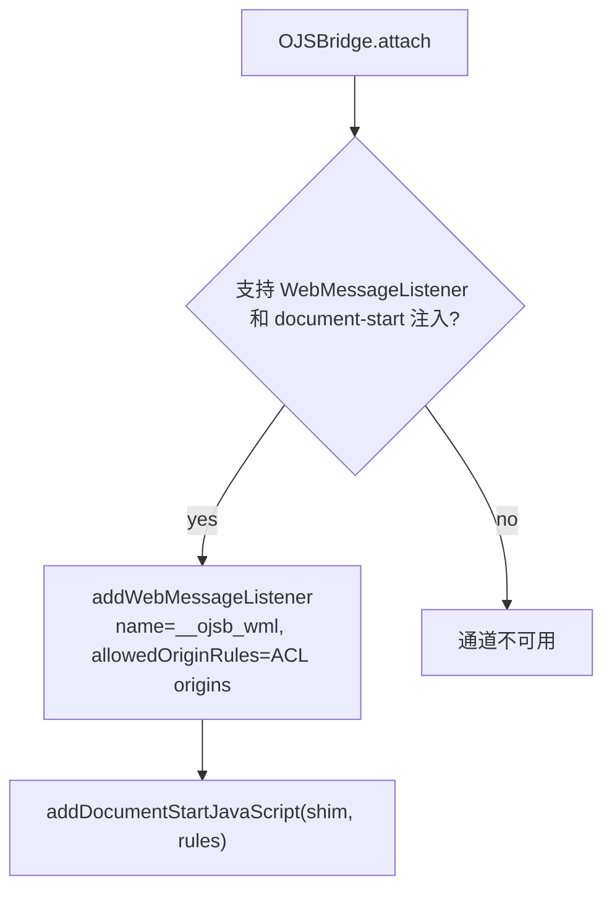
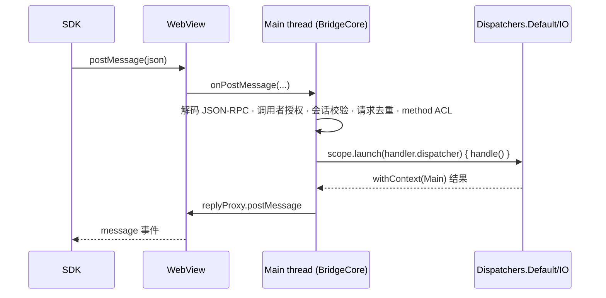

# Android 实现层（WebView）

> 仓库内的 `:host` 模块可构建 `host-release.aar`。参考实现使用 `androidx.webkit:webkit`、Kotlin Coroutines 和 Gson。
> Kotlin 参考宿主的 minSdk 为 24。首选通道取决于设备上的 **Android System WebView 版本**，宿主在运行时用 `WebViewFeature.isFeatureSupported(...)` 检测所需能力。
> 文中 androidx.webkit API 请在接入时以所用版本的官方文档复核。

Kotlin 参考宿主提供 `:host` Android 库。Release App 可以在自己的 `WebView` 上调用 `AndroidBridge.attach`，启用 `device.getInfo` 并注册异步业务方法。接入代码和模拟器验收步骤见 [Kotlin 示例](../examples/native-android/README.md)，协议要求见 [Native Host 最小接入](native-host.md)。

## 1. 通道选择

| 优先级 | 通道 | 条件 | 可信 origin | frame 定向推送 | trust |
|-------|------|------|------------|---------------|-------|
| 1 | `WebViewCompat.addWebMessageListener` | 首版参考实现要求 `WEB_MESSAGE_LISTENER` 和 `DOCUMENT_START_SCRIPT` | ✅ `sourceOrigin` + `isMainFrame` | 主 frame 的 `JavaScriptReplyProxy` | `full` |
| 2 | `addJavascriptInterface` + `@JavascriptInterface` | 受限内容的可选扩展，默认关闭 | ❌ | 首版无此通道 | `degraded` |

shim 注入：

| 优先级 | 方式 | 条件 |
|-------|------|------|
| 1 | `WebViewCompat.addDocumentStartJavaScript(webView, shim, allowedOriginRules)` | `WebViewFeature.DOCUMENT_START_SCRIPT` |
| 2 | 提交后注入 shim（候选） | 后续验证注入确实发生在目标 document，且 SDK 能等到 `ojsb:transportready` |

`onPageStarted` 与目标 document 就绪的时序可能不同。该回调中直接调用 `evaluateJavascript` 可能只触及当时显示的页面，SDK 等待 ready 事件无法弥补漏注入。[Android `evaluateJavascript` 文档](https://developer.android.com/reference/android/webkit/WebView#evaluateJavascript(java.lang.String,android.webkit.ValueCallback%3Cjava.lang.String%3E))



## 2. `addJavascriptInterface` 的安全风险

1. **历史 RCE**：Android 4.2（API 17）之前，注入对象的**所有 public 方法**（含继承自 `Object` 的 `getClass()`）都能被 JS 反射调用，可执行任意代码（CVE-2012-6636 一类问题）。API 17+ 只有标注 `@JavascriptInterface` 的方法暴露。参考实现要求 minSdk ≥ 21，且注入对象只暴露**一个** `postMessage(String)` 方法。
2. **无 origin 隔离**：对象注入到该 WebView 的**所有 frame、所有 origin**，包括第三方 iframe 和被重定向到的任意页面；回调参数里拿不到调用方 origin 和 frame。
3. **线程**：`@JavascriptInterface` 方法在 WebView 内部的后台线程（JavaBridge 线程）调用，不在主线程；而 `WebView` 的方法（含 `getUrl()`）只能在主线程调用，因此"在回调里读 `webView.url` 校验 origin"天然存在竞态（读到的可能已是导航后的 URL）。
4. **对象生命周期**：注入在下次页面加载后才生效，且会跨导航保留。

首版参考实现不启用此通道。需要兼容的宿主只能在显式配置、独立隔离的受限 WebView 中接入，且必须在该 WebView 的整个生命周期控制并验证可加载的内容，包括导航、重定向和嵌入 frame。会话始终标记 `trust = degraded`，仅开放 ACL 中 `allowDegraded: true` 的 method。入口无法验证 origin 或 frame 时，拒绝需要可信 origin 或主 frame 的能力。[Android JavaScript bridge 安全说明](https://developer.android.com/develop/ui/views/layout/webapps/native-api-access-jsbridge)

## 3. 首选通道：`addWebMessageListener`

```kotlin
private fun installWebMessageListener(webView: WebView) {
    WebViewCompat.addWebMessageListener(
        webView,
        WML_OBJECT,                                 // "__ojsb_wml"，只注入到匹配的 origin 的 frame
        acl.originRules(),                          // Set<String>，如 "https://m.acme.com", "https://*.acme.com"
    ) { view, message, sourceOrigin, isMainFrame, replyProxy ->
        if (message.type != WebMessageCompat.TYPE_STRING) {
            core.logDrop("unsupported_payload_type")
            return@addWebMessageListener
        }
        val raw = message.data ?: return@addWebMessageListener
        core.receive(raw, Caller(Origin.of(sourceOrigin), isMainFrame, FrameTarget.Proxy(replyProxy)))
    }
}
```

要点：

- `allowedOriginRules` 仅向匹配的 origin 注入对象。规则由 scheme、host（可含最左通配）和可选端口组成。Native 入口对每条消息还要执行调用者授权，验证 `sourceOrigin` 及 `isMainFrame`，然后检查适用的会话和 method 或事件 ACL。
- 注入对象在**下一次导航**才生效，`attach()` 必须在 `loadUrl` 之前调用。
- 将回调给出的 `JavaScriptReplyProxy` 与当前 document 的 sid 绑定。首版只处理主 frame 的调用，对回复和推送使用该会话的 proxy。宿主在导航提交时使旧 sid 失效，旧 proxy 随会话一起清理。
- 二进制：新版 androidx.webkit 提供 ArrayBuffer 消息能力（`WebViewFeature.WEB_MESSAGE_ARRAY_BUFFER`）。协议统一使用字符串，此能力仅作为未来 `blob` 优化的可选项，不进入 1.0。

Android shim（WML 版）：

```js
(function () {
  if (window !== window.top) return;
  if (window.__OJSB_TRANSPORT__) return;
  var o = window.__ojsb_wml; if (!o) return;          // 不在 allowedOriginRules 内的 frame 没有该对象
  var buf = [], recv;
  function deliver(m) { recv ? recv(m) : (buf.length < 256 && buf.push(m)); }
  o.addEventListener('message', function (e) { deliver(e.data); });   // replyProxy.postMessage → 这里
  var t = Object.freeze({ name: 'android-wml', protocols: Object.freeze([1]),
                          postMessage: function (s) { o.postMessage(s); } });
  Object.defineProperty(window, '__OJSB_TRANSPORT__', { value: t, writable: false, configurable: false });
  Object.defineProperty(window, '__OJSB_RECEIVE__', {
    configurable: false,
    get: function () { return deliver; },
    set: function (fn) {
      recv = typeof fn === 'function' ? fn : undefined;
      if (!recv) return;
      var q = buf; buf = [];
      q.forEach(function (m) {
        try { deliver(m); } catch (e) { setTimeout(function () { throw e; }); }
      });
    }
  });
  window.dispatchEvent(new CustomEvent('ojsb:transportready'));
})();
```

## 4. 入站授权和会话校验

1. 按 protocol §3 解码单条 `{jsb, meta?, rpc}` JSON-RPC 2.0 信封，拒绝批量数组。请求携带 `rpc.method` 和字符串 `rpc.id`，响应携带 `rpc.id` 以及 `rpc.result`、`rpc.error` 中恰好一项，通知携带 `rpc.method` 且省略 `rpc.id`。
2. 依据平台提供的调用者信息验证 scheme、origin 和主 frame，`bridge.hello` 也必须通过此授权。规则异常时终止处理，未分类异常使用通用 `-32603`。格式错误仅在请求类型和 `rpc.id` 明确且该 id 在对应范围内首次登记时发送关联错误。其余无法关联的格式错误可通过满足会话校验且绑定到原 document 的通道发送 `rpc.id: null` 的诊断错误，或记录后丢弃。已能识别为通知或响应的无效消息直接丢弃。
3. `bridge.hello` 为当前 document 建立会话或复用其活动 sid。仅握手及其关联响应可省略 `meta.sid`。握手若携带 sid，须匹配当前活动会话。其余消息校验 `meta.sid` 与调用者所属 (WebView, frame, document) 一致。允许的调用者尚未握手且请求缺少 sid 时使用 `-32005`。已提供无效、过期或不属于当前调用者的 sid，以及活动会话中缺少 sid 的请求，使用 `-32009`。请求错误仅在能安全确定响应所需的 sid 且确认投递到原 document 时返回。通知和响应校验失败时丢弃并记日志。
4. 握手请求按 document 去重，其他请求按 sid 和发起方向去重。重复 id 在分发前静默丢弃，格式错误的副本也适用。每次握手重试使用新的 id。请求通过 method ACL 才能分发。
5. 内置控制通知须经显式允许才分发，包括 `bridge.cancel`（`requestId`、可选 `reason`）、`bridge.event`（`name`、`payload`）和 `bridge.progress`（`requestId`、`seq`、可选 `chunk`）。这些控制方法仅接受通知格式。通知须通过方向、参数和权限校验，无 JSON-RPC 响应。取消、进度和反向响应只匹配当前会话内对应的请求，诊断错误不结算反向请求。入站事件须通过事件注册和 ACL 检查。

## 5. 线程模型



- **BridgeCore 只在主线程运行**（会话表、pending、订阅无需加锁）。
- 每个 WebView 一个 `CoroutineScope(SupervisorJob() + Dispatchers.Main.immediate)`；`detach()` 时 `scope.cancel()`。
- Handler 声明自己的 `dispatcher`（默认 `Dispatchers.Default`，UI 类 handler 用 `Dispatchers.Main`）。
- 注册异步业务方法后，参考宿主在握手中声明 `cancel`。每个异步业务请求对应一个 `Job`。收到当前会话中匹配的 `bridge.cancel` 时，宿主先释放并发槽，再调用 `job.cancel()`，通过原请求的通道返回一次 `-32002`。挂起的业务处理器通过协程取消机制退出。
- `replyProxy.postMessage` 只在主线程调用。

## 6. Handler 注册

```kotlin
@Serializable class DeviceGetInfoParams
@Serializable data class DeviceGetInfoResult(val os: String, val osVersion: String)

interface BridgeHandler<P : Any, R : Any> {
    val method: String
    val versions: IntArray get() = intArrayOf(1)
    val paramsSerializer: KSerializer<P>
    val resultSerializer: KSerializer<R>
    val dispatcher: CoroutineDispatcher get() = Dispatchers.Default
    suspend fun handle(params: P, version: Int, ctx: BridgeContext): R
}

class BridgeContext internal constructor(
    val sid: String, val id: String, val traceId: String,
    val origin: Origin, val isMainFrame: Boolean, val trust: Trust,
    private val webViewRef: WeakReference<WebView>,
    private val emitCallback: suspend (JsonElement) -> Unit,
) {
    val webView: WebView? get() = webViewRef.get()
    // 通过 bridge.progress 通知发送中间结果
    suspend fun <T> callback(serializer: KSerializer<T>, value: T) = emitCallback(Json.encodeToJsonElement(serializer, value))
}

class BridgeException(val code: Int, override val message: String, val data: JsonObject? = null) : Exception(message) {
    companion object {
        fun permissionDenied(reason: String) = BridgeException(-32003, "Permission denied", buildJsonObject { put("reason", reason) })
        val userDenied get() = BridgeException(-32007, "User denied")
    }
}

object DeviceGetInfo : BridgeHandler<DeviceGetInfoParams, DeviceGetInfoResult> {
    override val method = "device.getInfo"
    override val paramsSerializer = DeviceGetInfoParams.serializer()
    override val resultSerializer = DeviceGetInfoResult.serializer()
    override suspend fun handle(params: DeviceGetInfoParams, version: Int, ctx: BridgeContext) =
        DeviceGetInfoResult(os = "android", osVersion = Build.VERSION.RELEASE)
}
```

注册表（类型擦除，集中处理 JSON ↔ 对象与 `-32602`）：

```kotlin
class HandlerRegistry {
    private class Entry(val versions: IntArray, val dispatcher: CoroutineDispatcher,
                        val run: suspend (JsonObject, Int, BridgeContext) -> JsonElement)
    private val table = ConcurrentHashMap<String, Entry>()

    fun <P : Any, R : Any> register(h: BridgeHandler<P, R>) {
        require(listOf("bridge.", "ojsb.", "rpc.").none { h.method.startsWith(it) }) { "reserved namespace" }
        require(METHOD_RE.matches(h.method)) { "invalid method name ${h.method}" }
        table[h.method] = Entry(h.versions, h.dispatcher) { raw, v, ctx ->
            val p = try { json.decodeFromJsonElement(h.paramsSerializer, raw) }
                    catch (e: SerializationException) { throw BridgeException(-32602, "Invalid params") }
            json.encodeToJsonElement(h.resultSerializer, h.handle(p, v, ctx))
        }
    }

    /** 轻量 lambda 注册，便于业务快速接入 */
    inline fun <reified P : Any, reified R : Any> register(method: String, noinline block: suspend (P, BridgeContext) -> R) =
        register(object : BridgeHandler<P, R> {
            override val method = method
            override val paramsSerializer = serializer<P>()
            override val resultSerializer = serializer<R>()
            override suspend fun handle(params: P, version: Int, ctx: BridgeContext) = block(params, ctx)
        })

    internal fun lookup(m: String) = table[m]
    private companion object {
        val METHOD_RE = Regex("^[a-z][a-zA-Z0-9]*(\\.[a-z][a-zA-Z0-9]*)+$")
        val json = Json { ignoreUnknownKeys = true; explicitNulls = false }   // 对应协议"忽略未知字段"
    }
}
```

> 为什么不做注解处理器（`@BridgeMethod` + KSP 扫描）：可以做，但 M1 用显式注册即可；KSP 版本放到 M3，与 codegen 结合（从 schema 直接生成 `BridgeHandler` 抽象类，业务只实现 `handle`）。不使用运行时反射扫描，避免 R8 混淆/裁剪导致线上找不到方法。

对外 API：

```kotlin
val bridge = OJSBridge.attach(
    webView,
    registry = HandlerRegistry.shared.apply {
        register(DeviceGetInfo)
        register<ToastParams, Unit>("ui.toast.show") { p, ctx ->
            withContext(Dispatchers.Main) { Toast.makeText(ctx.webView!!.context, p.text, Toast.LENGTH_SHORT).show() }
        }
    },
    acl = Acl.fromAsset(context, "ojsb-acl.json"),
    options = OJSBridge.Options(debug = BuildConfig.DEBUG),
)
webView.loadUrl("https://m.acme.com/home")       // 必须在 attach 之后
```

以下 Native → Web API 由宿主按已验证、已广告的能力开放。

```kotlin
bridge.emit("network.changed", buildJsonObject { put("type", "wifi") })
val share = bridge.callWeb("page.getShareInfo", ShareInfo.serializer(), timeoutMs = 3_000)
```

在 Activity 或 Fragment 的 `onDestroy` 调用 `bridge.detach()`。

### 6.1 WebViewClient 集成

同 iOS，不抢 `WebViewClient`：提供 `OJSBridgeWebViewClient(delegate: WebViewClient)` 包装器，或让业务在自己的 client 里转调：

| 回调 | Bridge 行为 |
|------|------------|
| 主 frame 新 document 提交 | 使旧 sid 失效，取消进行中的 handler 和反向请求，清理订阅和 blob，丢弃旧会话待发送的消息 |
| 同一 document 内路由变化 | 保留原 sid 和会话状态 |
| `onRenderProcessGone`（API 26+） | 所有 sid 失效、取消所有 Job；返回值由业务决定（返回 true 表示 App 自己处理，需销毁该 WebView） |
| `shouldInterceptRequest` | 处理 blob 虚拟路径（§8） |

`onPageStarted` 只能提示导航开始。要以宿主可验证的新 document 提交信号切换会话，并协调它与 document-start 握手的到达顺序。提交前收到的新 document 握手须等宿主确认后再建会话。导航失败且原 document 仍在时，应保留原会话。

后续只有在宿主能验证每个子 frame 及其 document、感知子 frame 的新 document 提交、立即使旧 sid 失效，并保证旧消息无法进入新 document 时，才对该宿主声明 iframe 能力。`JavaScriptReplyProxy` 可用于定向发送，`onPageStarted` 只报告主 frame 导航。[Android `JavaScriptReplyProxy` 文档](https://developer.android.com/reference/androidx/webkit/JavaScriptReplyProxy) · [Android `WebViewClient` 文档](https://developer.android.com/reference/android/webkit/WebViewClient#onPageStarted(android.webkit.WebView,java.lang.String,android.graphics.Bitmap))

## 7. Native → Web 推送

以下示例用于已有会话的消息。握手及握手前的 JSON-RPC 响应使用入站消息自带的 proxy，并且只向发起请求的 document 投递。

```kotlin
@MainThread
internal fun push(env: Envelope, target: FrameTarget.Proxy) {
    if (!sessions.isCurrent(env.meta?.sid, target)) return
    target.proxy.postMessage(env.encode())
}
```

WML 通道下推送**不需要拼接 JS 源码**，天然避免注入问题，这也是首选它的理由之一。

参考宿主通过文档确认时取得的 reply proxy 投递 `network.changed`。在投递前检查当前会话与订阅，shim 校验同一个文档标记。Android Emulator 中的 WebView 测试覆盖退订、会话失效和同源文档替换。开放其他通知或反向请求时，沿用文档定向并验证对应的生命周期。

[参考宿主](../examples/native-android/host/src/main/java/dev/openjsbridge/host/DocumentTransport.kt) · [原生基础能力](native-profiles.md)

## 8. 大数据

- 已实现的选图数据通道使用 `bridge.blob.read@1` 和 `bridge.blob.release@1`。[会话内分片协议](protocol.md#102-分片读取与释放)
- 若另行实现 URL 资源扩展，可在页面同源下挂虚拟路径 `https://<page-host>/__ojsb__/blob/<token>`，由 `shouldInterceptRequest` 按 token 返回 `WebResourceResponse`。必须校验 `request.url` 的 host 与该 token 绑定会话的 origin 一致。
- 或使用 `androidx.webkit.WebViewAssetLoader` 的专用域（`appassets.androidplatform.net`）配合自定义 `PathHandler`，此时是跨源，需要返回 CORS 头。
- `shouldInterceptRequest` 在非主线程调用，BlobStore 需线程安全。

## 9. 单元测试策略

| 层 | 工具 | 内容 |
|----|------|------|
| JVM 单测 | JUnit 4 | JSON-RPC 信封与共享一致性用例、业务方法注册、限流、文档替换和待处理调用清理 |
| Robolectric（可选） | Robolectric | 仅测与 Android 类耦合但不依赖真实 WebView 渲染的部分；**不要**用它测通道行为（Robolectric 不运行真实 WebView） |
| 仪器测试 | androidx.test + 真实 WebView | WML 主 frame 握手、陌生 origin 与子 frame 拒绝、reload 后无旧消息交给新 document、render process gone（设备支持时） |
| 一致性 | conformance runner | 同 iOS，在 instrumentation 中加载 runner 页面，产出 JUnit XML |
| 兼容矩阵 | Firebase Test Lab / 自建设备池 | 覆盖不同 System WebView 版本，验证所需 feature 缺失时通道不可用 |

CI 运行 `:host:testDebugUnitTest`，并用模拟器执行 Release WebView 测试。失败报告见 [Release WebView 回归](conformance.md#32-原生-release-webview-回归)，本地测试命令见 [Kotlin 示例](../examples/native-android/README.md#在模拟器验证)。
