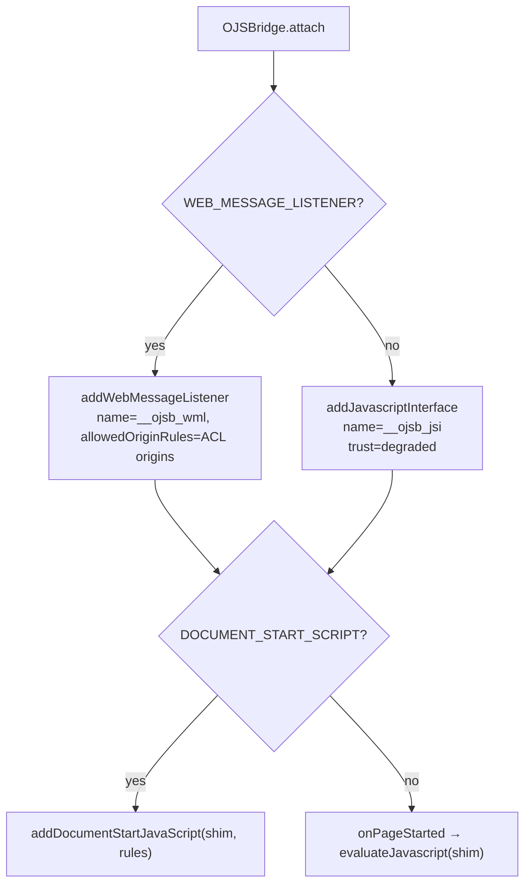
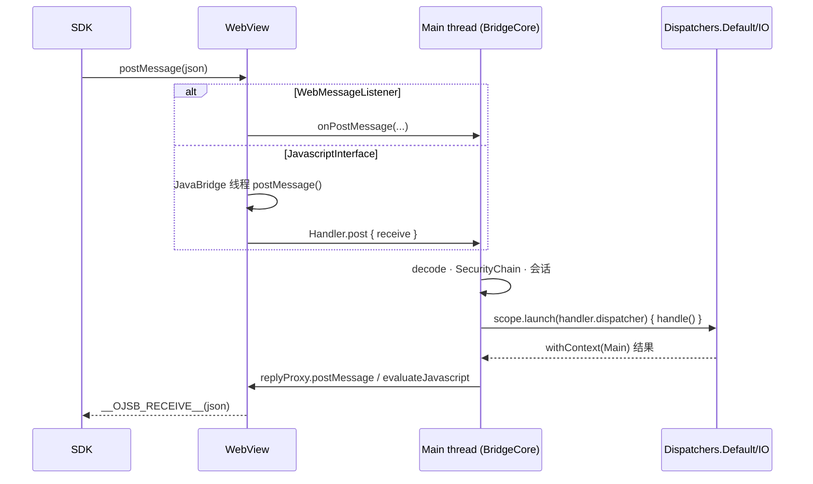

# Android 实现层（WebView）

> AAR：`dev.openjsbridge:openjsbridge`。依赖 `androidx.webkit:webkit`、`kotlinx-coroutines`、`kotlinx-serialization-json`。
> minSdk 建议 21；首选通道依赖设备上 **Android System WebView 的版本**（而非 Android 系统版本），必须运行时用 `WebViewFeature.isFeatureSupported(...)` 检测。
> 文中 androidx.webkit API 请在接入时以所用版本的官方文档复核。

## 1. 通道选择

| 优先级 | 通道 | 条件 | 可信 origin | frame 定向推送 | trust |
|-------|------|------|------------|---------------|-------|
| 1 | `WebViewCompat.addWebMessageListener` | `WebViewFeature.WEB_MESSAGE_LISTENER` | ✅ `sourceOrigin` + `isMainFrame` | ✅ `JavaScriptReplyProxy` | `full` |
| 2 | `addJavascriptInterface` + `@JavascriptInterface` | 总是可用 | ❌（只能读 `webView.url`，有竞态） | ❌（只能 `evaluateJavascript` 到主 frame） | `degraded` |

shim 注入：

| 优先级 | 方式 | 条件 |
|-------|------|------|
| 1 | `WebViewCompat.addDocumentStartJavaScript(webView, shim, allowedOriginRules)` | `WebViewFeature.DOCUMENT_START_SCRIPT` |
| 2 | `onPageStarted` 中 `evaluateJavascript(shim)` | 总是可用，但**不保证**早于页面脚本；SDK 通过等待 `ojsb:transportready`（protocol T2）容忍晚到 |



## 2. `addJavascriptInterface` 的安全风险

1. **历史 RCE**：Android 4.2（API 17）之前，注入对象的**所有 public 方法**（含继承自 `Object` 的 `getClass()`）都能被 JS 反射调用，可执行任意代码（CVE-2012-6636 一类问题）。API 17+ 只有标注 `@JavascriptInterface` 的方法暴露。参考实现要求 minSdk ≥ 21，且注入对象只暴露**一个** `postMessage(String)` 方法。
2. **无 origin 隔离**：对象注入到该 WebView 的**所有 frame、所有 origin**，包括第三方 iframe 和被重定向到的任意页面；回调参数里拿不到调用方 origin 和 frame。
3. **线程**：`@JavascriptInterface` 方法在 WebView 内部的后台线程（JavaBridge 线程）调用，不在主线程；而 `WebView` 的方法（含 `getUrl()`）只能在主线程调用，因此"在回调里读 `webView.url` 校验 origin"天然存在竞态（读到的可能已是导航后的 URL）。
4. **对象生命周期**：注入在下次页面加载后才生效，且会跨导航保留。

因此回退通道下：会话 `trust = degraded`，只开放 ACL 中 `allowDegraded: true` 的 method（protocol S2），且只允许 main frame（无法区分 frame，按最保守处理）。

## 3. 首选通道：`addWebMessageListener`

```kotlin
private fun installWebMessageListener(webView: WebView) {
    WebViewCompat.addWebMessageListener(
        webView,
        WML_OBJECT,                                 // "__ojsb_wml"，只注入到匹配的 origin 的 frame
        acl.originRules(),                          // Set<String>，如 "https://m.acme.com", "https://*.acme.com"
    ) { view, message, sourceOrigin, isMainFrame, replyProxy ->
        // 该回调在 UI 线程（以 androidx.webkit 文档为准）
        val raw = message.data ?: return@addWebMessageListener
        core.receive(raw, Caller(Origin.of(sourceOrigin), isMainFrame, FrameTarget.Proxy(replyProxy)))
    }
}
```

要点：

- `allowedOriginRules` 让 **白名单外的 origin 根本拿不到注入对象**，比 iOS 的"注入到所有页面再逐条校验"更进一步。规则语法有限（scheme + host 可含最左通配 + 可选端口），与 protocol S3 的匹配规则一致；Native 侧**仍然**用 `sourceOrigin` 再走一遍完整 SecurityChain（method ACL 与 frame 规则无法用 originRules 表达）。
- 注入对象在**下一次导航**才生效，`attach()` 必须在 `loadUrl` 之前调用。
- 推送使用回调给的 `JavaScriptReplyProxy.postMessage(String)`，消息只到达发起该会话的 frame（protocol F3）。会话中保存 proxy；frame 导航后旧 proxy 投递的消息由 SDK 的 sid 校验丢弃。
- 二进制：新版 androidx.webkit 提供 ArrayBuffer 消息能力（`WebViewFeature.WEB_MESSAGE_ARRAY_BUFFER`）。协议统一使用字符串，此能力仅作为未来 `blob` 优化的可选项，不进入 1.0。

Android shim（WML 版）：

```js
(function () {
  if (window.__OJSB_TRANSPORT__) return;
  var o = window.__ojsb_wml; if (!o) return;          // 不在 allowedOriginRules 内的 frame 没有该对象
  var buf = [], recv;
  function deliver(m) { recv ? recv(m) : (buf.length < 256 && buf.push(m)); }
  o.addEventListener('message', function (e) { deliver(e.data); });   // replyProxy.postMessage → 这里
  var t = Object.freeze({ name: 'android-wml', protocols: Object.freeze([1]),
                          postMessage: function (s) { o.postMessage(s); } });
  Object.defineProperty(window, '__OJSB_TRANSPORT__', { value: t, writable: false, configurable: false });
  Object.defineProperty(window, '__OJSB_RECEIVE__', { configurable: false,
    get: function () { return deliver; },
    set: function (fn) { recv = fn; var q = buf; buf = []; q.forEach(function (m) { fn(m); }); } });
  window.dispatchEvent(new CustomEvent('ojsb:transportready'));
})();
```

JSI 回退版只替换 `name: 'android-jsi'` 与 `postMessage: function (s) { window.__ojsb_jsi.postMessage(s); }`，推送走 `evaluateJavascript` 调 `__OJSB_RECEIVE__`。两份 shim 由同一模板生成。

## 4. 回退通道：`@JavascriptInterface`

```kotlin
internal class JsiEndpoint(private val core: BridgeCore, private val main: Handler) {
    @JavascriptInterface
    fun postMessage(raw: String) {                       // JavaBridge 后台线程
        if (raw.length > core.limits.maxMessageChars) return  // 先挡超大消息，避免切线程拷贝
        main.post {                                       // 切到主线程，与 Core 单线程模型一致
            val url = core.webView?.url                   // 仅作为"尽力而为"的 origin，存在竞态
            core.receive(raw, Caller(Origin.ofUrl(url), isMainFrame = true, FrameTarget.MainFrameEval, trust = Trust.DEGRADED))
        }
    }
}
```

## 5. 线程模型



- **BridgeCore 只在主线程运行**（会话表、pending、订阅无需加锁）。
- 每个 WebView 一个 `CoroutineScope(SupervisorJob() + Dispatchers.Main.immediate)`；`detach()` 时 `scope.cancel()`。
- Handler 声明自己的 `dispatcher`（默认 `Dispatchers.Default`，UI 类 handler 用 `Dispatchers.Main`）。
- 每个 request 一个 `Job`，`cancel` 消息或会话失效时 `job.cancel()`，handler 中的挂起点自动响应取消。
- `evaluateJavascript` / `replyProxy.postMessage` 只在主线程调用。

## 6. Handler 注册

```kotlin
@Serializable data class DeviceGetInfoParams(val fields: List<String>? = null)
@Serializable data class DeviceGetInfoResult(val os: String, val osVersion: String, val model: String)

interface BridgeHandler<P : Any, R : Any> {
    val method: String
    val versions: IntArray get() = intArrayOf(1)
    val paramsSerializer: KSerializer<P>
    val resultSerializer: KSerializer<R>
    val dispatcher: CoroutineDispatcher get() = Dispatchers.Default
    suspend fun handle(params: P, version: Int, ctx: BridgeContext): R
}

class BridgeContext internal constructor(
    val sid: String, val id: String, val traceId: String,
    val origin: Origin, val isMainFrame: Boolean, val trust: Trust,
    private val webViewRef: WeakReference<WebView>,
    private val emitCallback: suspend (JsonElement) -> Unit,
) {
    val webView: WebView? get() = webViewRef.get()
    suspend fun <T> callback(serializer: KSerializer<T>, value: T) = emitCallback(Json.encodeToJsonElement(serializer, value))
}

class BridgeException(val code: Int, override val message: String, val data: JsonObject? = null) : Exception(message) {
    companion object {
        fun permissionDenied(reason: String) = BridgeException(-32003, "Permission denied", buildJsonObject { put("reason", reason) })
        val userDenied get() = BridgeException(-32007, "User denied")
    }
}

object DeviceGetInfo : BridgeHandler<DeviceGetInfoParams, DeviceGetInfoResult> {
    override val method = "device.getInfo"
    override val paramsSerializer = DeviceGetInfoParams.serializer()
    override val resultSerializer = DeviceGetInfoResult.serializer()
    override suspend fun handle(params: DeviceGetInfoParams, version: Int, ctx: BridgeContext) =
        DeviceGetInfoResult(os = "android", osVersion = Build.VERSION.RELEASE, model = Build.MODEL)
}
```

注册表（类型擦除，集中处理 JSON ↔ 对象与 `-32602`）：

```kotlin
class HandlerRegistry {
    private class Entry(val versions: IntArray, val dispatcher: CoroutineDispatcher,
                        val run: suspend (JsonObject, Int, BridgeContext) -> JsonElement)
    private val table = ConcurrentHashMap<String, Entry>()

    fun <P : Any, R : Any> register(h: BridgeHandler<P, R>) {
        require(!h.method.startsWith("bridge.") && !h.method.startsWith("ojsb.")) { "reserved namespace" }
        require(METHOD_RE.matches(h.method)) { "invalid method name ${h.method}" }
        table[h.method] = Entry(h.versions, h.dispatcher) { raw, v, ctx ->
            val p = try { json.decodeFromJsonElement(h.paramsSerializer, raw) }
                    catch (e: SerializationException) { throw BridgeException(-32602, "Invalid params") }
            json.encodeToJsonElement(h.resultSerializer, h.handle(p, v, ctx))
        }
    }

    /** 轻量 lambda 注册，便于业务快速接入 */
    inline fun <reified P : Any, reified R : Any> register(method: String, noinline block: suspend (P, BridgeContext) -> R) =
        register(object : BridgeHandler<P, R> {
            override val method = method
            override val paramsSerializer = serializer<P>()
            override val resultSerializer = serializer<R>()
            override suspend fun handle(params: P, version: Int, ctx: BridgeContext) = block(params, ctx)
        })

    internal fun lookup(m: String) = table[m]
    private companion object {
        val METHOD_RE = Regex("^[a-z][a-zA-Z0-9]*(\\.[a-z][a-zA-Z0-9]*)+$")
        val json = Json { ignoreUnknownKeys = true; explicitNulls = false }   // 对应协议"忽略未知字段"
    }
}
```

> 为什么不做注解处理器（`@BridgeMethod` + KSP 扫描）：可以做，但 M1 用显式注册即可；KSP 版本放到 M3，与 codegen 结合（从 schema 直接生成 `BridgeHandler` 抽象类，业务只实现 `handle`）。不使用运行时反射扫描，避免 R8 混淆/裁剪导致线上找不到方法。

对外 API：

```kotlin
val bridge = OJSBridge.attach(
    webView,
    registry = HandlerRegistry.shared.apply {
        register(DeviceGetInfo)
        register<ToastParams, Unit>("ui.toast.show") { p, ctx ->
            withContext(Dispatchers.Main) { Toast.makeText(ctx.webView!!.context, p.text, Toast.LENGTH_SHORT).show() }
        }
    },
    acl = Acl.fromAsset(context, "ojsb-acl.json"),
    options = OJSBridge.Options(enableIframes = false, debug = BuildConfig.DEBUG),
)
webView.loadUrl("https://m.acme.com/home")       // 必须在 attach 之后

bridge.emit("network.changed", buildJsonObject { put("type", "wifi") })
val share = bridge.callWeb("page.getShareInfo", ShareInfo.serializer(), timeoutMs = 3_000)

// 在 Activity/Fragment onDestroy
bridge.detach()
```

### 6.1 WebViewClient 集成

同 iOS，不抢 `WebViewClient`：提供 `OJSBridgeWebViewClient(delegate: WebViewClient)` 包装器，或让业务在自己的 client 里转调：

| 回调 | Bridge 行为 |
|------|------------|
| `onPageStarted`（主 frame） | 使该 WebView 所有 sid 失效；回退注入模式下注入 shim |
| `onRenderProcessGone`（API 26+） | 所有 sid 失效、取消所有 Job；返回值由业务决定（返回 true 表示 App 自己处理，需销毁该 WebView） |
| `shouldInterceptRequest` | 处理 blob 虚拟路径（§8） |

## 7. Native → Web 推送

```kotlin
@MainThread
internal fun push(env: Envelope, target: FrameTarget) {
    val json = env.encode()
    when (target) {
        is FrameTarget.Proxy -> target.proxy.postMessage(json)           // WML：frame 定向，无需拼 JS
        FrameTarget.MainFrameEval -> {
            val literal = JSONObject.quote(json)                          // 二次编码为 JS 字符串字面量
                .replace("\u2028", "\\u2028").replace("\u2029", "\\u2029")
            webView?.evaluateJavascript("window.__OJSB_RECEIVE__&&window.__OJSB_RECEIVE__($literal)", null)
        }
    }
}
```

WML 通道下推送**不需要拼接 JS 源码**，天然避免注入问题，这也是首选它的理由之一。

## 8. 大数据

- 推荐在页面同源下挂虚拟路径：`https://<page-host>/__ojsb__/blob/<token>`，在 `shouldInterceptRequest` 中按 token 返回 `WebResourceResponse`；同源避免 CORS。必须校验 `request.url` 的 host 与该 token 绑定会话的 origin 一致。
- 或使用 `androidx.webkit.WebViewAssetLoader` 的专用域（`appassets.androidplatform.net`）配合自定义 `PathHandler`，此时是跨源，需要返回 CORS 头。
- `shouldInterceptRequest` 的 `WebResourceRequest` 拿不到请求体，因此 **Web→Native 上传走分片**（protocol §10.2），Host 不广告 `blob.upload` feature。
- `shouldInterceptRequest` 在非主线程调用，BlobStore 需线程安全。

## 9. 单元测试策略

| 层 | 工具 | 内容 |
|----|------|------|
| JVM 单测 | JUnit5 + kotlinx-coroutines-test | Envelope、ACL 匹配反例、SecurityChain、HandlerRegistry（`-32602`）、取消传播、限流；BridgeCore 通过 `FakeTransport` 测试状态机 |
| Robolectric（可选） | Robolectric | 仅测与 Android 类耦合但不依赖真实 WebView 渲染的部分；**不要**用它测通道行为（Robolectric 不运行真实 WebView） |
| 仪器测试 | androidx.test + 真实 WebView | `loadDataWithBaseURL("https://trusted.test/", html, ...)` 构造 origin；WML 与 JSI 两种通道参数化各跑一遍；iframe、reload 迟到响应、render process gone（`chrome://crash` 类手段视设备支持） |
| 一致性 | conformance runner | 同 iOS，在 instrumentation 中加载 runner 页面，产出 JUnit XML |
| 兼容矩阵 | Firebase Test Lab / 自建设备池 | 覆盖不同 System WebView 版本，确认 feature 检测与回退路径都被执行 |

CI：`./gradlew :openjsbridge:test :openjsbridge-test:connectedAndroidTest`。
