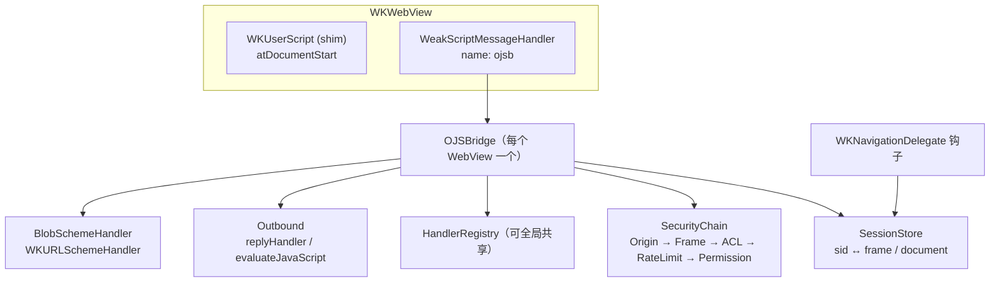
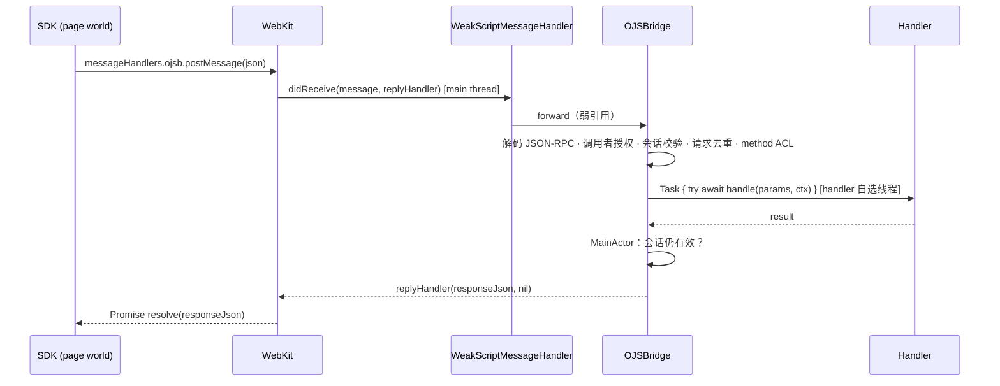

# iOS 实现层（WKWebView）

> Swift Package：`OpenJSBridge`。首版参考实现使用 **iOS 14+ 的 WKWebView**，仅开放主 frame。iOS 13 回退通道按 §3 的条件后续启用。
> 本文 API 以 Apple 公开 WebKit API 为准；标注 "iOS 14+" 的 API 请在接入时以当前 Xcode SDK 文档复核。

要运行握手与 echo，参见 [Swift 示例](../examples/native-ios/README.md)。已有 App 可在 Release 中通过 `NativeIOSHost.attach` 接入自己的 `WKWebView`，注册业务方法，并继续管理原有导航。[Release 接入示例](../examples/native-ios/README.md#接入-app-自己的-wkwebview) · [Native Host 最小接入](native-host.md)

## 1. 总体结构



## 2. 注入方式

### 2.1 Shim 脚本

shim 是一段几百字节的 JS，实现 [protocol.md §2](protocol.md#2-host-shim-契约transport-层) 的契约。它被打包为 bundle 资源 `ojsb-shim-ios.js`，由 conformance 套件同一份模板生成。

```js
(function () {
  if (window.__OJSB_TRANSPORT__) return;
  var h = window.webkit && window.webkit.messageHandlers && window.webkit.messageHandlers.ojsb;
  if (!h) return;
  var buf = [], recv;
  function deliver(m) { recv ? recv(m) : (buf.length < 256 && buf.push(m)); }
  var transport = Object.freeze({
    name: 'ios-wk',
    protocols: Object.freeze([1]),
    // iOS 14+ WithReply：Promise resolve 为 JSON-RPC 响应信封字符串或传输回执 null
    postMessage: function (s) { return h.postMessage(s); }
  });
  Object.defineProperty(window, '__OJSB_TRANSPORT__', { value: transport, writable: false, configurable: false });
  Object.defineProperty(window, '__OJSB_RECEIVE__', {
    configurable: false,
    get: function () { return deliver; },
    set: function (fn) {
      recv = typeof fn === 'function' ? fn : undefined;
      if (!recv) return;
      var q = buf; buf = [];
      q.forEach(function (m) {
        try { deliver(m); } catch (e) { setTimeout(function () { throw e; }); }
      });
    }
  });
  window.dispatchEvent(new CustomEvent('ojsb:transportready'));
})();
```

> 注意 `__OJSB_RECEIVE__` 的 getter 始终返回一个"转发器"，Native 推送永远调用这个转发器，所以 SDK 晚加载也不会丢消息（缓冲上限 256）。

### 2.2 `WKUserScript` 选项取舍

| 选项 | 选择 | 理由 |
|------|------|------|
| `injectionTime` | `.atDocumentStart` | 保证页面任何脚本执行前 shim 就绪；SDK 可以同步检测 |
| `forMainFrameOnly` | 首版固定为 `true` | Native 接收入口同时校验 `frameInfo.isMainFrame`。后续通过 §8 的 iframe 验证后，才允许显式配置开放子 frame |
| `contentWorld`（iOS 14+） | `.page` | SDK 跑在页面 world，必须与 shim 同一 world 才能互相访问。若 Host 还有不想让页面看到的私有脚本，放到 `.defaultClient` 或自定义 `WKContentWorld.world(name:)` |

消息 handler 对 `.page` world 中的所有 frame 可见。即使 shim 只注入主 frame，Native 入口也必须用 WebKit 提供的 `frameInfo` 校验每条消息的来源和 frame。

## 3. 通信通道

| 方向 | iOS 14+（首版参考实现） | iOS 13（回退候选） |
|------|---------------|---------------|
| Web→Native 消息 | `WKScriptMessageHandlerWithReply` | `WKScriptMessageHandler` |
| Native→Web JSON-RPC 响应 | `replyHandler(responseString, nil)` → JS 侧 Promise resolve | `evaluateJavaScript` 调 `__OJSB_RECEIVE__` |
| Native→Web 通知 | `callAsyncJavaScript` 向当前受信文档投递，见 §9 | 主 frame 回退待验证 |

- `replyHandler` 的第二个参数用于通道故障。Web SDK 将传输 Promise 的拒绝映射为 `-32000`。业务 handler 意外抛错时，宿主通过第一个参数返回脱敏的 `-32603` JSON-RPC 响应，并保留原请求的 id 和会话关联。
- WithReply 的每次入站调用都要完成一次回执。对通知、反向调用的响应以及直接丢弃的消息，调用 `replyHandler(NSNull(), nil)`。这个 `null` 是传输回执。`bridge.cancel` 引发的最终 `-32002` 响应使用原请求的 `replyHandler`，并携带原请求的 `rpc.id`。
- iOS 13 只能向主 frame 执行 JavaScript。回退通道的响应也依赖 §9 的 document 校验，验证通过后才能启用回退。
- 两种通道下，shim 的 `postMessage` 返回值不同（Promise vs undefined），SDK 已统一处理（web-sdk.md §2.2）。



## 4. 内存：弱引用防循环引用

`WKUserContentController` **强持有** message handler；而 handler（bridge）通常持有 WebView 或其所属 ViewController，形成环：`WKWebView → configuration → userContentController → handler → bridge → webView`。

```swift
/// 打破 WKUserContentController 对 bridge 的强引用
final class WeakScriptMessageHandler: NSObject, WKScriptMessageHandler, WKScriptMessageHandlerWithReply {
    weak var target: OJSBridge?
    init(_ target: OJSBridge) { self.target = target }

    func userContentController(_ c: WKUserContentController, didReceive message: WKScriptMessage) {
        target?.receive(message, reply: nil)
    }

    @available(iOS 14.0, *)
    func userContentController(_ c: WKUserContentController,
                               didReceive message: WKScriptMessage,
                               replyHandler: @escaping (Any?, String?) -> Void) {
        guard let target else { replyHandler(nil, "bridge deallocated"); return }
        target.receive(message, reply: replyHandler)
    }
}
```

- bridge 对 webView 也用 `weak`。
- `detach()`（或 `deinit`）时调用 `removeScriptMessageHandler(forName:contentWorld:)` / `removeScriptMessageHandler(forName:)` 并移除自己注入的 user script（`removeAllUserScripts()` 会误删业务脚本，参考实现记录自己的脚本后重建列表）。
- 单测里用 `addTeardownBlock { [weak bridge] in XCTAssertNil(bridge) }` 检测泄漏。

## 5. 线程模型

- `WKScriptMessageHandler` 回调、`evaluateJavaScript`、`WKNavigationDelegate` 都在**主线程**。
- Bridge Core（会话、pending、ACL 判定）标注 `@MainActor`，避免加锁。
- Handler 是 `async` 函数，由 handler 自己决定在哪执行（默认继承调用者的 actor 隔离；耗时 handler 应自行 `Task.detached` 或使用自有 actor）。需要操作 UI 的 handler 标注 `@MainActor`。
- 结果回到 `@MainActor` 后再调用 `replyHandler` / `evaluateJavaScript`。
- 注册异步业务方法后，参考宿主在握手中声明 `cancel`。每个异步业务请求对应一个 `Task`。收到当前会话中匹配的 `bridge.cancel` 时，宿主先释放并发槽，再调用 `task.cancel()`，通过原请求的通道返回一次 `-32002`。业务处理器可用 `try Task.checkCancellation()` 协作取消。

## 6. Handler 注册机制

### 6.1 协议 + 注册表（推荐，零魔法）

```swift
public struct BridgeContext: Sendable {
    public let sid: String
    public let id: String
    public let traceId: String
    public let origin: String           // 来自 frameInfo.securityOrigin，可信
    public let isMainFrame: Bool
    public let trust: Trust             // .full | .degraded
    public let callback: @Sendable (Encodable) async -> Void   // 发送 bridge.progress 通知
    public weak var webView: WKWebView? { _webView.value }
    let _webView: WeakBox<WKWebView>
}

public protocol BridgeHandler: Sendable {
    associatedtype Params: Decodable & Sendable
    associatedtype Result: Encodable & Sendable
    static var method: String { get }            // "device.getInfo"
    static var versions: [Int] { get }           // [1, 2]
    func handle(_ params: Params, version: Int, ctx: BridgeContext) async throws -> Result
}

public struct BridgeError: Error, Encodable {
    public let code: Int
    public let message: String
    public var data: [String: AnyCodable]?
    public static func permissionDenied(_ reason: String) -> Self { .init(code: -32003, message: "Permission denied", data: ["reason": .init(reason)]) }
    public static let userDenied = BridgeError(code: -32007, message: "User denied")
}
```

示例 handler（`Params`/`Result` 可由 codegen 从 schema 生成）：

```swift
struct DeviceGetInfo: BridgeHandler {
    struct Params: Decodable, Sendable {}
    struct Result: Encodable, Sendable { let os: String; let osVersion: String }
    static let method = "device.getInfo"
    static let versions = [1]

    @MainActor
    func handle(_ p: Params, version: Int, ctx: BridgeContext) async throws -> Result {
        let d = UIDevice.current
        return .init(os: "ios", osVersion: d.systemVersion)
    }
}

struct PreparePhotos: BridgeHandler {
    struct Params: Decodable, Sendable { var count: Int = 1 }
    struct Result: Encodable, Sendable { let images: [BlobRef] }
    static let method = "acme.photos.prepare"
    static let versions = [1]
    func handle(_ p: Params, version: Int, ctx: BridgeContext) async throws -> Result {
        // ... 展示 PHPicker；用户取消 → throw BridgeError.userDenied
        await ctx.callback(["selected": 1])
        try Task.checkCancellation()
        return .init(images: [])
    }
}
```

注册表做**类型擦除**，把 JSON → Params 解码、Result → JSON 编码集中处理：

```swift
public final class HandlerRegistry: @unchecked Sendable {
    typealias Erased = @Sendable (Data, Int, BridgeContext) async throws -> Data
    private var table: [String: (versions: [Int], run: Erased)] = [:]
    private let lock = NSLock()

    public func register<H: BridgeHandler>(_ h: H) {
        precondition(!["bridge.", "ojsb.", "rpc."].contains(where: H.method.hasPrefix), "reserved namespace")
        let run: Erased = { raw, v, ctx in
            let p: H.Params
            do { p = try JSONDecoder().decode(H.Params.self, from: raw) }
            catch { throw BridgeError(code: -32602, message: "Invalid params", data: ["detail": .init("\(error)")]) }
            return try JSONEncoder().encode(try await h.handle(p, version: v, ctx: ctx))
        }
        lock.withLock { table[H.method] = (H.versions, run) }
    }
    func lookup(_ m: String) -> (versions: [Int], run: Erased)? { lock.withLock { table[m] } }
    var methods: [String: [Int]] { lock.withLock { table.mapValues(\.versions) } }
}
```

> 为什么不用 Objective-C runtime / 宏自动扫描：反射式注册（遍历 `@objc` 方法名）在 Swift 里需要 `NSObject` 子类、方法签名受限、难做类型安全，且 release 构建中容易被裁剪。若追求更少样板，M3 可提供 **Swift Macro**（如 `@BridgeMethod("device.getInfo")`）生成 `BridgeHandler` conformance，但它只是语法糖，底层仍是上面的注册表。

### 6.2 对外 API

```swift
let bridge = OJSBridge(
    webView: webView,
    registry: .shared,                            // 全局 handler 可共享
    acl: try ACL(jsonFile: Bundle.main.url(forResource: "ojsb-acl", withExtension: "json")!),
    options: .init(debugLogging: isDebug)
)
bridge.registry.register(DeviceGetInfo())
bridge.registry.register(ChooseImage())
```

以下 Native → Web API 在 §9 的 document 定向机制验证后开放，宿主只声明已启用的能力。

```swift
bridge.emit("network.changed", ["type": "wifi"])
let share: ShareInfo = try await bridge.callWeb("page.getShareInfo", timeout: 3)
```

`OJSBridge.init` 内部完成：注入 shim、添加 message handler、注册 `ojsb-blob` scheme（注意 `setURLSchemeHandler` 必须在 WebView 创建前设置到 `WKWebViewConfiguration`，因此提供 `OJSBridge.configure(_ config: WKWebViewConfiguration)` 静态方法，在创建 WebView 前调用）、hook 导航代理。

### 6.3 导航代理：不抢 delegate

Bridge 需要感知导航，但 `navigationDelegate` 往往被业务占用。参考实现提供两种方式：

1. 业务在自己的 delegate 中转调：`bridge.webView(webView, didCommit: navigation)`、`bridge.webViewWebContentProcessDidTerminate(webView)`；
2. 或使用 `OJSNavigationDelegateProxy(forwardingTo: existing)` 包装业务 delegate（消息转发实现）。

## 7. 接收与权限校验链

`Envelope.decode` 按 protocol §3 解析一个 `{jsb, meta?, rpc}` 对象，要求 `rpc.jsonrpc` 为 `"2.0"`，并拒绝批量数组。示例中的 `env.rpc` 是解码后的枚举。请求携带 `rpc.method` 和字符串 `rpc.id`，响应携带 `rpc.id` 以及 `rpc.result`、`rpc.error` 中恰好一项，通知携带 `rpc.method` 且省略 `rpc.id`。

```swift
@MainActor
func receive(_ message: WKScriptMessage, reply: ((Any?, String?) -> Void)?) {
    let out = Outbound(reply: reply, frame: message.frameInfo, webView: webView)
    guard let raw = message.body as? String else {
        logDrop(reason: "unsupported_payload_type")
        return out.acknowledge()
    }
    let decoded = Envelope.decode(raw)
    let origin = message.frameInfo.securityOrigin
    let caller = Caller(origin: Origin(origin), isMainFrame: message.frameInfo.isMainFrame, frame: message.frameInfo)

    do {
        try security.checkCaller(caller)
        let document = try session.requireCurrentDocument(caller)
        guard case .message(let env) = decoded else {
            return rejectMalformed(decoded, document: document, out: out)
        }
        if case .request(let request) = env.rpc, request.method == "bridge.hello" {
            guard session.recordHelloID(request.id, in: document) else { return out.acknowledge() }
            return try session.hello(request, meta: env.meta, document: document, out: out)
        }
        let s = try session.requireActive(sid: env.meta?.sid, document: document)

        switch env.rpc {
        case .request(let request):
            guard s.recordIncomingRequestID(request.id) else { return out.acknowledge() }
            try security.checkMethod(request.method, caller: caller, session: s)
            return dispatch(request, meta: env.meta, session: s, out: out)
        case .response(let response):
            if response.id != nil { reverse.settle(response, in: s) }
        case .notification(let notification):
            switch notification {
            case .cancel(let control):
                session.cancel(id: control.requestId, reason: control.reason, in: s)
            case .event(let event):
                try events.receiveFromWeb(event, caller: caller, session: s)
            case .progress(let progress):
                reverse.progress(progress, in: s)
            case .unknown:
                break
            }
        }
        out.acknowledge()
    } catch {
        let failure = error as? BridgeError ?? BridgeError(code: -32603, message: "Internal error")
        return rejectIfSafe(decoded, failure: failure, caller: caller, out: out)
    }
}
```

`rejectMalformed` 仅在请求类型明确、能安全恢复 `rpc.id` 且在对应范围内首次登记该 id 时，才发送关联的格式错误。无法关联的格式错误可通过满足会话校验且绑定到原 document 的通道发送 `rpc.id: null` 的诊断错误，或记录后丢弃。已能识别为通知或响应的无效消息直接丢弃。日志只记录错误类别等元数据。

`checkCaller` 校验 scheme、origin 白名单和可信主 frame 标记，覆盖握手。仅 `bridge.hello` 请求及其关联响应可省略 `meta.sid`。握手仅为当前已确认的 document 建立或复用会话，并返回经授权的能力。握手请求若携带 sid，须匹配当前活动会话。其余消息须匹配当前 (WebView, frame, document, sid)。符合调用者授权、尚未握手且未提供 sid 的请求对应 `-32005`。提供无效、过期或不匹配的 sid，以及活动会话中缺少 sid 的请求，对应 `-32009`。`rejectIfSafe` 仅在能安全确定响应所需的 sid、排除重复请求并确认投递到原 document 时，才为请求返回对应错误。其余情况只完成传输回执。

握手按 document 去重，其他请求按 sid 和发起方向去重。重复 id 在分发前静默丢弃，格式错误的副本也适用。WithReply 只完成该副本的传输回执。最终结果在投递前再次验证目标 document 和适用的会话。

示例只分发显式允许的控制通知 `bridge.cancel`（`requestId`、可选 `reason`）、`bridge.event`（`name`、`payload`）和 `bridge.progress`（`requestId`、`seq`、可选 `chunk`）。这些控制方法仅接受通知格式。通知须通过方向、参数和权限校验，取消、进度和反向响应只匹配当前会话内对应的请求。入站事件须通过事件注册和 ACL 检查。

`SecurityChain` 由可插拔的调用者规则和方法规则组成。任何规则抛出错误都终止当前入站处理，未分类异常转换为通用 `-32603`。

```swift
public protocol CallerRule { func check(_ caller: Caller) throws }
public protocol MethodRule { func check(_ method: String, _ caller: Caller, _ s: Session) throws }

let security = SecurityChain(
    callerRules: [
        SchemeRule(allowHTTP: isDebug),
        OriginAllowlistRule(acl),
        MainFrameRule()
    ],
    methodRules: [
        MethodACLRule(acl),
        RateLimitRule(acl),
        SystemPermissionRule()
    ]
)
```

> 白名单外的 origin 实际上收不到 shim 吗？**不一定**：`WKUserScript` 不支持按 origin 过滤注入，所以 shim 会进入任何导航到的页面。这正是校验必须在 Native 侧逐条进行的原因。可以在 shim 里额外判断 `location.origin` 决定是否暴露（降低能力探测面），但这只是"减少暴露"，不是安全措施。

## 8. 会话与生命周期

| 事件 | 处理 |
|------|------|
| 主 frame 新 document 提交（`didCommit`） | 使旧 document 的 sid 失效；新 document 从握手开始 |
| 同一 document 内路由变化 | 保留原 sid 和会话状态 |
| `webViewWebContentProcessDidTerminate` | 所有 sid 失效，取消所有 Task |
| App 拆卸 WebView | App 调用 `Attachment.detach()`，取消旧任务并移除桥接 handler 与注入脚本 |

会话失效时取消进行中的 handler 和反向请求，清理订阅、释放 blob，丢弃尚未投递的旧会话消息。仍持有的 WithReply 回调以传输层 `null` 完成一次，避免将旧会话的协议数据交给新 document。同一 document 内使用新 id 重试握手时，复用活动 sid。

宿主须协调 `didCommit` 与 document-start 握手的到达顺序。只有确认握手来自当前提交的 document，才允许建立或复用会话。

子 frame 能力留待后续验证。WebKit 的 `WKFrameInfo` 可用于路由，但无法跨 delegate 调用唯一标识 frame，公开的 `didCommit` 也只报告主 frame。开放 iframe 前，宿主必须能验证来源 frame 和 document 的身份，在子 frame 导航提交时使旧 sid 失效，并证明旧载荷在切换后不会进入新 document。[WebKit `WKFrameInfo` 契约](https://github.com/WebKit/WebKit/blob/main/Source/WebKit/UIProcess/API/Cocoa/WKFrameInfo.h#L29-L33) · [WebKit 导航回调](https://github.com/WebKit/WebKit/blob/main/Source/WebKit/UIProcess/API/Cocoa/WKNavigationDelegate.h#L101-L123)

## 9. Native → Web 推送

参考宿主为受信主文档提供可选的 `network.changed`。Native 检查当前会话和订阅，随后把 origin、文档标记和序列化的信封作为 `callAsyncJavaScript` 的参数传入。脚本在同一次执行中校验 origin 和文档标记，通过后交给页面接收器。Shim 在接收器就绪前按协议缓冲通知。

整页导航提交使旧会话失效。退订停止后续通知，页面隐藏时更换 shim 的文档标记并清空通知缓存。iOS 13 回退、子 frame 与反向请求仍需独立验证。

[参考宿主](../examples/native-ios/Sources/NativeIOSHost/NativeIOSHost.swift) · [原生基础能力](native-profiles.md) · [Apple callAsyncJavaScript](https://developer.apple.com/documentation/webkit/wkwebview/callasyncjavascript(_:arguments:in:contentworld:))

## 10. 大数据：`WKURLSchemeHandler`

```swift
final class BlobSchemeHandler: NSObject, WKURLSchemeHandler {
    let store: BlobStore            // token → (data/fileURL, mime, sid, expiresAt)
    func webView(_ w: WKWebView, start task: WKURLSchemeTask) {
        guard let url = task.request.url, let item = store.take(token: url.lastPathComponent) else {
            return task.didFailWithError(URLError(.fileDoesNotExist))
        }
        let headers = ["Content-Type": item.mime,
                       "Content-Length": "\(item.size)",
                       "Access-Control-Allow-Origin": item.allowedOrigin]   // 自定义 scheme 对页面是跨源
        task.didReceive(HTTPURLResponse(url: url, statusCode: 200, httpVersion: "HTTP/1.1", headerFields: headers)!)
        task.didReceive(item.data)       // 大文件分块 didReceive
        task.didFinish()
    }
    func webView(_ w: WKWebView, stop task: WKURLSchemeTask) { /* 标记停止，后续不再回调 task */ }
}
```

注意：`stop` 之后再调用 task 的方法会抛 ObjC 异常导致崩溃，参考实现在 handler 内维护已停止集合。

## 11. 单元测试策略

| 层 | 工具 | 内容 |
|----|------|------|
| 纯逻辑 | XCTest（无 WebView） | Envelope 编解码、ACL 匹配（含 `example.com.evil.io` 等反例）、SecurityChain、RateLimit、JSString.literal 转义（含 `</script>`、U+2028、emoji） |
| Core 状态机 | XCTest + FakeTransport | 握手幂等、握手前 `-32005`、旧 sid `-32009`、重复请求静默丢弃、校验异常终止分发、`bridge.cancel` 按 sid 隔离、每个 replyHandler 恰好调用一次 |
| 集成 | XCTest + 真 `WKWebView` | 验证可信主 frame 握手、陌生 origin 与子 frame 拒绝、reload 后无旧消息交给新 document。启用推送或回退前验证对应的导航竞态 |
| 一致性 | conformance runner（见 conformance.md） | 在宿主 App target 里加载 runner 页面，跑全量 cases，输出 JUnit |
| 泄漏 | XCTest teardown | WebView 与 bridge 均能释放 |

CI：`xcodebuild test -scheme OpenJSBridge -destination 'platform=iOS Simulator,name=<device>'`，矩阵覆盖最低支持的 WithReply 系统与最新系统。
