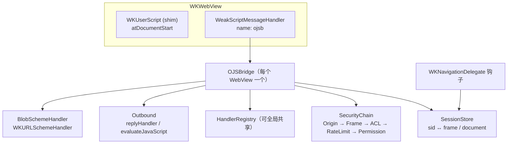
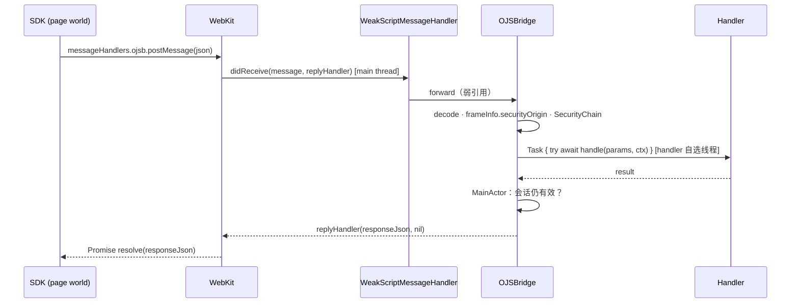

# iOS 实现层（WKWebView）

> Swift Package：`OpenJSBridge`。最低系统：**iOS 13**（iOS 14+ 走首选通道，iOS 13 走回退通道）。不支持 UIWebView。
> 本文 API 以 Apple 公开 WebKit API 为准；标注 "iOS 14+" 的 API 请在接入时以当前 Xcode SDK 文档复核。

## 1. 总体结构



## 2. 注入方式

### 2.1 Shim 脚本

shim 是一段几百字节的 JS，实现 [protocol.md §2](protocol.md#2-host-shim-契约transport-层) 的契约。它被打包为 bundle 资源 `ojsb-shim-ios.js`，由 conformance 套件同一份模板生成。

```js
(function () {
  if (window.__OJSB_TRANSPORT__) return;
  var h = window.webkit && window.webkit.messageHandlers && window.webkit.messageHandlers.ojsb;
  if (!h) return;
  var buf = [], recv;
  var transport = Object.freeze({
    name: 'ios-wk',
    protocols: Object.freeze([1]),
    // iOS 14+ WithReply：postMessage 返回 Promise，resolve 为 response 字符串
    postMessage: function (s) { return h.postMessage(s); }
  });
  Object.defineProperty(window, '__OJSB_TRANSPORT__', { value: transport, writable: false, configurable: false });
  Object.defineProperty(window, '__OJSB_RECEIVE__', {
    configurable: false,
    get: function () { return function (m) { recv ? recv(m) : (buf.length < 256 && buf.push(m)); }; },
    set: function (fn) { recv = fn; var q = buf; buf = []; q.forEach(function (m) { try { fn(m); } catch (e) { setTimeout(function () { throw e; }); } }); }
  });
  window.dispatchEvent(new CustomEvent('ojsb:transportready'));
})();
```

> 注意 `__OJSB_RECEIVE__` 的 getter 始终返回一个"转发器"，Native 推送永远调用这个转发器，所以 SDK 晚加载也不会丢消息（缓冲上限 256）。

### 2.2 `WKUserScript` 选项取舍

| 选项 | 选择 | 理由 |
|------|------|------|
| `injectionTime` | `.atDocumentStart` | 保证页面任何脚本执行前 shim 就绪；SDK 可以同步检测 |
| `forMainFrameOnly` | **默认 `true`**；ACL 中存在 `frames: "any"` 规则时设为 `false` | 默认只给主 frame 开能力（protocol F1）。设为 `false` 后 shim 会进入所有 iframe（包括第三方广告 frame），但调用仍会被 Native 侧按 frame 的 origin 校验，安全不依赖注入范围 |
| `contentWorld`（iOS 14+） | `.page` | SDK 跑在页面 world，必须与 shim 同一 world 才能互相访问。若 Host 还有不想让页面看到的私有脚本，放到 `.defaultClient` 或自定义 `WKContentWorld.world(name:)` |

> 关于 content world：`window.webkit.messageHandlers.ojsb` 本身对 `.page` world 是可见的，页面脚本可绕过 shim 直接 postMessage。这是**可接受的**，因为所有安全判断都在 Native 侧基于 `frameInfo` 做，shim 只是适配层，不是安全边界。

## 3. 通信通道

| 方向 | iOS 14+（首选） | iOS 13（回退） |
|------|---------------|---------------|
| Web→Native request | `WKScriptMessageHandlerWithReply`，`replyHandler` 直接回 response | `WKScriptMessageHandler` |
| Native→Web response | `replyHandler(responseString, nil)` → JS 侧 Promise resolve | `evaluateJavaScript` 调 `__OJSB_RECEIVE__` |
| Native→Web callback / event / 反向 request | `evaluateJavaScript(_:in:in:completionHandler:)`（可指定 frame + content world） | `evaluateJavaScript(_:completionHandler:)`（仅主 frame） |

- `replyHandler` 的第二个参数是错误字符串，会让 JS Promise reject。**协议错误一律走第一个参数（error 信封）**，只在 Native 自身故障时使用第二个参数，SDK 将其映射为 `-32603`。
- 回退通道（iOS 13）无法指定 frame 推送，因此 iOS 13 上 iframe 能力 MUST 关闭。
- 两种通道下，shim 的 `postMessage` 返回值不同（Promise vs undefined），SDK 已统一处理（web-sdk.md §2.2）。



## 4. 内存：弱引用防循环引用

`WKUserContentController` **强持有** message handler；而 handler（bridge）通常持有 WebView 或其所属 ViewController，形成环：`WKWebView → configuration → userContentController → handler → bridge → webView`。

```swift
/// 打破 WKUserContentController 对 bridge 的强引用
final class WeakScriptMessageHandler: NSObject, WKScriptMessageHandler, WKScriptMessageHandlerWithReply {
    weak var target: OJSBridge?
    init(_ target: OJSBridge) { self.target = target }

    func userContentController(_ c: WKUserContentController, didReceive message: WKScriptMessage) {
        target?.receive(message, reply: nil)
    }

    @available(iOS 14.0, *)
    func userContentController(_ c: WKUserContentController,
                               didReceive message: WKScriptMessage,
                               replyHandler: @escaping (Any?, String?) -> Void) {
        guard let target else { replyHandler(nil, "bridge deallocated"); return }
        target.receive(message, reply: replyHandler)
    }
}
```

- bridge 对 webView 也用 `weak`。
- `detach()`（或 `deinit`）时调用 `removeScriptMessageHandler(forName:contentWorld:)` / `removeScriptMessageHandler(forName:)` 并移除自己注入的 user script（`removeAllUserScripts()` 会误删业务脚本，参考实现记录自己的脚本后重建列表）。
- 单测里用 `addTeardownBlock { [weak bridge] in XCTAssertNil(bridge) }` 检测泄漏。

## 5. 线程模型

- `WKScriptMessageHandler` 回调、`evaluateJavaScript`、`WKNavigationDelegate` 都在**主线程**。
- Bridge Core（会话、pending、ACL 判定）标注 `@MainActor`，避免加锁。
- Handler 是 `async` 函数，由 handler 自己决定在哪执行（默认继承调用者的 actor 隔离；耗时 handler 应自行 `Task.detached` 或使用自有 actor）。需要操作 UI 的 handler 标注 `@MainActor`。
- 结果回到 `@MainActor` 后再调用 `replyHandler` / `evaluateJavaScript`。
- 取消：每个 request 对应一个 `Task`，收到 `cancel` 或会话失效时 `task.cancel()`，handler 内用 `try Task.checkCancellation()` 协作取消。

## 6. Handler 注册机制

### 6.1 协议 + 注册表（推荐，零魔法）

```swift
public struct BridgeContext: Sendable {
    public let sid: String
    public let id: String
    public let traceId: String
    public let origin: String           // 来自 frameInfo.securityOrigin，可信
    public let isMainFrame: Bool
    public let trust: Trust             // .full | .degraded
    public let callback: @Sendable (Encodable) async -> Void   // 流式回调
    public weak var webView: WKWebView? { _webView.value }
    let _webView: WeakBox<WKWebView>
}

public protocol BridgeHandler: Sendable {
    associatedtype Params: Decodable & Sendable
    associatedtype Result: Encodable & Sendable
    static var method: String { get }            // "device.getInfo"
    static var versions: [Int] { get }           // [1, 2]
    func handle(_ params: Params, version: Int, ctx: BridgeContext) async throws -> Result
}

public struct BridgeError: Error, Encodable {
    public let code: Int
    public let message: String
    public var data: [String: AnyCodable]?
    public static func permissionDenied(_ reason: String) -> Self { .init(code: -32003, message: "Permission denied", data: ["reason": .init(reason)]) }
    public static let userDenied = BridgeError(code: -32007, message: "User denied")
}
```

示例 handler（`Params`/`Result` 可由 codegen 从 schema 生成）：

```swift
struct DeviceGetInfo: BridgeHandler {
    struct Params: Decodable, Sendable { var fields: [String]? }
    struct Result: Encodable, Sendable { let os: String; let osVersion: String; let model: String }
    static let method = "device.getInfo"
    static let versions = [1]

    @MainActor
    func handle(_ p: Params, version: Int, ctx: BridgeContext) async throws -> Result {
        let d = UIDevice.current
        return .init(os: "ios", osVersion: d.systemVersion, model: d.model)
    }
}

struct ChooseImage: BridgeHandler {
    struct Params: Decodable, Sendable { var count: Int = 1 }
    struct Result: Encodable, Sendable { let images: [BlobRef] }
    static let method = "media.chooseImage"
    static let versions = [1]
    func handle(_ p: Params, version: Int, ctx: BridgeContext) async throws -> Result {
        // ... 展示 PHPicker；用户取消 → throw BridgeError.userDenied
        await ctx.callback(["selected": 1])
        try Task.checkCancellation()
        return .init(images: [])
    }
}
```

注册表做**类型擦除**，把 JSON → Params 解码、Result → JSON 编码集中处理：

```swift
public final class HandlerRegistry: @unchecked Sendable {
    typealias Erased = @Sendable (Data, Int, BridgeContext) async throws -> Data
    private var table: [String: (versions: [Int], run: Erased)] = [:]
    private let lock = NSLock()

    public func register<H: BridgeHandler>(_ h: H) {
        precondition(!H.method.hasPrefix("bridge.") && !H.method.hasPrefix("ojsb."), "reserved namespace")
        let run: Erased = { raw, v, ctx in
            let p: H.Params
            do { p = try JSONDecoder().decode(H.Params.self, from: raw) }
            catch { throw BridgeError(code: -32602, message: "Invalid params", data: ["detail": .init("\(error)")]) }
            return try JSONEncoder().encode(try await h.handle(p, version: v, ctx: ctx))
        }
        lock.withLock { table[H.method] = (H.versions, run) }
    }
    func lookup(_ m: String) -> (versions: [Int], run: Erased)? { lock.withLock { table[m] } }
    var methods: [String: [Int]] { lock.withLock { table.mapValues(\.versions) } }
}
```

> 为什么不用 Objective-C runtime / 宏自动扫描：反射式注册（遍历 `@objc` 方法名）在 Swift 里需要 `NSObject` 子类、方法签名受限、难做类型安全，且 release 构建中容易被裁剪。若追求更少样板，M3 可提供 **Swift Macro**（如 `@BridgeMethod("device.getInfo")`）生成 `BridgeHandler` conformance，但它只是语法糖，底层仍是上面的注册表。

### 6.2 对外 API

```swift
let bridge = OJSBridge(
    webView: webView,
    registry: .shared,                            // 全局 handler 可共享
    acl: try ACL(jsonFile: Bundle.main.url(forResource: "ojsb-acl", withExtension: "json")!),
    options: .init(enableIframes: false, debugLogging: isDebug)
)
bridge.registry.register(DeviceGetInfo())
bridge.registry.register(ChooseImage())

// Native → Web
bridge.emit("network.changed", ["type": "wifi"])                 // 只发给订阅了且有权限的 frame
let share: ShareInfo = try await bridge.callWeb("page.getShareInfo", timeout: 3)
```

`OJSBridge.init` 内部完成：注入 shim、添加 message handler、注册 `ojsb-blob` scheme（注意 `setURLSchemeHandler` 必须在 WebView 创建前设置到 `WKWebViewConfiguration`，因此提供 `OJSBridge.configure(_ config: WKWebViewConfiguration)` 静态方法，在创建 WebView 前调用）、hook 导航代理。

### 6.3 导航代理：不抢 delegate

Bridge 需要感知导航，但 `navigationDelegate` 往往被业务占用。参考实现提供两种方式：

1. 业务在自己的 delegate 中转调：`bridge.webView(webView, didCommit: navigation)`、`bridge.webViewWebContentProcessDidTerminate(webView)`；
2. 或使用 `OJSNavigationDelegateProxy(forwardingTo: existing)` 包装业务 delegate（消息转发实现）。

## 7. 接收与权限校验链

```swift
@MainActor
func receive(_ message: WKScriptMessage, reply: ((Any?, String?) -> Void)?) {
    let out = Outbound(reply: reply, frame: message.frameInfo, webView: webView)
    guard let raw = message.body as? String, let env = try? Envelope.decode(raw) else {
        return out.sendError(id: nil, .parse)                  // 无 id：仅日志
    }
    let origin = message.frameInfo.securityOrigin               // 可信来源（S1）
    let caller = Caller(origin: Origin(origin), isMainFrame: message.frameInfo.isMainFrame, frame: message.frameInfo)

    switch env.type {
    case .request:
        if env.method == "bridge.hello" { return session.hello(env, caller, out) }
        guard let s = session.validate(sid: env.meta?.sid, caller: caller) else {
            return out.sendError(env, .sessionExpired)
        }
        do {
            try security.check(method: env.method!, caller: caller, session: s)   // 链式
        } catch let e as BridgeError { return out.sendError(env, e) } catch {}
        dispatch(env, s, out)
    case .cancel:   session.cancel(id: env.id!, caller: caller)
    case .response, .callback: reverse.settle(env, caller)
    case .event:    events.receiveFromWeb(env, caller)
    }
}
```

`SecurityChain` 由一组可插拔的 `SecurityRule` 组成，按顺序短路：

```swift
public protocol SecurityRule { func check(_ method: String, _ caller: Caller, _ s: Session) throws }

let security = SecurityChain([
    SchemeRule(allowHTTP: isDebug),         // 拒绝 http/file/data/null origin（S4）
    OriginAllowlistRule(acl),               // 精确或最左子域通配（S3）
    FrameRule(acl),                         // main-only 或 any（F1/F2）
    MethodACLRule(acl),                     // deny 优先（11.3）
    DegradedTrustRule(),                    // 回退通道只允许 allowDegraded 的 method（S2）
    RateLimitRule(acl),                     // 令牌桶，按 (sid, method)
    SystemPermissionRule(),                 // 相机/相册等系统授权前置检查（可选）
])
```

> 白名单外的 origin 实际上收不到 shim 吗？**不一定**：`WKUserScript` 不支持按 origin 过滤注入，所以 shim 会进入任何导航到的页面。这正是校验必须在 Native 侧逐条进行的原因。可以在 shim 里额外判断 `location.origin` 决定是否暴露（降低能力探测面），但这只是"减少暴露"，不是安全措施。

## 8. 会话与生命周期

| 事件 | 处理 |
|------|------|
| 主 frame `didCommit` | 使该 WebView **所有** sid 失效（主 frame 新 document 意味着所有子 frame 也被替换） |
| 子 frame 新 document | WebKit 公开 API 没有子 frame commit 回调；新 document 会重新 `bridge.hello` 得到新 sid；旧 sid 在下次向该 frame 投递失败或 TTL 到期后回收。SDK 侧 sid 校验保证旧 sid 的消息不会被新 document 接受 |
| `webViewWebContentProcessDidTerminate` | 所有 sid 失效，取消所有 Task |
| WebView 释放 / `detach()` | 取消所有 Task、移除 handler 与 user script、释放 blob |

失效时：pending 的 handler `Task.cancel()`；`replyHandler` 仍需调用一次（WebKit 要求每个 replyHandler 被调用；document 已不存在时结果被丢弃），参考实现以 `-32009` 回复。

## 9. Native → Web 推送

```swift
@MainActor
func push(_ env: Envelope, to target: FrameTarget) {
    let json = env.jsonString()                                   // 第一次编码：信封
    let literal = JSString.literal(json)                          // 第二次编码：安全的 JS 字符串字面量（protocol 11.5）
    let js = "window.__OJSB_RECEIVE__&&window.__OJSB_RECEIVE__(\(literal))"
    if #available(iOS 14.0, *), let frame = target.frameInfo, !frame.isMainFrame {
        webView?.evaluateJavaScript(js, in: frame, in: .page) { r in if case .failure = r { self.session.markUnreachable(target) } }
    } else {
        webView?.evaluateJavaScript(js) { _, err in if err != nil { self.session.markUnreachable(target) } }
    }
}

enum JSString {
    static func literal(_ s: String) -> String {
        // JSONSerialization 对字符串做 JSON 编码，再补上 U+2028/U+2029（旧引擎中它们在字符串字面量里非法）
        let data = try! JSONSerialization.data(withJSONObject: [s], options: [.fragmentsAllowed])
        let lit = String(data: data, encoding: .utf8)!.dropFirst().dropLast()   // 去掉 [ ]
        return String(lit).replacingOccurrences(of: "\u{2028}", with: "\\u2028").replacingOccurrences(of: "\u{2029}", with: "\\u2029")
    }
}
```

> 对子 frame 推送依赖在会话中保存的 `WKFrameInfo`；frame 被移除或导航后推送会失败，此时把对应 sid 标记为不可达并回收。该行为需要在 conformance 的 iframe 用例中实际验证。

## 10. 大数据：`WKURLSchemeHandler`

```swift
final class BlobSchemeHandler: NSObject, WKURLSchemeHandler {
    let store: BlobStore            // token → (data/fileURL, mime, sid, expiresAt)
    func webView(_ w: WKWebView, start task: WKURLSchemeTask) {
        guard let url = task.request.url, let item = store.take(token: url.lastPathComponent) else {
            return task.didFailWithError(URLError(.fileDoesNotExist))
        }
        let headers = ["Content-Type": item.mime,
                       "Content-Length": "\(item.size)",
                       "Access-Control-Allow-Origin": item.allowedOrigin]   // 自定义 scheme 对页面是跨源
        task.didReceive(HTTPURLResponse(url: url, statusCode: 200, httpVersion: "HTTP/1.1", headerFields: headers)!)
        task.didReceive(item.data)       // 大文件分块 didReceive
        task.didFinish()
    }
    func webView(_ w: WKWebView, stop task: WKURLSchemeTask) { /* 标记停止，后续不再回调 task */ }
}
```

注意：`stop` 之后再调用 task 的方法会抛 ObjC 异常导致崩溃，参考实现在 handler 内维护已停止集合。

## 11. 单元测试策略

| 层 | 工具 | 内容 |
|----|------|------|
| 纯逻辑 | XCTest（无 WebView） | Envelope 编解码、ACL 匹配（含 `example.com.evil.io` 等反例）、SecurityChain、RateLimit、JSString.literal 转义（含 `</script>`、U+2028、emoji） |
| Core 状态机 | XCTest + FakeTransport | 握手幂等、sid 失效后 `-32009`、cancel → `Task.isCancelled`、每个 replyHandler 恰好调用一次 |
| 集成 | XCTest + 真 `WKWebView` | `loadHTMLString(html, baseURL: URL(string: "https://trusted.test")!)` 构造任意 origin；验证 origin 拒绝、iframe（`srcdoc` / 不同 baseURL）、reload 后迟到响应被丢弃 |
| 一致性 | conformance runner（见 conformance.md） | 在宿主 App target 里加载 runner 页面，跑全量 cases，输出 JUnit |
| 泄漏 | XCTest teardown | WebView 与 bridge 均能释放 |

CI：`xcodebuild test -scheme OpenJSBridge -destination 'platform=iOS Simulator,name=<device>'`，矩阵覆盖最低支持系统（回退通道）与最新系统（首选通道）。
