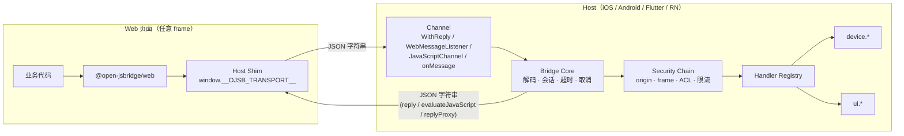
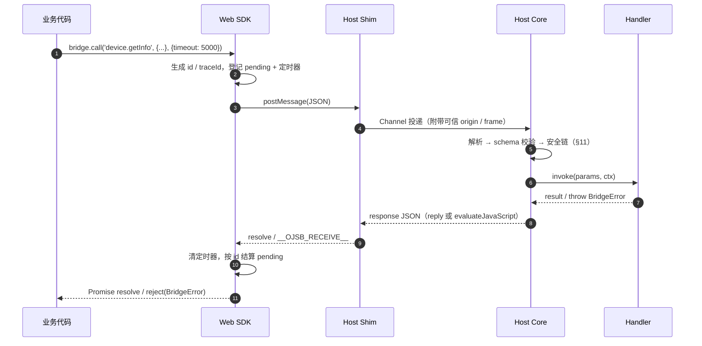
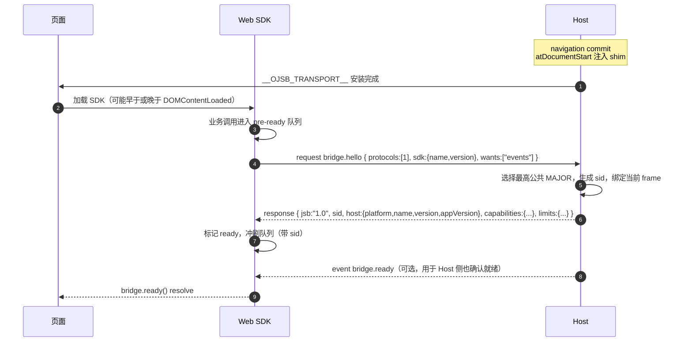
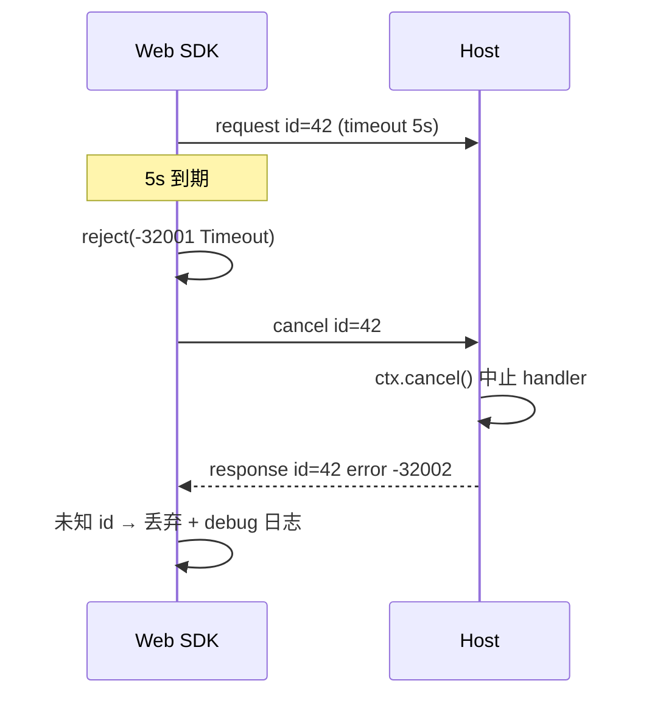
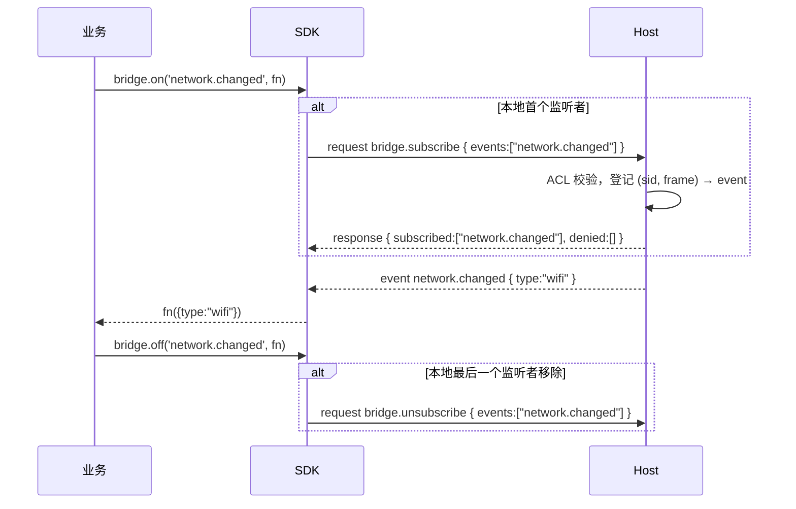
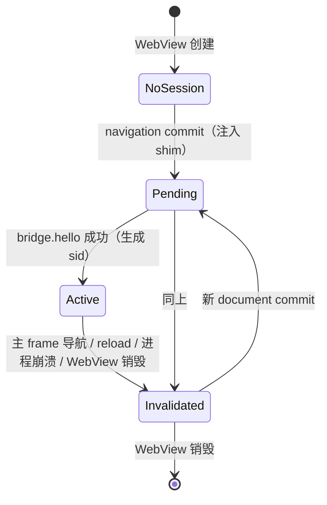

# Open JSBridge 协议规范（Draft, `jsb: 1.0`）

> 本文中的 **MUST / MUST NOT / SHOULD / SHOULD NOT / MAY** 按 RFC 2119 / RFC 8174 解释。
> 术语："**Web 端**" 指运行在 WebView 中的页面与 SDK；"**Host 端**" 指宿主实现（iOS / Android / Flutter / React Native）；"**Peer**" 泛指任意一端。

## 0. 总览



协议分三层：

1. **Transport 层**：把一个 UTF-8 JSON **字符串**从一端送到另一端。由各平台 Channel 实现（§2）。
2. **Envelope 层**：消息信封、类型、关联 id、错误（§3–§5）。
3. **Semantics 层**：握手、能力协商、事件、取消、大数据、安全、生命周期（§6–§13）。

---

## 1. 设计约束

1. 所有跨端调用 MUST 是异步的。实现 MUST NOT 提供依赖阻塞 JS 线程的同步 API。
2. Wire 格式 MUST 是 UTF-8 JSON 文本（一个完整 JSON object 对应一条消息）。Transport 即便支持结构化对象（如 `WKScriptMessage.body` 可传 JS 对象），参考实现也 SHOULD 统一传字符串，以保证三端解析行为一致（数字精度、`undefined`、`Date` 等边界一致）。
3. 消息体 MUST 是 JSON object，MUST NOT 依赖 key 顺序。
4. 整数超过 2^53−1 的值 MUST 以字符串传输。

---

## 2. Host Shim 契约（Transport 层）

为了让 **一份 Web SDK 适配所有宿主**（包括 Flutter、React Native），Host MUST 在页面脚本执行前（或尽可能早）注入一个满足以下契约的 shim。SDK 只依赖这个契约，不直接依赖 `window.webkit` / `window.ReactNativeWebView` 等平台对象。

```ts
// Host 注入（参考实现见各平台文档）
interface OJSBTransport {
  /** 宿主标识：'ios-wk' | 'android-wml' | 'android-jsi' | 'flutter' | 'rn' | 'mock' | string */
  readonly name: string;
  /** 宿主支持的协议主版本列表，如 [1] */
  readonly protocols: readonly number[];
  /**
   * 发送一条消息（JSON 字符串）。
   * - 若通道原生支持 reply（如 WKScriptMessageHandlerWithReply），MAY 返回 Promise<string>，
   *   resolve 值为与本 request 对应的 response 信封字符串。
   * - 否则返回 void，response 通过 __OJSB_RECEIVE__ 异步投递。
   */
  postMessage(message: string): void | Promise<string | null>;
}

declare global {
  interface Window {
    __OJSB_TRANSPORT__?: Readonly<OJSBTransport>;
    /** 由 SDK 定义；Host 用它把 Native→Web 消息投递进来。SDK 未加载时 Host MUST 缓冲（§12.2）。 */
    __OJSB_RECEIVE__?: (message: string) => void;
  }
}
```

规则：

- **T1** Host MUST 用 `Object.freeze` + `Object.defineProperty(..., { writable: false, configurable: false })` 安装 `__OJSB_TRANSPORT__`，防止页面脚本替换。
- **T2** shim 安装后 Host MUST 派发 `window` 上的 `CustomEvent('ojsb:transportready')`，供晚于 shim 加载的 SDK 之外的场景使用；SDK 在加载时 MUST 先同步检测 `__OJSB_TRANSPORT__` 是否已存在。
- **T3** Host 投递 Native→Web 消息时，若 `__OJSB_RECEIVE__` 尚不存在，shim MUST 在页面内缓冲（上限建议 256 条），并在 SDK 赋值 `__OJSB_RECEIVE__` 时（shim 用 setter 拦截）依序冲刷。
- **T4** 契约名中的 `__OJSB_` 前缀为保留前缀，业务 MUST NOT 使用。

---

## 3. 消息信封（Envelope）

### 3.1 结构

```jsonc
{
  "jsb": "1.0",                    // MUST，协议版本 MAJOR.MINOR
  "id": "s7f3k2-42",               // request/response/callback/cancel MUST；event MAY 省略
  "type": "request",               // MUST：request | response | event | callback | cancel
  "method": "device.getInfo",      // request MUST；event MUST（事件名）；其它 MUST NOT
  "params": { "fields": ["os"] },  // request/event MAY；MUST 为 object（不允许 array，便于演进）
  "result": { },                   // response 成功 MUST；callback MAY
  "error": { "code": -32601, "message": "Method not found", "data": { } }, // response 失败 MUST
  "meta": {                        // MAY，但参考实现 SHOULD 总是填写
    "sid": "a1b2c3",               // 会话 id（每个 document 一次握手生成，§6）
    "traceId": "4bf92f3577b34da6a3ce929d0e0e4736", // §14
    "ts": 1763880000123,           // 发送方 epoch ms
    "timeout": 10000,              // request：调用方 deadline（ms），被调方 MAY 用于提前放弃
    "seq": 3,                      // callback：同一 id 下的序号，从 0 递增
    "final": false                 // callback：是否最后一条（true 后紧跟或替代 response，§8）
  }
}
```

- `result` 与 `error` 在同一 response 中 MUST 恰好出现一个。
- 未知的顶层字段 MUST 被忽略（向前兼容），未知的 `meta` 字段 MUST 被忽略。
- 信封的权威 JSON Schema 位于 `spec/protocol/envelope.schema.json`。

### 3.2 消息类型

| type | 方向 | 含义 | 是否需要应答 |
|------|------|------|------------|
| `request` | 双向（Web→Host 为主；Host→Web 用于 Web 注册的 handler） | 调用一个 method | MUST 有且仅有一个 `response` |
| `response` | 与 request 相反 | 调用结果，`id` 与 request 相同 | 否 |
| `callback` | 与 request 相反 | 同一 request 的**中间结果/进度/流**（如下载进度、扫码连续结果） | 否 |
| `event` | 双向（Host→Web 为主） | 无需应答的通知（如 `app.didEnterBackground`） | 否 |
| `cancel` | 与 request 同向 | 请求取消某个进行中的 `id` | 否（被取消方 SHOULD 以 `-32002 Cancelled` 结束该 request） |

> 说明：JSON-RPC 用 "notification" 表示无 id 的请求；OJSB 用显式 `type: "event"` 代替，语义更清楚，也避免"忘写 id 变成通知"的误用。

### 3.3 id 规则

- `id` MUST 是字符串，在一个会话（`sid`）内、同一发起方向上 MUST 唯一。
- 推荐格式：`<发起方前缀><sid 片段>-<自增计数>`，如 Web 发起 `w-a1b2-42`，Host 发起 `n-a1b2-7`，避免双向 request 的 id 冲突。
- 接收方 MUST 拒绝在同一会话中重复的 request id（返回 `-32600`，`data.reason = "duplicate_id"`），这是防重放的一部分（§11.6）。

### 3.4 Method 命名

- 格式：`<namespace>.<name>`，可多级：`ui.toast.show`。正则：`^[a-z][a-zA-Z0-9]*(\.[a-z][a-zA-Z0-9]*)+$`。
- 至少两段；`name` 用 lowerCamelCase 动词开头（`getInfo`、`openUrl`）。事件名用过去式或状态描述（`app.didEnterBackground`、`network.changed`）。
- 保留命名空间（业务 MUST NOT 注册）：

| 命名空间 | 用途 |
|---------|------|
| `bridge.*` | 握手、能力、订阅、心跳、调试 |
| `conformance.*` | 一致性测试，生产构建 MUST 关闭 |
| `ojsb.*` | 未来扩展保留 |

- 标准 profile（可选实现）：`device.*`、`app.*`、`ui.*`、`storage.*`、`network.*`、`media.*`。
- 厂商/业务扩展 SHOULD 使用反域名或公司前缀：`acme.pay.create`，避免与未来标准冲突。
- Method 版本：schema 中声明 `x-ojsb-version: 2`；调用时 MAY 写 `device.getInfo@2`，不写则为该 Host 广告的**最低**受支持版本（保证老调用方行为不变）。

---

## 4. 错误

### 4.1 错误对象

```jsonc
{
  "code": -32003,                 // MUST，整数
  "message": "Permission denied", // MUST，面向开发者的简短英文描述，不得用于逻辑判断
  "data": {                       // MAY
    "reason": "origin_not_allowed",   // 机器可读子原因，snake_case
    "retryable": false,               // 调用方是否可以重试
    "method": "device.getInfo",
    "detail": { }                     // 任意补充信息，MUST NOT 含敏感数据
  }
}
```

### 4.2 错误码表

**协议标准码（与 JSON-RPC 2.0 对齐）**

| code | 名称 | 触发条件 |
|------|------|---------|
| -32700 | Parse error | 消息不是合法 JSON |
| -32600 | Invalid request | 信封不符合 schema、重复 id、type 非法 |
| -32601 | Method not found | method 未注册，或该版本不支持 |
| -32602 | Invalid params | params 不符合 method schema |
| -32603 | Internal error | handler 抛出未分类异常 |

**Bridge 保留码（-32000 ~ -32099）**

| code | 名称 | 说明 | retryable |
|------|------|------|-----------|
| -32000 | Bridge unavailable | 不在宿主中 / 通道不存在（SDK 本地产生） | 否 |
| -32001 | Timeout | 超过 deadline（通常由调用方本地产生） | 视 method |
| -32002 | Cancelled | 被 `cancel` 或页面卸载终止 | 否 |
| -32003 | Permission denied | origin / frame / ACL 校验失败 | 否 |
| -32004 | Unsupported protocol | 协议主版本无交集 | 否 |
| -32005 | Not ready | 握手未完成且未入队（如队列溢出） | 是 |
| -32006 | Payload too large | 超过单消息上限（§10） | 否 |
| -32007 | User denied | 用户拒绝系统授权 / 弹窗 | 否 |
| -32008 | Rate limited | 触发限流 | 是 |
| -32009 | Session expired | 迟到消息属于已失效会话（§12） | 否 |
| -32010 | Busy | 该 method 不可并发且已有调用在进行 | 是 |
| -32011 ~ -32099 | 保留 | 未来协议使用 | — |

**业务码段**

| 范围 | 归属 |
|------|------|
| 1 ~ 9999 | 标准 profile（`device.*` 用 1000–1999，`ui.*` 2000–2999，`storage.*` 3000–3999，`network.*` 4000–4999，`media.*` 5000–5999 …），在 `spec/protocol/errors.json` 注册 |
| 10000 ~ 99999 | 厂商/业务自定义，SHOULD 在各自 method schema 的 `x-ojsb-errors` 中声明 |
| 其它（含负数非保留区间） | MUST NOT 使用 |

规则：调用方 MUST 依据 `code`（及 `data.reason`）做逻辑判断；`message` 只用于日志。

---

## 5. Request / Response 时序



- Host 对每个 request MUST 恰好产生一个 response，包括：handler 抛异常（-32603）、method 不存在（-32601）、校验失败（-32602/-32003）。
- Host 收到无法解析出 `id` 的消息时 MUST 丢弃并记录日志（无法应答）。
- 调用方收到未知 `id` 的 response/callback MUST 丢弃并记录（可能是超时后迟到的响应）。

---

## 6. 握手与能力协商

### 6.1 流程



### 6.2 `bridge.hello`

Request params:

```jsonc
{
  "protocols": [1],                              // MUST，SDK 支持的主版本
  "sdk": { "name": "@open-jsbridge/web", "version": "1.2.0" },
  "wants": ["events", "callbacks", "blob"]        // MAY，SDK 希望使用的可选特性
}
```

Response result:

```jsonc
{
  "jsb": "1.0",                    // 协商后的协议版本
  "sid": "a1b2c3d4",               // 会话 id，此后所有消息 meta.sid MUST 携带
  "host": { "platform": "ios", "name": "ios-wk", "version": "1.0.3", "appId": "com.acme.app", "appVersion": "8.2.0" },
  "capabilities": {
    "methods": {                   // 当前 origin + frame 在 ACL 过滤后 *可调用* 的 method
      "device.getInfo": { "versions": [1, 2] },
      "ui.toast.show":  { "versions": [1] }
    },
    "events": ["app.didEnterBackground", "network.changed"],
    "features": ["callbacks", "cancel", "blob"]
  },
  "limits": { "maxMessageBytes": 1048576, "maxInflight": 64, "defaultTimeoutMs": 15000 }
}
```

规则：

- **H1** 协议主版本无交集时 Host MUST 返回 `-32004`，`data.supported = [..]`；SDK MUST 进入降级模式（§6.4）。
- **H2** `capabilities.methods` MUST 是**经过 ACL 过滤后的结果**，不向不受信 origin 泄露完整能力清单。
- **H3** 同一 document 重复 `bridge.hello` 时，Host MUST 返回同一 `sid`（幂等），除非页面已导航。
- **H4** 握手前收到的非 `bridge.*` request，Host MUST 返回 `-32005`；SDK 侧 SHOULD 通过 pre-ready 队列避免这种情况。
- **H5** `bridge.getCapabilities` MAY 在任意时刻调用以刷新能力（例如登录后 ACL 变化）；Host 能力变化时 SHOULD 发送 `bridge.capabilitiesChanged` 事件。

### 6.3 SDK 侧握手超时

- SDK 检测不到 `__OJSB_TRANSPORT__` 时，SHOULD 监听 `ojsb:transportready` 至多 `handshakeTimeout`（默认 3000 ms），之后判定为"不在宿主中"。
- `bridge.hello` 本身超时（默认 3000 ms）MAY 重试一次。

### 6.4 降级

| 情况 | SDK 行为 |
|------|---------|
| 不在宿主（普通浏览器） | 使用 `BrowserFallbackAdapter`：`has()` 恒为 false（除非注册了 Web 实现的 polyfill），`call()` reject `-32000` |
| 协议版本不兼容 | 同上，`ready()` reject `-32004` |
| method 不在 capabilities | `call()` 本地直接 reject `-32601`，不发送到 Host |
| method 版本不支持 | 本地 reject `-32601`，`data.reason = "version_unsupported"` |

业务 SHOULD 用 `bridge.has('x.y')` 做特性检测，而不是解析 App 版本号。

---

## 7. 超时与取消

- **D1** 每个 request MUST 有 deadline。SDK 默认值取 `limits.defaultTimeoutMs`（握手前用 15000），业务可在调用时覆盖；`timeout: 0` 表示不超时，仅允许 schema 中声明 `x-ojsb-long-running: true` 的 method（如等待用户操作的选择器）。
- **D2** 调用方超时时 MUST 本地 reject `-32001`，并 SHOULD 发送 `cancel`，让被调方释放资源。
- **D3** 被调方 SHOULD 读取 `meta.timeout` + `meta.ts`，在明显超时后放弃执行（注意两端时钟不一致，只作提示）。
- **D4** 取消：

```jsonc
{ "jsb": "1.0", "type": "cancel", "id": "w-a1b2-42", "meta": { "sid": "a1b2c3d4", "reason": "abort" } }
```

  被调方收到后 SHOULD 中止 handler（handler 通过 ctx 的取消信号感知），并 MUST 以 `-32002` 结束该 request（如果尚未结束）。调用方在发出 cancel 时已本地 reject，因此该 response 会被当作未知 id 丢弃——这是预期行为。
- **D5** Web 端通过 `AbortSignal` 暴露取消（见 web-sdk.md）。



---

## 8. 流式回调（callback）

适用于进度、连续结果（扫码、定位持续更新、下载进度）。

- 被调方在最终 `response` 之前 MAY 发送任意条 `callback`，`id` 与 request 相同，`meta.seq` 从 0 严格递增。
- 调用方 MUST 按 `seq` 处理；遇到乱序（理论上同一通道不会发生）SHOULD 丢弃旧 seq。
- 最终结果 MUST 仍以一条 `response` 结束；callback 仅在 schema 声明 `x-ojsb-callbacks` 时允许。
- 每条 callback 到达 SHOULD 重置调用方的 idle 定时器（可选特性 `idleTimeout`）。

---

## 9. 事件（Native → Web 推送）

### 9.1 订阅模型

事件采用**显式订阅**，避免 Host 向不关心或无权限的页面推送：



规则：

- **E1** Host MUST 只向订阅了该事件且通过 ACL 的 (sid, frame) 推送。
- **E2** 事件 MUST NOT 依赖投递保证：document 卸载、WebView 不可见时可能丢失。需要可靠性的场景 MUST 用 request 拉取当前状态（"事件提示 + 拉取真相"模式），例如订阅 `auth.changed` 后调用 `auth.getState`。
- **E3** 页面内 SDK MUST 做本地多路复用：同一事件只向 Host 订阅一次，引用计数归零再退订。
- **E4** Host MAY 对高频事件做合并/节流，schema 中以 `x-ojsb-throttle-ms` 声明。
- **E5** Web → Host 的 `event` 合法（如埋点上报 `analytics.track`），但 Host 对未注册的事件 MUST 静默丢弃。

### 9.2 Host → Web 的 request（反向调用）

Host 可调用 Web 侧通过 `bridge.handle('page.getShareInfo', fn)` 注册的 handler。SDK 在握手时通过 `bridge.hello` 的 `wants` 带上 `"reverse"`，并在注册/注销时调用 `bridge.registerWebMethods` 告知 Host。Web 侧未注册时 SDK MUST 应答 `-32601`。

---

## 10. 二进制与大数据传输

所有通道都基于字符串，且大字符串会在 JS 引擎与 Native 间复制，对内存与主线程都有压力。规范按大小分三档：

| 档位 | 大小（UTF-8 编码后的消息） | 策略 |
|------|------------------------|------|
| Inline | ≤ 256 KB（SHOULD） | 直接放在 params/result；二进制用 base64 字符串，字段名后缀 `Base64`（如 `imageBase64`） |
| Chunked | 256 KB ~ `limits.maxMessageBytes` 以上、无本地资源 URL 能力时 | 使用 `bridge.blob.*` 分片（见下） |
| URL 引用 | 大文件、媒体 | Host 返回 **本地资源 URL**，Web 直接 `fetch()` / `` |

### 10.1 URL 引用（推荐）

- Host 返回 `{ "blob": { "url": "<scheme>://blob/<token>", "mime": "image/jpeg", "size": 2345678, "expiresAt": 1763880600000 } }`。
- iOS：`WKURLSchemeHandler` 注册自定义 scheme（如 `ojsb-blob://`）。注意自定义 scheme 与页面 origin 不同，`fetch` 会受 CORS 约束，handler MUST 返回 `Access-Control-Allow-Origin: <页面 origin>`。
- Android：`shouldInterceptRequest` 或 `androidx.webkit.WebViewAssetLoader` 风格，在页面同源下挂一个虚拟路径（如 `https://<page-host>/__ojsb__/blob/<token>`）返回数据，可规避跨源问题；或使用 `https://appassets.androidplatform.net` 一类专用域。
- token MUST 不可猜测（≥128 bit 随机）、一次性或短时有效（默认 ≤ 10 分钟）、绑定 sid；会话失效时 MUST 释放。
- Web → Host 上传大数据：优先让 Host 提供上传 URL（`bridge.blob.createUpload` 返回一个 Host 拦截的 URL，Web 用 `fetch(url, {method:'PUT', body})`）。注意：部分 WebView 的请求拦截 API 拿不到请求体，此时退回分片方案；具体能力以 Host 在 `features` 中是否广告 `blob.upload` 为准。

### 10.2 分片（兜底）

```
bridge.blob.open   { mime, size, direction: "upload" }        → { blobId, chunkSize }
bridge.blob.write  { blobId, index, dataBase64 }              → { }
bridge.blob.close  { blobId, sha256? }                        → { blobRef }
bridge.blob.read   { blobRef, index }                         → { dataBase64, done }
bridge.blob.release{ blobRef }                                → { }
```

- 业务 method 参数中以 `{ "$blobRef": "..." }` 引用已上传对象。
- 并发分片数 SHOULD ≤ 4，Host MUST 对 blob 总量设上限并在会话结束时回收。

### 10.3 上限

- 超过 `limits.maxMessageBytes` 的消息，接收方 MUST 拒绝（-32006），SDK SHOULD 在发送前本地检测并直接 reject。

---

## 11. 权限与安全

### 11.1 威胁模型

| 威胁 | 示例 | 对策 |
|------|------|------|
| 不受信页面调用敏感能力 | WebView 被重定向到第三方页面 / 广告落地页 | origin 白名单 + method ACL（11.2/11.3） |
| 第三方 iframe | 嵌入的广告、评论组件 | 默认只允许 main frame；iframe 单独授权（11.4） |
| 伪造来源 | payload 里写 `"origin": "https://trusted.com"` | origin 只取 Native 从 WebView 获得的值（11.2） |
| 导航后迟到响应 | A 页面的结果被投递到 B 页面 | sid 绑定 document，导航即失效（§12） |
| 替换 bridge 对象 | 页面脚本覆写 `__OJSB_TRANSPORT__` 劫持调用 | freeze + non-configurable（T1）；iOS 可将 shim 放在隔离 content world（见 native-ios.md） |
| 注入 | Host 拼接 JS 字符串推送数据 | 推送 MUST 用 JSON 序列化后作为字符串字面量传入（11.5） |
| 滥用/DoS | 高频调用、超大消息 | 限流 + maxInflight + maxMessageBytes |

> 范围说明：同一 origin 下的页面脚本（含 XSS）与 SDK 处于同一信任域，协议层无法区分"合法业务代码"与"XSS 注入的代码"。防御 XSS 属于 Web 安全（CSP 等）的职责；协议能做的是把能力最小化到 origin + frame + method 级别。

### 11.2 Origin 获取与校验

- **S1** Host MUST 从平台提供的可信来源获取调用者 origin：iOS `WKScriptMessage.frameInfo.securityOrigin`；Android `WebMessageListener` 回调的 `sourceOrigin`；Flutter / React Native 见 flutter.md、react-native.md（多数情况下拿不到可信 frame origin，按 S2 处理）。payload 中的任何 origin/url 字段 MUST 被忽略。
- **S2** 当平台无法提供可信 origin（如 `addJavascriptInterface` 回退通道、部分跨端 WebView 插件），Host MUST 将会话标记为 `trust: "degraded"`，并 MUST 只开放 ACL 中标注 `allowDegraded: true` 的 method。
- **S3** origin 匹配 MUST 是 `scheme://host[:port]` 的精确匹配或受限通配（仅允许最左子域 `https://*.example.com`），MUST NOT 用前缀/子串匹配（防 `https://example.com.evil.io`）。
- **S4** `http:` origin 默认 MUST 被拒绝，除非 debug 构建显式开启。`file:`、`data:`、`about:blank`、opaque origin（`null`）默认 MUST 被拒绝。

### 11.3 Method 级 ACL

配置示例（三端共用同一格式，可随 App 下发、也可内置）：

```jsonc
{
  "version": 1,
  "rules": [
    {
      "origins": ["https://m.acme.com", "https://*.acme.com"],
      "frames": "main",                     // main | any
      "allow": ["device.*", "ui.*", "acme.pay.*"],
      "deny":  ["acme.pay.refund"]
    },
    {
      "origins": ["https://partner.example.org"],
      "frames": "any",
      "allow": ["ui.toast.show", "app.getInfo"],
      "rateLimit": { "perSecond": 10 }
    }
  ],
  "default": "deny"
}
```

- 求值顺序：`deny` 优先于 `allow`；未命中任何规则 → `default`（MUST 为 `deny`）。
- `bridge.hello / bridge.getCapabilities / bridge.subscribe` 等握手类 method 对白名单内的 origin 始终可用；对白名单外的 origin，Host SHOULD 直接不注入 shim（iOS/Android 现代通道可以按 origin 规则控制注入范围）。
- Handler MAY 声明 `requiresUserGesture` / `requiresPermission`（系统权限），在安全链中统一检查。

### 11.4 iframe

- **F1** 默认仅 main frame 可用（`frames: "main"`）。
- **F2** 允许 iframe 时，每个 frame 独立握手、独立 sid、独立 ACL 评估（按该 frame 自己的 origin）。
- **F3** Host → Web 的 response/event MUST 投递到发起的那个 frame，MUST NOT 广播到 main frame 再由页面转发。
- **F4** 页面内用 `window.postMessage` 在 frame 间转发 bridge 调用的"代理模式"MUST NOT 被参考实现采用（会使 origin 校验失效）。

### 11.5 Host→Web 推送的注入安全

使用 evaluateJavaScript 类 API 时，Host MUST 先把信封序列化为 JSON 字符串，再把**这个字符串作为 JS 字符串字面量**再编码一次：

```
window.__OJSB_RECEIVE__ && window.__OJSB_RECEIVE__(<JSON.stringify(envelopeJsonString)>)
```

即两次编码：第一次得到信封文本，第二次把信封文本编码为安全的 JS 字符串字面量（转义 `"`、`\`、换行、`\u2028`、`\u2029`）。MUST NOT 把业务数据直接拼到 JS 源码中。

### 11.6 防重放与完整性

- 同一 sid 内 request id 去重（§3.3）；sid 在导航时失效（§12），迟到/重放的旧会话消息返回 `-32009`。
- 协议 **不**引入签名/HMAC：注入页面的任何密钥同样可被同源脚本读取，签名无法提供额外保证，反而带来"已安全"的错觉。对需要更强保证的业务（支付），应由业务服务端做票据校验，bridge 只负责传递。

### 11.7 敏感数据

- 日志 MUST 默认脱敏 params/result（只记录 method、id、耗时、错误码），schema 中 `x-ojsb-sensitive: true` 的字段在 debug 日志中也 MUST 掩码。

---

## 12. 生命周期

### 12.1 会话（sid）与 document 绑定



- **L1** 一个 sid 绑定一个 (WebView, frame, document)。Host MUST 在 frame 发生新 document 提交时使旧 sid 失效。
- **L2** sid 失效时，Host MUST：取消该 sid 下所有进行中的 handler（ctx 取消信号）、清理事件订阅、释放 blob、丢弃对该 sid 的所有待发送响应（不得投递给新 document）。
- **L3** 同 document 内的 History API 路由（SPA `pushState`）**不**改变 sid。
- **L4** Web 侧在 `pagehide` 时 SHOULD 将所有 pending reject `-32002`；bfcache 恢复（`pageshow` 且 `persisted === true`）时 SDK MUST 重新握手（Host 可能已使会话失效）。
- **L5** WebView 渲染进程崩溃（iOS `webViewWebContentProcessDidTerminate`、Android `onRenderProcessGone`）MUST 视同 sid 失效。

### 12.2 WebView 复用 / 预热

- 预热池中的 WebView 在被业务取用并加载新 URL 时，必然产生新 document → 新 sid；Host MUST 在"归还池子"时清理 handler 上下文中保存的页面相关状态。
- 预加载 SDK 的空白页（如 `about:blank` 预热）不应开放能力（S4）。

### 12.3 多 WebView

- Handler Registry MAY 全局共享（无状态 handler），但 **会话、订阅、pending、ACL 结果 MUST 按 WebView 实例隔离**。
- 需要"推送给所有页面"的事件由 Host 侧事件总线分发到每个 WebView 的 bridge 实例，各自按订阅过滤。

---

## 13. 并发与顺序

- 同一通道上同一方向的消息 MUST 按发送顺序到达（各平台通道都满足）。
- 不同 request 之间无顺序保证：Host MAY 并发执行 handler，响应可乱序。
- schema 中 `x-ojsb-concurrency: "serial"` 的 method，Host MUST 串行执行，或在已有调用时返回 `-32010`（由 `x-ojsb-concurrency-policy: queue | reject` 决定）。
- `limits.maxInflight` 超限时 SDK SHOULD 本地排队，Host MUST 返回 `-32008`。

---

## 14. 可观测性

### 14.1 Trace

- `meta.traceId`：32 位 hex，SHOULD 与 W3C Trace Context 的 trace-id 格式一致；SDK 允许业务传入现有 traceId，便于把前端请求、bridge 调用、Native 网络请求串成一条链。
- Host 在 handler 内发起的网络请求 SHOULD 透传该 traceId（如 `traceparent` header）。

### 14.2 统一日志字段

| 字段 | 说明 |
|------|------|
| `side` | `web` / `host` |
| `platform` | `ios` / `android` / `flutter` / `rn` / `browser` |
| `sid`, `id`, `traceId` | 关联字段 |
| `type`, `method` | 消息类型、方法 |
| `phase` | `send` / `recv` / `dispatch` / `done` / `drop` |
| `code` | 错误码（如有） |
| `durMs` | 耗时 |
| `bytes` | 消息大小 |

### 14.3 性能埋点

每次调用 SDK 计算并通过 `onMetric` 钩子暴露：

```
t0 SDK 发送  →  t1 Host 收到  →  t2 handler 开始  →  t3 handler 结束  →  t4 SDK 收到
```

Host 在 response 的 `meta.timing = { recv: t1, start: t2, end: t3 }` 中回带自己的时间戳（Host 时钟）。由于两端时钟可能有偏差，跨端只比较**同一端内**的差值：`roundTrip = t4 - t0`（Web 时钟）、`handler = t3 - t2`（Host 时钟）、`overhead ≈ roundTrip - handler`。

### 14.4 调试

- `bridge.debug.setLogLevel` / `bridge.debug.dump`（只在 debug 构建可用）。
- SDK 提供 `devtools` 包：浮层展示每条消息、耗时、错误。

---

## 15. 兼容性与版本演进

| 变更类型 | 允许在 | 要求 |
|---------|-------|------|
| 新增 `meta` 字段、新增可选信封字段 | MINOR | 接收方必须忽略未知字段（§3.1） |
| 新增 `type` | MAJOR | 旧实现无法正确处理新 type |
| 新增错误码（保留段内） | MINOR | 调用方对未知码按 `-32603` 处理 |
| 新增 `bridge.*` method / feature | MINOR | 通过 `features` 广告 |
| 改变已有字段语义或删除字段 | MAJOR | 握手协商，旧 MAJOR 至少维护 12 个月 |
| method 新增可选 param / result 字段 | 不升 method 版本 | 调用方必须容忍多余字段 |
| method 删除字段 / 改语义 / 新增必填 param | method 版本 +1 | 旧版本继续广告直到 deprecated 期结束 |

- **废弃流程**：schema 中标 `deprecated: true` + `x-ojsb-sunset: "2027-12-31"`；SDK 在 debug 模式调用废弃 method 时输出警告。
- **Host 广告多版本**：`"device.getInfo": { "versions": [1, 2] }`，调用方显式 `@2` 才使用新版本。

---

## 附录 A：完整消息示例

```jsonc
// Web → Host request
{"jsb":"1.0","id":"w-a1b2-7","type":"request","method":"media.chooseImage","params":{"count":3},"meta":{"sid":"a1b2c3d4","traceId":"4bf92f3577b34da6a3ce929d0e0e4736","ts":1763880000123,"timeout":0}}
// Host → Web callback（进度）
{"jsb":"1.0","id":"w-a1b2-7","type":"callback","result":{"selected":1},"meta":{"sid":"a1b2c3d4","seq":0}}
// Host → Web response
{"jsb":"1.0","id":"w-a1b2-7","type":"response","result":{"images":[{"blob":{"url":"ojsb-blob://blob/9f1c...","mime":"image/jpeg","size":823412}}]},"meta":{"sid":"a1b2c3d4","timing":{"recv":1763880000130,"start":1763880000131,"end":1763880004410}}}
// Host → Web event
{"jsb":"1.0","type":"event","method":"app.didEnterBackground","params":{},"meta":{"sid":"a1b2c3d4"}}
// 错误响应
{"jsb":"1.0","id":"w-a1b2-8","type":"response","error":{"code":-32003,"message":"Permission denied","data":{"reason":"frame_not_allowed","retryable":false,"method":"acme.pay.create"}},"meta":{"sid":"a1b2c3d4"}}
```

## 附录 B：`spec/protocol/envelope.schema.json`（节选）

```json
{
  "$schema": "https://json-schema.org/draft/2020-12/schema",
  "$id": "https://open-jsbridge.dev/spec/envelope.schema.json",
  "type": "object",
  "required": ["jsb", "type"],
  "properties": {
    "jsb": { "type": "string", "pattern": "^[0-9]+\\.[0-9]+$" },
    "id": { "type": "string", "minLength": 1, "maxLength": 128 },
    "type": { "enum": ["request", "response", "event", "callback", "cancel"] },
    "method": { "type": "string", "pattern": "^[a-z][a-zA-Z0-9]*(\\.[a-z][a-zA-Z0-9]*)+(@[0-9]+)?$" },
    "params": { "type": "object" },
    "result": {},
    "error": {
      "type": "object",
      "required": ["code", "message"],
      "properties": {
        "code": { "type": "integer" },
        "message": { "type": "string" },
        "data": { "type": "object" }
      }
    },
    "meta": { "type": "object" }
  },
  "allOf": [
    { "if": { "properties": { "type": { "const": "request" } } }, "then": { "required": ["id", "method"] } },
    { "if": { "properties": { "type": { "const": "event" } } }, "then": { "required": ["method"] } },
    { "if": { "properties": { "type": { "const": "response" } } },
      "then": { "required": ["id"], "oneOf": [ { "required": ["result"] }, { "required": ["error"] } ] } },
    { "if": { "properties": { "type": { "enum": ["callback", "cancel"] } } }, "then": { "required": ["id"] } }
  ]
}
```
