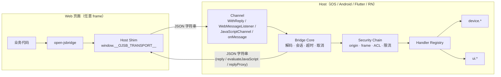
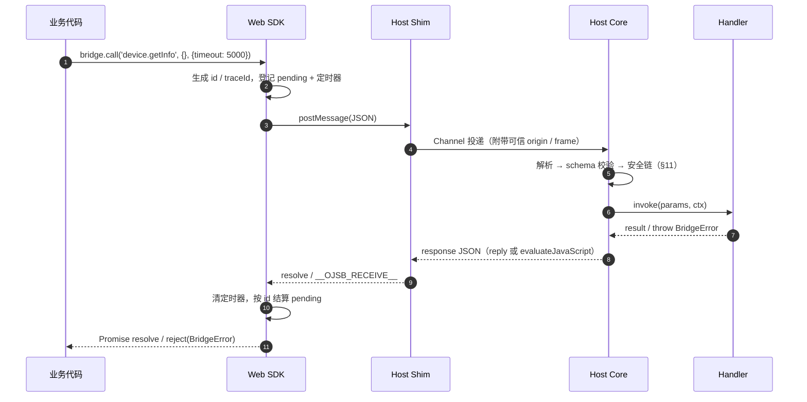
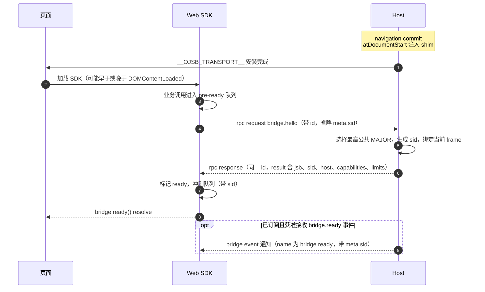
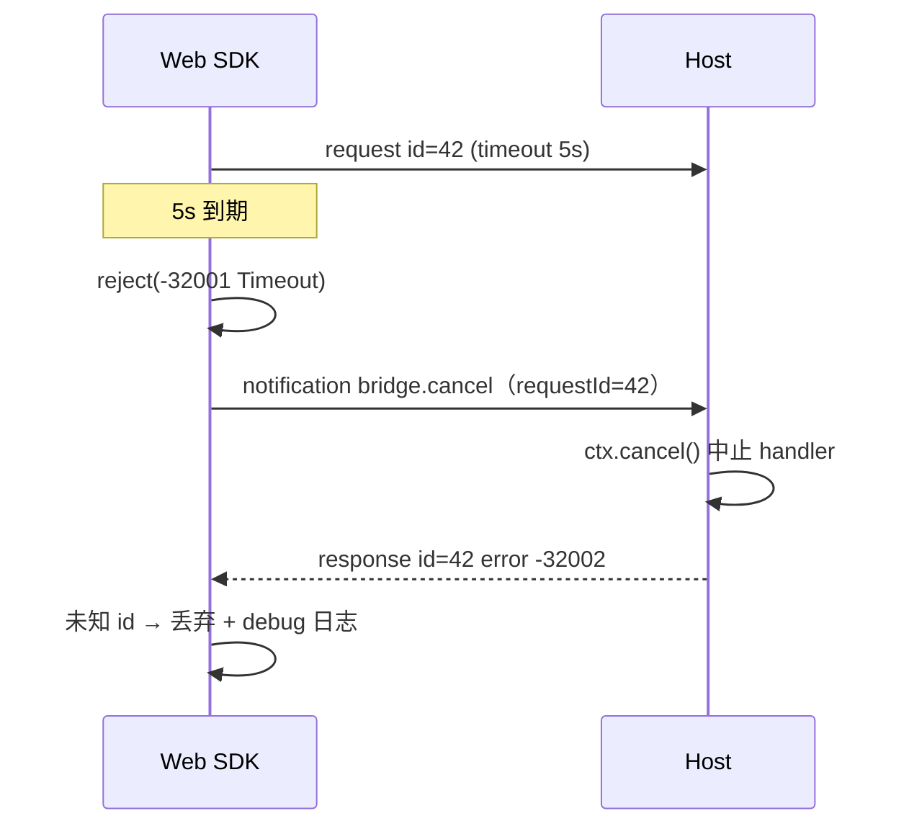
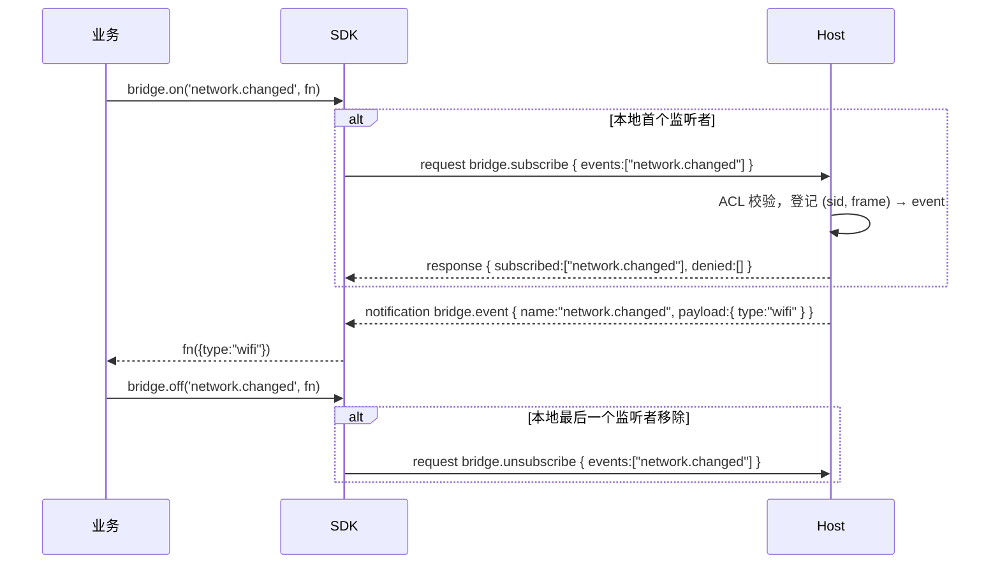
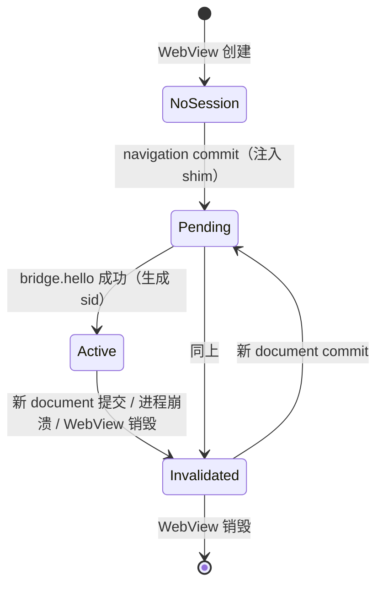

# Open JSBridge 协议规范（Draft, `jsb: 1.0`）

> 本文中的 **MUST / MUST NOT / SHOULD / SHOULD NOT / MAY** 按 RFC 2119 / RFC 8174 解释。
> 术语："**Web 端**" 指运行在 WebView 中的页面与 SDK；"**Host 端**" 指宿主实现（iOS / Android / Flutter / React Native）；"**Peer**" 泛指任意一端。

## 0. 总览



协议分三层：

1. **Transport 层**：把一个 UTF-8 JSON **字符串**从一端送到另一端。由各平台 Channel 实现（§2）。
2. **Envelope 层**：Open JSBridge 信封、JSON-RPC 2.0 请求与通知、关联 id 和错误（§3–§5）。
3. **Semantics 层**：握手、能力协商、事件、取消、大数据、安全、生命周期（§6–§13）。

---

## 1. 设计约束

1. 所有跨端调用 MUST 是异步的。实现 MUST NOT 提供依赖阻塞 JS 线程的同步 API。
2. Wire 格式 MUST 是 UTF-8 JSON 文本（一个完整 JSON object 对应一条消息）。Transport 即便支持结构化对象（如 `WKScriptMessage.body` 可传 JS 对象），参考实现也 SHOULD 统一传字符串，以保证三端解析行为一致（数字精度、`undefined`、`Date` 等边界一致）。
3. 一条消息 MUST 是一个 JSON object，包含一个 JSON-RPC 2.0 对象。v1 在信封层和 `rpc` 层均不支持批量消息。接收方 MUST NOT 依赖字段顺序。
4. 整数超出 JavaScript 安全整数范围（−(2^53−1) 至 2^53−1）时 MUST 以字符串传输。JSON 数字须能以有限值解码。
5. Web 编码器在序列化前校验整个信封的 JSON 值。对象字段必须是可枚举的字符串数据属性，数组必须稠密。遇到 JavaScript 专有值、访问器、非普通对象、自定义序列化函数或循环引用时，编码器以 `-32600` 拒绝。可选字段应直接省略。
6. Web 解码器在返回 JSON 数据前过滤任意层级的 `__proto__`、`constructor` 和 `prototype` 对象字段。

---

## 2. Host Shim 契约（Transport 层）

本节定义默认 Web SDK 的 WebView 传输绑定。采用此绑定的 Host MUST 在页面脚本执行前（或尽可能早）注入满足以下契约的 shim。SDK 只依赖这个契约。`window.webkit`、`window.ReactNativeWebView` 及各平台的通道名称由宿主适配器决定。其他传输可复用 §3 起的 wire 格式与协议语义。参见 [Native Host 最小接入要求](native-host.md)。

```ts
// Host 注入（参考实现见各平台文档）
interface OJSBTransport {
  /** 宿主标识：'ios-wk' | 'android-wml' | 'android-jsi' | 'flutter' | 'rn' | 'mock' | string */
  readonly name: string;
  /** 宿主支持的协议主版本列表，如 [1] */
  readonly protocols: readonly number[];
  /**
   * 发送一条消息（JSON 字符串）。
   * - 若通道原生支持 reply（如 WKScriptMessageHandlerWithReply），MAY 返回 Promise<string | null>。
   *   有 RPC 应答时返回 response 信封字符串。无应答时返回 null（例如 notification）。
   * - 否则返回 void，response 通过 __OJSB_RECEIVE__ 异步投递。
   */
  postMessage(message: string): void | Promise<string | null>;
}

declare global {
  interface Window {
    __OJSB_TRANSPORT__?: Readonly<OJSBTransport>;
    /** 由 SDK 定义；Host 用它把 Native→Web 消息投递进来。SDK 未加载时 Host MUST 缓冲（§12.2）。 */
    __OJSB_RECEIVE__?: (message: string) => void;
  }
}
```

规则：

- **T1** Host MUST 用 `Object.freeze` + `Object.defineProperty(..., { writable: false, configurable: false })` 安装 `__OJSB_TRANSPORT__`，防止页面脚本替换。
- **T2** shim 安装后 Host MUST 派发 `window` 上的 `CustomEvent('ojsb:transportready')`，供晚于 shim 加载的 SDK 之外的场景使用；SDK 在加载时 MUST 先同步检测 `__OJSB_TRANSPORT__` 是否已存在。
- **T3** Host 投递 Native→Web 消息时，若 `__OJSB_RECEIVE__` 尚不存在，shim MUST 在页面内缓冲（上限建议 256 条），并在 SDK 赋值 `__OJSB_RECEIVE__` 时（shim 用 setter 拦截）依序冲刷。
- **T4** 契约名中的 `__OJSB_` 前缀为保留前缀，业务 MUST NOT 使用。

---

## 3. 消息信封（Envelope）

### 3.1 结构

```jsonc
{
  "jsb": "1.0",
  "meta": {
    "sid": "a1b2c3",
    "traceId": "4bf92f3577b34da6a3ce929d0e0e4736",
    "ts": 1763880000123,
    "timeout": 10000
  },
  "rpc": {
    "jsonrpc": "2.0",
    "method": "device.getInfo",
    "id": "w-a1b2-42",
    "params": {}
  }
}
```

- v1 消息 MUST 带 `jsb: "1.0"` 和 `rpc` 对象。`rpc.jsonrpc` MUST 为 `"2.0"`。`jsb` 标识外层 OJSB 协议版本，`jsonrpc` 标识内部 RPC 格式。
- `meta` MAY 省略。若存在，MUST 为对象。`meta.sid` 若存在 MUST 为非空字符串，会话内消息始终携带它（§6.2）。`meta.timeout` 与 `meta.ts` 若存在 MUST 为非负整数，分别表示剩余超时毫秒数与发送方 epoch 毫秒时间戳（§7）。`meta.traceId` 若存在 MUST 为字符串（§14）。
- 接收方 MUST 忽略未知的信封字段与 `meta` 字段。`rpc` 及 `rpc.error` 只接受 §3.2 和 §4.1 列出的字段。实现可在校验后为内部消息设置类型标记。
- 信封 JSON Schema 位于 `spec/protocol/envelope.schema.json`。会话、权限和分派规则由运行时执行。

### 3.2 消息类型

接收方 MUST 校验 `rpc` 的字段组合来识别消息。以下各类均包含 `jsonrpc`。

| 消息 | 其余允许字段 | 规则 |
|------|------------|------|
| Request | `method`、`id`、可选 `params` | `method` 遵循 §3.4。`id` MUST 为含 1 至 128 个 Unicode 码点的字符串，`params` 若存在 MUST 为对象 |
| Notification | `method`、可选 `params` | `method` 遵循 §3.4。`params` 若存在 MUST 为对象。接收方始终不发送 RPC 应答 |
| 成功 response | `id`、`result` | `id` MUST 与 request 的字符串 `id` 相同。`result` 可为任意 JSON 值，无返回值时 MUST 发送 `result: null` |
| 错误 response | `id`、`error` | 已知 request 的字符串 `id` 时 MUST 原样回传。无法识别请求 id 时，按 §5 使用 `id: null`。`error` 遵循 §4.1 |

通知只分派给以下保留控制处理器或显式注册的通知处理器。普通 RPC handler 的注册不会启用同名通知。缺少 `id` 的消息 MUST NOT 分派给普通 RPC handler。下列控制通知 MUST 以 notification 发送。

| 控制方法 | `params` 对象 |
|----------|---------------|
| `bridge.event` | 必填 `name`（事件名）和 `payload`（任意 JSON 值），见 §9 |
| `bridge.cancel` | 必填 `requestId`（非空字符串），可选 `reason`（字符串），见 §7 |
| `bridge.progress` | 必填 `requestId`（非空字符串）和 `seq`（从 0 开始递增的非负整数），可选 `chunk`（任意 JSON 值），见 §8 |

通知处理前仍须校验会话、方向、参数和权限。接收方 MUST 丢弃未知或不允许的通知。

### 3.3 id 规则

- `rpc.id` 在一个会话（`sid`）内、同一发起方向上 MUST 唯一。握手请求的 id 在同一 document 内的握手尝试间 MUST 唯一。
- 推荐格式：`<发起方前缀><sid 片段>-<自增计数>`，如 Web 发起 `w-a1b2-42`，Host 发起 `n-a1b2-7`，避免双向 request 的 id 冲突。
- 接收方 MUST 在分派前登记请求 id，并在同一会话和方向上静默丢弃重复请求。握手请求按发起 document 去重。重复请求不得触发 handler 或产生任何 RPC 应答，以保护原调用的结算（§11.6）。

### 3.4 Method 命名

- 格式：`<namespace>.<name>`，可多级：`ui.toast.show`。正则：`^[a-z][a-zA-Z0-9]*(\.[a-z][a-zA-Z0-9]*)+$`。
- 至少两段；`name` 用 lowerCamelCase 动词开头（`getInfo`、`openUrl`）。事件名用过去式或状态描述（`app.didEnterBackground`、`network.changed`）。
- 保留命名空间（业务 MUST NOT 注册）：

| 命名空间 | 用途 |
|---------|------|
| `bridge.*` | 握手、能力、订阅、控制通知、心跳、调试 |
| `conformance.*` | 一致性测试，生产构建 MUST 关闭 |
| `ojsb.*` | 未来扩展保留 |
| `rpc.*` | JSON-RPC 保留，OJSB v1 禁止在 wire 消息中使用 |

- 标准 profile（可选实现）：`device.*`、`app.*`、`ui.*`、`storage.*`、`network.*`、`media.*`。已定义的设备和网络接口见 [原生基础能力](native-profiles.md)。系统能力的候选归属见 [原生能力目录提案](native-capability-catalog.md)。
- 厂商/业务扩展 SHOULD 使用反域名或公司前缀：`acme.pay.create`，避免与未来标准冲突。
- Method 版本在 schema 中用 `x-ojsb-version` 声明。调用 MAY 写 `device.getInfo@2`。后缀使用无前导零的十进制正整数。省略时选择 Host 声明支持的最低版本。

---

## 4. 错误

### 4.1 错误对象

`rpc.error` MUST 为对象，包含安全整数 `code`（§1）、字符串 `message` 和可选的 `data`。`data` 可为任意 JSON 值。OJSB 定义的结构化错误可用以下形式。

```jsonc
{
  "code": -32003,                 // MUST，整数
  "message": "Permission denied", // MUST，面向开发者的简短英文描述，不得用于逻辑判断
  "data": {                       // MAY
    "reason": "origin_not_allowed",   // 机器可读子原因，snake_case
    "retryable": false,               // 调用方是否可以重试
    "method": "device.getInfo",
    "detail": { }                     // 任意补充信息，MUST NOT 含敏感数据
  }
}
```

### 4.2 错误码表

**协议标准码（与 JSON-RPC 2.0 对齐）**

| code | 名称 | 触发条件 |
|------|------|---------|
| -32700 | Parse error | 消息不是合法 JSON |
| -32600 | Invalid request | 信封或 RPC 字段组合不符合规范，如收到批量消息或使用 `rpc.*` 方法 |
| -32601 | Method not found | method 未注册，或该版本不支持 |
| -32602 | Invalid params | params 不符合 method schema |
| -32603 | Internal error | handler 抛出未分类异常 |

**Bridge 保留码（-32000 ~ -32099）**

| code | 名称 | 说明 | retryable |
|------|------|------|-----------|
| -32000 | Bridge unavailable | 不在宿主中 / 通道不存在（SDK 本地产生） | 否 |
| -32001 | Timeout | 超过 deadline（通常由调用方本地产生） | 视 method |
| -32002 | Cancelled | 被 `bridge.cancel` 或页面卸载终止 | 否 |
| -32003 | Permission denied | origin / frame / ACL 校验失败 | 否 |
| -32004 | Unsupported protocol | shim 或握手通告的协议主版本无交集 | 否 |
| -32005 | Not ready | 握手未完成且未入队（如队列溢出） | 是 |
| -32006 | Payload too large | 超过单消息上限（§10） | 否 |
| -32007 | User denied | 用户拒绝系统授权 / 弹窗 | 否 |
| -32008 | Rate limited | 触发限流 | 是 |
| -32009 | Session expired | 迟到消息属于已失效会话（§12） | 否 |
| -32010 | Busy | 该 method 不可并发且已有调用在进行 | 是 |
| -32011 ~ -32099 | 保留 | 未来协议使用 | — |

**业务码段**

| 范围 | 归属 |
|------|------|
| 1 ~ 9999 | 标准 profile（`device.*` 用 1000–1999，`ui.*` 2000–2999，`storage.*` 3000–3999，`network.*` 4000–4999，`media.*` 5000–5999 …），在 `spec/protocol/errors.json` 注册 |
| 10000 ~ 99999 | 厂商/业务自定义，SHOULD 在各自 method schema 的 `x-ojsb-errors` 中声明 |
| 其它（含负数非保留区间） | MUST NOT 使用 |

调用方 MUST 依据 `code` 做逻辑判断。结构化 `data` 可用 `reason` 细分错误。`message` 只用于日志。

---

## 5. Request / Response 时序



- 对可安全回复的非重复 request，接收方 MUST 恰好产生一个关联 response。handler 抛出未分类异常使用 `-32603`，method 不存在使用 `-32601`，method 参数校验失败使用 `-32602`，权限拒绝使用 `-32003`。
- 接收方可针对无法解析的 JSON 发送 `-32700`，针对结构非法且无法分派的请求发送 `-32600`。能识别有效请求 id 时原样回传，否则使用 `rpc.id: null`。若该 id 已登记，按 §3.3 丢弃。只有能确认返回路由符合会话和 document 投递规则（H6、F3、L2）时才可应答。无法安全投递时丢弃并记录。批量消息被整体拒绝，MUST NOT 分派其中任何元素。
- 接收方 MUST NOT 回复合法 notification 或 response。无法通过校验的 response MUST 丢弃。调用方只以当前关联中的字符串 `rpc.id` 结算 pending。未知 id、`rpc.id: null` 和不匹配当前会话的 response MUST 丢弃，可记录诊断日志。

---

## 6. 握手与能力协商

### 6.1 流程



### 6.2 `bridge.hello`

`spec/methods/bridge/hello.json` 定义握手请求参数与成功结果。`rpc.params.protocols` MUST 为包含至少一个元素的数组，元素为互不重复的正安全整数。示例中的 `sdk` 和 `wants` 均可省略。

```jsonc
{
  "protocols": [1],                              // SDK 支持的主版本
  "sdk": { "name": "open-jsbridge", "version": "1.2.0" },
  "wants": ["events", "callbacks", "blob"]        // MAY，SDK 希望使用的可选特性
}
```

成功响应的 `rpc.result` 如下。

```jsonc
{
  "jsb": "1.0",                    // 协商后的协议版本
  "sid": "a1b2c3d4",               // 非空会话 id，此后的会话消息在 meta.sid 中携带
  "host": { "platform": "ios", "name": "ios-wk", "version": "1.0.3", "appId": "com.acme.app", "appVersion": "8.2.0" },
  "capabilities": {
    "methods": {                   // 当前 origin + frame 在 ACL 过滤后 *可调用* 的 method
      "device.getInfo": { "versions": [1, 2] },
      "ui.toast.show":  { "versions": [1] }
    },
    "events": ["app.didEnterBackground", "network.changed"],
    "features": ["callbacks", "cancel", "blob"]
  },
  "limits": { "maxMessageBytes": 1048576, "maxInflight": 64, "defaultTimeoutMs": 15000 }
}
```

规则：

- **H1** `bridge.hello` 通告的协议主版本与 Host 无交集时，Host MUST 返回 `-32004`，并以 `data.supported` 给出自身支持的主版本。shim 通告无交集时 SDK 可在本地判定 `-32004`。SDK 遇到协议不兼容 MUST 进入降级模式（§6.4）。外层 `jsb` 字段的形状校验见 §3.1，违反该约束属于 `-32600`。
- **H2** `capabilities.methods` MUST 是**经过 ACL 过滤后的结果**，不向不受信 origin 泄露完整能力清单。
- **H3** 同一 document 的有效会话内重复 `bridge.hello` 时，Host MUST 返回同一 `sid`（幂等）。会话已失效时，握手 MUST 重新校验调用者并分配新的 `sid`。
- **H4** Host MUST 先校验调用者的 origin、frame 和通道策略。`bridge.hello` 是唯一允许在没有有效会话时执行的 request。调用者校验通过后，无 `sid` 且尚未握手的 request 使用 `-32005`。其余缺少有效匹配 `sid` 的 request 使用 `-32009`。调用者被策略拒绝时使用 `-32003`，校验意外异常按 §11.3 处理。Host 仅在满足 H6、F3 和 L2 时发送错误响应，其余情况记录错误并丢弃消息。
- **H5** `bridge.getCapabilities` MAY 在有效会话内调用以刷新能力（例如登录后 ACL 变化）；Host 能力变化时 SHOULD 发送 `bridge.capabilitiesChanged` 事件。
- **H6** 仅 `bridge.hello` request 及其关联的握手 response 可省略 `meta.sid`。Host MUST 对携带 `meta.sid` 的入站消息校验 WebView、frame 和 document 绑定。Web MUST 在分派会话内消息前校验 `meta.sid` 与当前有效会话一致。SDK 建立或重建会话时，只允许当前尚未结算的 `bridge.hello` 的关联 response 进入握手流程。成功响应 MUST 包含有效的协商版本和非空 `rpc.result.sid`。成功响应若携带 `meta.sid`，其值 MUST 等于 `rpc.result.sid`。握手失败的 response 也可省略 `meta.sid`。握手过期、被取消或被替换后，SDK MUST 丢弃其迟到响应。

### 6.3 SDK 侧握手超时

- SDK 检测不到 `__OJSB_TRANSPORT__` 时，SHOULD 监听 `ojsb:transportready` 至多 `handshakeTimeout`（默认 3000 ms），之后判定为"不在宿主中"。
- `bridge.hello` 本身超时（默认 3000 ms）MAY 用新请求 ID 重试一次。Web SDK 自动重试一次，两次都超时则 `ready()` 返回 `-32001`。格式有效但语义非法的成功响应立即以 `-32600` 结束本次握手，同一个 ID 的后续响应不再处理。

### 6.4 降级

| 情况 | SDK 行为 |
|------|---------|
| 不在宿主（普通浏览器） | 使用 `BrowserFallbackAdapter`：`has()` 恒为 false（除非注册了 Web 实现的 polyfill），`call()` reject `-32000` |
| 协议版本不兼容 | 同上，`ready()` reject `-32004` |
| method 不在 capabilities | `call()` 本地直接 reject `-32601`，不发送到 Host |
| method 版本不支持 | 本地 reject `-32601`，`data.reason = "version_unsupported"` |

业务 SHOULD 用 `bridge.has('x.y')` 做特性检测，而不是解析 App 版本号。

---

## 7. 超时与取消

- **D1** 每个 request MUST 有 deadline。SDK 默认值取 `limits.defaultTimeoutMs`（握手前用 15000），业务可在调用时覆盖；`timeout: 0` 表示不超时，仅允许 schema 中声明 `x-ojsb-long-running: true` 的 method（如等待用户操作的选择器）。
- **D2** 调用方超时时 MUST 本地 reject `-32001`。请求已经发出、原会话仍有效且被调方在该会话声明 `cancel` 能力时，调用方 SHOULD 在该会话发送 `bridge.cancel` 通知，让被调方释放资源。等待握手时也计入调用超时。
- **D3** 被调方 SHOULD 读取 `meta.timeout` + `meta.ts`，在明显超时后放弃执行（注意两端时钟不一致，只作提示）。
- **D4** 取消通知用 `params.requestId` 关联被取消的请求。

```jsonc
{
  "jsb": "1.0",
  "meta": { "sid": "a1b2c3d4" },
  "rpc": { "jsonrpc": "2.0", "method": "bridge.cancel", "params": { "requestId": "w-a1b2-42", "reason": "abort" } }
}
```

  被调方收到后 SHOULD 中止同一会话、同一发起方向的 handler（通过 ctx 的取消信号），并 MUST 以 `-32002` 结束尚未完成的原 request。调用方已在本地 reject，因此随后收到的原 request response 会按未知 id 丢弃。`bridge.cancel` 本身无需应答。
- **D5** Web 端通过 `AbortSignal` 暴露取消（见 web-sdk.md）。超时或取消发生在发送前时，SDK MUST 使排队项失效，MUST NOT 发送该 request 或对应的 `bridge.cancel`。冲刷队列时须再次确认请求未超时、未取消。有 deadline 的请求使用剩余时长作为 `meta.timeout`，无 deadline 的长任务仍使用 `0`。



---

## 8. 流式回调（callback）

适用于进度、连续结果（扫码、定位持续更新、下载进度）。

- 被调方在最终 response 之前 MAY 发送任意条 `bridge.progress` 通知。`params.requestId` 对应原请求的 `rpc.id`，`params.seq` 从 0 严格递增，`params.chunk` 可携带进度或中间结果。
- 调用方 MUST 只在匹配会话和未结算请求时分派进度，按 `params.seq` 处理。收到乱序或重复进度时 SHOULD 丢弃旧序号。
- 方法 schema 声明 `x-ojsb-callbacks` 时才允许发送进度通知。最终结果 MUST 以原请求的一条 response 结束。
- 每条已分派的进度通知 SHOULD 重置调用方的 idle 定时器（可选特性 `idleTimeout`）。

---

## 9. 事件（Native → Web 推送）

### 9.1 订阅模型

事件采用**显式订阅**，避免 Host 向不关心或无权限的页面推送：



宿主在握手的 `capabilities.events` 声明当前页面可请求订阅的事件。SDK 使用带请求 ID 的 `bridge.subscribe` 和 `bridge.unsubscribe`，宿主按当前会话执行这两个控制方法。 对同一会话中的同一事件，宿主 MUST 按控制请求的到达顺序更新订阅，并在更新后应答。

- 两个请求的 `params.events` 都是非空、无重复的事件名列表。事件名至少两段，例如 `network.changed` 或 `acme.pay.orderChanged`。 保留 `rpc.*`。
- `bridge.subscribe` 返回 `{ subscribed, denied }`。请求中的每个事件名恰好出现在其中一个列表。
- `bridge.unsubscribe` 返回 `{ unsubscribed }`。它确认请求的各个事件已处于退订状态，包括原先就未订阅的事件。

订阅和退订的报文结构见 [subscribe Schema](../spec/methods/bridge/subscribe.json) 和 [unsubscribe Schema](../spec/methods/bridge/unsubscribe.json)。

规则：

- **E1** Host MUST 只向订阅了该事件且通过 ACL 的 (sid, frame) 推送。
- **E2** 事件 MUST NOT 依赖投递保证：document 卸载、WebView 不可见时可能丢失。需要可靠性的场景 MUST 用 request 拉取当前状态（"事件提示 + 拉取真相"模式），例如订阅 `auth.changed` 后调用 `auth.getState`。
- **E3** 页面内 SDK MUST 做本地多路复用：同一事件只向 Host 订阅一次，引用计数归零再退订。
- **E4** Host MAY 对高频事件做合并/节流，schema 中以 `x-ojsb-throttle-ms` 声明。
- **E5** 双向事件统一用 `bridge.event` 通知传输。事件名由 `rpc.params.name` 指定，事件数据由 `rpc.params.payload` 携带。Host 对未注册的 Web → Host 事件 MUST 静默丢弃。

### 9.2 Host → Web 的 request（反向调用）

Host 可调用 Web 侧通过 `bridge.handle('page.getShareInfo', fn)` 注册的 handler。SDK 在握手时通过 `bridge.hello` 的 `wants` 带上 `"reverse"`，并在注册/注销时调用 `bridge.registerWebMethods` 告知 Host。Web 侧未注册时 SDK MUST 应答 `-32601`。

---

## 10. 二进制与大数据传输

所有通道都基于字符串，且大字符串会在 JS 引擎与 Native 间复制，对内存与主线程都有压力。规范按大小分三档：

| 档位 | 大小（UTF-8 编码后的消息） | 策略 |
|------|------------------------|------|
| Inline | ≤ 256 KB（SHOULD） | 直接放在 params/result；二进制用 base64 字符串，字段名后缀 `Base64`（如 `imageBase64`） |
| Chunked | 256 KB ~ `limits.maxMessageBytes` 以上、无本地资源 URL 能力时 | 使用 `bridge.blob.*` 分片（见下） |
| URL 引用 | 大文件、媒体 | Host 返回 **本地资源 URL**，Web 直接 `fetch()` / `` |

### 10.1 URL 引用（推荐）

- Host 返回 `{ "blob": { "url": "<scheme>://blob/<token>", "mime": "image/jpeg", "size": 2345678, "expiresAt": 1763880600000 } }`。
- iOS：`WKURLSchemeHandler` 注册自定义 scheme（如 `ojsb-blob://`）。注意自定义 scheme 与页面 origin 不同，`fetch` 会受 CORS 约束，handler MUST 返回 `Access-Control-Allow-Origin: <页面 origin>`。
- Android：`shouldInterceptRequest` 或 `androidx.webkit.WebViewAssetLoader` 风格，在页面同源下挂一个虚拟路径（如 `https://<page-host>/__ojsb__/blob/<token>`）返回数据，可规避跨源问题；或使用 `https://appassets.androidplatform.net` 一类专用域。
- token MUST 不可猜测（≥128 bit 随机）、一次性或短时有效（默认 ≤ 10 分钟）、绑定 sid；会话失效时 MUST 释放。
- Web → Host 上传大数据：优先让 Host 提供上传 URL（`bridge.blob.createUpload` 返回一个 Host 拦截的 URL，Web 用 `fetch(url, {method:'PUT', body})`）。注意：部分 WebView 的请求拦截 API 拿不到请求体，此时退回分片方案；具体能力以 Host 在 `features` 中是否广告 `blob.upload` 为准。

### 10.2 分片（兜底）

```
bridge.blob.open   { mime, size, direction: "upload" }        → { blobId, chunkSize }
bridge.blob.write  { blobId, index, dataBase64 }              → { }
bridge.blob.close  { blobId, sha256? }                        → { blobRef }
bridge.blob.read   { blobRef, index }                         → { dataBase64, done }
bridge.blob.release{ blobRef }                                → { }
```

- 业务 method 参数中以 `{ "$blobRef": "..." }` 引用已上传对象。
- 并发分片数 SHOULD ≤ 4，Host MUST 对 blob 总量设上限并在会话结束时回收。

### 10.3 上限

- `limits.maxMessageBytes` 按 UTF-8 编码后的完整消息计算。Web SDK 在建立会话前使用 1 MiB 的入站帧上限。接收方 MUST 在解析前丢弃超限帧，以免读取无法安全关联的请求或通知 id。需要传输层回执时返回 `null`。
- SDK SHOULD 在发送前检查大小并以 `-32006` 本地结算超限请求。若已校验的请求产生超限结果，Host MUST 用同一请求 id 返回 `-32006` 错误响应。

---

## 11. 权限与安全

### 11.1 威胁模型

| 威胁 | 示例 | 对策 |
|------|------|------|
| 不受信页面调用敏感能力 | WebView 被重定向到第三方页面 / 广告落地页 | origin 白名单 + method ACL（11.2/11.3） |
| 第三方 iframe | 嵌入的广告、评论组件 | 默认只允许 main frame；iframe 单独授权（11.4） |
| 伪造来源 | payload 里写 `"origin": "https://trusted.com"` | origin 只取 Native 从 WebView 获得的值（11.2） |
| 导航后迟到响应 | A 页面的结果被投递到 B 页面 | sid 绑定 document，导航即失效（§12） |
| 替换 bridge 对象 | 页面脚本覆写 `__OJSB_TRANSPORT__` 劫持调用 | freeze + non-configurable（T1）；iOS 可将 shim 放在隔离 content world（见 native-ios.md） |
| 注入 | Host 拼接 JS 字符串推送数据 | 推送 MUST 用 JSON 序列化后作为字符串字面量传入（11.5） |
| 滥用/DoS | 高频调用、超大消息 | 限流 + maxInflight + maxMessageBytes |

> 范围说明：同一 origin 下的页面脚本（含 XSS）与 SDK 处于同一信任域，协议层无法区分"合法业务代码"与"XSS 注入的代码"。防御 XSS 属于 Web 安全（CSP 等）的职责；协议能做的是把能力最小化到 origin + frame + method 级别。

### 11.2 Origin 获取与校验

- **S1** Host MUST 从平台提供的可信来源获取调用者 origin：iOS `WKScriptMessage.frameInfo.securityOrigin`；Android `WebMessageListener` 回调的 `sourceOrigin`；Flutter / React Native 见 flutter.md、react-native.md（多数情况下拿不到可信 frame origin，按 S2 处理）。payload 中的任何 origin/url 字段 MUST 被忽略。
- **S2** 当通道缺少可信 origin 或 frame 信息时，Host MUST 默认禁用该通道。只有宿主能够独立约束可达内容、确认其满足调用来源与 frame 策略并显式启用时，才 MAY 建立 `trust: "degraded"` 会话。此类会话只允许 ACL 中标注 `allowDegraded: true` 的 method。顶层 URL 和页面自报字段不能充当消息来源或主 frame 的证明。
- **S3** origin 匹配 MUST 是 `scheme://host[:port]` 的精确匹配或受限通配（仅允许最左子域 `https://*.example.com`），MUST NOT 用前缀/子串匹配（防 `https://example.com.evil.io`）。
- **S4** `http:` origin 默认 MUST 被拒绝，除非 debug 构建显式开启。`file:`、`data:`、`about:blank`、opaque origin（`null`）默认 MUST 被拒绝。

### 11.3 Method 级 ACL

配置示例（三端共用同一格式，可随 App 下发、也可内置）：

```jsonc
{
  "version": 1,
  "rules": [
    {
      "origins": ["https://m.acme.com", "https://*.acme.com"],
      "frames": "main",                     // main | any
      "allow": ["device.*", "ui.*", "acme.pay.*"],
      "deny":  ["acme.pay.refund"]
    },
    {
      "origins": ["https://partner.example.org"],
      "frames": "any",
      "allow": ["ui.toast.show", "app.getInfo"],
      "rateLimit": { "perSecond": 10 }
    }
  ],
  "default": "deny"
}
```

- 求值顺序：`deny` 优先于 `allow`；未命中任何规则 → `default`（MUST 为 `deny`）。
- 任何权限规则拒绝或抛出异常时，Host MUST 停止处理且不得调用 handler。可安全回复的 request 遇到意外校验异常时使用 `-32603`，错误中不得包含内部异常细节。
- `bridge.hello` 通过调用者校验后可在无会话时执行。其他保留 method 须匹配当前会话并实施各自的权限检查，例如 `bridge.subscribe` 须校验事件 ACL。平台支持按 origin 限制注入时，Host SHOULD 不向白名单外的 origin 注入 shim。
- Handler MAY 声明 `requiresUserGesture` / `requiresPermission`（系统权限），在安全链中统一检查。

### 11.4 iframe

- **F1** 默认仅 main frame 可用（`frames: "main"`）。
- **F2** 允许 iframe 时，每个 frame 独立握手、独立 sid、独立 ACL 评估（按该 frame 自己的 origin）。
- **F3** Host → Web 的消息 MUST 定向投递到对应的 frame 与 document。响应对应请求来源，事件对应每个获准订阅的目标。Host MUST NOT 广播到主 frame 再由页面转发。
- **F4** 页面内用 `window.postMessage` 在 frame 间转发 bridge 调用的"代理模式"MUST NOT 被参考实现采用（会使 origin 校验失效）。
- **F5** Host 只有在能够可信识别发起 frame、将会话绑定到该 frame 的 document、按 L1/L2 失效和隔离投递时，才 MAY 开启并声明 `iframe` 能力。其余宿主只接受可信主 frame，或遵循 S2 的受控降级条件。`frames: "any"` 规则不能启用平台尚未提供的能力。

### 11.5 Host→Web 推送的注入安全

使用 evaluateJavaScript 类 API 时，Host MUST 先把信封序列化为 JSON 字符串，再把**这个字符串作为 JS 字符串字面量**再编码一次：

```
window.__OJSB_RECEIVE__ && window.__OJSB_RECEIVE__(<JSON.stringify(envelopeJsonString)>)
```

即两次编码：第一次得到信封文本，第二次把信封文本编码为安全的 JS 字符串字面量（转义 `"`、`\`、换行、`\u2028`、`\u2029`）。MUST NOT 把业务数据直接拼到 JS 源码中。

### 11.6 防重放与完整性

- 同一 sid 内静默丢弃重复 request（§3.3）。sid 在导航时失效（§12），迟到或重放的旧会话消息按 H4 和 H6 拒绝。旧会话的响应不得投递到新 document。
- 协议 **不**引入签名/HMAC：注入页面的任何密钥同样可被同源脚本读取，签名无法提供额外保证，反而带来"已安全"的错觉。对需要更强保证的业务（支付），应由业务服务端做票据校验，bridge 只负责传递。

### 11.7 敏感数据

- 日志 MUST 默认脱敏 params/result（只记录 method、id、耗时、错误码），schema 中 `x-ojsb-sensitive: true` 的字段在 debug 日志中也 MUST 掩码。

---

## 12. 生命周期

### 12.1 会话（sid）与 document 绑定



- **L1** 一个 sid 绑定一个 (WebView, frame, document)。Host MUST 在 frame 发生新 document 提交时使旧 sid 失效。
- **L2** sid 失效时，Host MUST 取消该 sid 下进行中的 handler 和反向请求、清理事件订阅、释放 blob，并丢弃该 sid 下所有待发送消息。
- 使用脚本执行等下行方式时，Host MUST 在目标 document 内执行消息交付前确认身份，或使用由平台绑定到该 document 的通道。仅在入队时检查、等待 TTL 回收或依靠 SDK 收到后丢弃，均不能保证旧消息不进入新 document。无法保证时，Host MUST 关闭对应的下行能力。
- **L3** 同 document 内的 History API 路由（SPA `pushState`）**不**改变 sid。
- **L4** Web 侧在 `pagehide` 时 MUST 清除当前接收会话和握手尝试，并 SHOULD 将所有 pending reject `-32002`。旧会话声明 `cancel` 时，SDK 尽力用旧 `sid` 向已发送的请求投递 `bridge.cancel`，随后解除传输绑定。仍在排队的请求在本地取消。bfcache 恢复（`pageshow` 且 `persisted === true`）时 SDK MUST 重新握手（Host 可能已使会话失效）。在新握手成功前按 H6 拒绝分派会话消息。
- **L5** WebView 渲染进程崩溃（iOS `webViewWebContentProcessDidTerminate`、Android `onRenderProcessGone`）MUST 视同 sid 失效。

### 12.2 WebView 复用 / 预热

- 预热池中的 WebView 在被业务取用并加载新 URL 时，必然产生新 document → 新 sid；Host MUST 在"归还池子"时清理 handler 上下文中保存的页面相关状态。
- 预加载 SDK 的空白页（如 `about:blank` 预热）不应开放能力（S4）。

### 12.3 多 WebView

- Handler Registry MAY 全局共享（无状态 handler），但 **会话、订阅、pending、ACL 结果 MUST 按 WebView 实例隔离**。
- 需要"推送给所有页面"的事件由 Host 侧事件总线分发到每个 WebView 的 bridge 实例，各自按订阅过滤。

---

## 13. 并发与顺序

- 同一通道上同一方向的消息 MUST 按发送顺序到达（各平台通道都满足）。
- 不同 request 之间无顺序保证：Host MAY 并发执行 handler，响应可乱序。
- schema 中 `x-ojsb-concurrency: "serial"` 的 method，Host MUST 串行执行，或在已有调用时返回 `-32010`（由 `x-ojsb-concurrency-policy: queue | reject` 决定）。
- `limits.maxInflight` 超限时 SDK SHOULD 本地排队，Host MUST 返回 `-32008`。

---

## 14. 可观测性

### 14.1 Trace

- `meta.traceId` 为可选字符串，SHOULD 使用与 W3C Trace Context 兼容的 32 位十六进制 trace-id。SDK 允许业务传入现有 traceId，便于关联前端请求、bridge 调用和 Native 网络请求。
- Host 在 handler 内发起的网络请求 SHOULD 透传该 traceId（如 `traceparent` header）。

### 14.2 统一日志字段

| 字段 | 说明 |
|------|------|
| `side` | `web` / `host` |
| `platform` | `ios` / `android` / `flutter` / `rn` / `browser` |
| `sid`, `id`, `traceId` | 关联字段 |
| `type`, `method` | 解析后确定的日志消息类型、RPC 方法 |
| `phase` | `send` / `recv` / `dispatch` / `done` / `drop` |
| `code` | 错误码（如有） |
| `durMs` | 耗时 |
| `bytes` | 消息大小 |

### 14.3 性能埋点

每次调用 SDK 计算并通过 `onMetric` 钩子暴露：

```
t0 SDK 发送  →  t1 Host 收到  →  t2 handler 开始  →  t3 handler 结束  →  t4 SDK 收到
```

Host 在 response 的 `meta.timing = { recv: t1, start: t2, end: t3 }` 中回带自己的时间戳（Host 时钟）。由于两端时钟可能有偏差，跨端只比较**同一端内**的差值：`roundTrip = t4 - t0`（Web 时钟）、`handler = t3 - t2`（Host 时钟）、`overhead ≈ roundTrip - handler`。

### 14.4 调试

- `bridge.debug.setLogLevel` / `bridge.debug.dump`（只在 debug 构建可用）。
- SDK 提供 `devtools` 包：浮层展示每条消息、耗时、错误。

---

## 15. 兼容性与版本演进

| 变更类型 | 允许在 | 要求 |
|---------|-------|------|
| 新增 `meta` 字段、新增可选外层信封字段 | MINOR | 接收方必须忽略未知字段（§3.1） |
| 变更 `rpc` 消息结构 | MAJOR | 旧实现按原有字段组合校验（§3.2） |
| 新增错误码（保留段内） | MINOR | 调用方对未知码按 `-32603` 处理 |
| 新增 `bridge.*` method / feature | MINOR | 通过 `features` 广告 |
| 改变已有字段语义或删除字段 | MAJOR | 握手协商，旧 MAJOR 至少维护 12 个月 |
| method 新增可选 param / result 字段 | 不升 method 版本 | 调用方必须容忍多余字段 |
| method 删除字段 / 改语义 / 新增必填 param | method 版本 +1 | 旧版本继续广告直到 deprecated 期结束 |

- **废弃流程**：schema 中标 `deprecated: true` + `x-ojsb-sunset: "2027-12-31"`；SDK 在 debug 模式调用废弃 method 时输出警告。
- **Host 广告多版本**：`"device.getInfo": { "versions": [1, 2] }`，调用方显式 `@2` 才使用新版本。

---

## 附录 A：完整消息示例

```jsonc
// Web → Host hello request
{"jsb":"1.0","rpc":{"jsonrpc":"2.0","id":"w-hello-1","method":"bridge.hello","params":{"protocols":[1],"sdk":{"name":"open-jsbridge","version":"1.2.0"}}}}
// Host → Web hello response
{"jsb":"1.0","rpc":{"jsonrpc":"2.0","id":"w-hello-1","result":{"jsb":"1.0","sid":"a1b2c3d4","host":{"platform":"ios","name":"ios-wk","version":"1.0.3","appId":"com.acme.app","appVersion":"8.2.0"},"capabilities":{"methods":{"media.chooseImage":{"versions":[1]}},"events":["app.didEnterBackground"],"features":["callbacks","cancel","blob"]},"limits":{"maxMessageBytes":1048576,"maxInflight":64,"defaultTimeoutMs":15000}}}}
// Web → Host request
{"jsb":"1.0","meta":{"sid":"a1b2c3d4","traceId":"4bf92f3577b34da6a3ce929d0e0e4736","ts":1763880000123,"timeout":0},"rpc":{"jsonrpc":"2.0","id":"w-a1b2-7","method":"media.chooseImage","params":{"count":3}}}
// Host → Web 进度通知
{"jsb":"1.0","meta":{"sid":"a1b2c3d4"},"rpc":{"jsonrpc":"2.0","method":"bridge.progress","params":{"requestId":"w-a1b2-7","seq":0,"chunk":{"selected":1}}}}
// Host → Web response
{"jsb":"1.0","meta":{"sid":"a1b2c3d4","timing":{"recv":1763880000130,"start":1763880000131,"end":1763880004410}},"rpc":{"jsonrpc":"2.0","id":"w-a1b2-7","result":{"images":[{"blob":{"url":"ojsb-blob://blob/9f1c...","mime":"image/jpeg","size":823412}}]}}}
// Host → Web 事件通知
{"jsb":"1.0","meta":{"sid":"a1b2c3d4"},"rpc":{"jsonrpc":"2.0","method":"bridge.event","params":{"name":"app.didEnterBackground","payload":null}}}
// 错误响应
{"jsb":"1.0","meta":{"sid":"a1b2c3d4"},"rpc":{"jsonrpc":"2.0","id":"w-a1b2-8","error":{"code":-32003,"message":"Permission denied","data":{"reason":"frame_not_allowed","retryable":false,"method":"acme.pay.create"}}}}
// 无可识别的请求 id，且能安全投递到当前会话时的解析错误
{"jsb":"1.0","meta":{"sid":"a1b2c3d4"},"rpc":{"jsonrpc":"2.0","id":null,"error":{"code":-32700,"message":"Parse error"}}}
```

## 附录 B：机器可读规范

- 信封与内部 RPC 形状。[envelope.schema.json](../spec/protocol/envelope.schema.json)
- 协议错误码注册表。[errors.json](../spec/protocol/errors.json)
- `bridge.hello` 的请求参数和成功结果。[hello.json](../spec/methods/bridge/hello.json)
- 跨实现复用的 wire 正反例。[wire.json](../conformance-tests/fixtures/wire.json)
