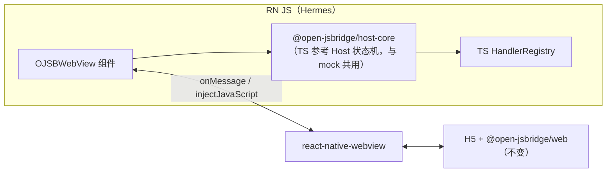

# React Native 宿主实现（`@open-jsbridge/react-native`）

> RN 在这里是 **WebView 宿主端**：RN App 用 `react-native-webview` 加载 H5，H5 使用**同一份** `@open-jsbridge/web`，**Web SDK 不做任何修改**。RN 侧实现 Host 职责并注入满足 [Host Shim 契约](protocol.md#2-host-shim-契约transport-层) 的 shim。
>
> `react-native-webview` 的 prop / 方法名以接入时所用版本的文档为准；文中"需核实"的点必须在实现前用 conformance 用例实测。

## 1. 可用的 `react-native-webview` 能力

| 需求 | 能力 | 备注 |
|------|------|------|
| document-start 注入 shim | `injectedJavaScriptBeforeContentLoaded` | 另有 main-frame-only 相关 prop（`injectedJavaScriptBeforeContentLoadedForMainFrameOnly` 等，平台支持范围需核实） |
| Web→RN | 页面 `window.ReactNativeWebView.postMessage(string)` → `onMessage(event)`，`event.nativeEvent.data` 为字符串 | 只传字符串；无返回值 |
| RN→Web | `ref.injectJavaScript(js)`；或 `ref.postMessage(string)` | `postMessage` 在页面侧派发 `message` 事件的目标对象（`window` / `document`）在不同平台/版本上有差异，**参考实现统一用 `injectJavaScript` 调用 `__OJSB_RECEIVE__`** |
| 导航控制 | `originWhitelist`、`onShouldStartLoadWithRequest` | `originWhitelist` 控制的是"允许在 WebView 内加载的 URL"，**不是**消息来源校验 |
| 生命周期 | `onLoadStart`、`onContentProcessDidTerminate`（iOS）、`onRenderProcessGone`（Android） | 用于会话失效 |

关键限制：`onMessage` 事件里的 `nativeEvent.url` 是 WebView 当前（主 frame）URL，**不能证明消息来自哪个 frame / origin**。因此基于 `react-native-webview` 的纯 JS 宿主，会话 trust 为 `degraded`（protocol S2），除非能从原生层拿到可信来源。

## 2. 架构方案：纯 TS 宿主 vs TurboModule/JSI 复用原生层

### 方案 A：纯 JS/TS 宿主（**推荐默认**）



- Host 核心是一个 TS 包 `@open-jsbridge/host-core`，**与 `@open-jsbridge/mock` 共用同一个参考 Host 状态机**（mock 只是把 transport 换成页面内对象）。这样 RN 宿主几乎零额外协议代码，且天然通过 conformance。
- 优点：不改原生代码、可 OTA 更新 handler、与 `react-native-webview` 全部能力兼容、Expo 等托管工作流也能用。
- 缺点：trust = degraded（拿不到可信 frame origin）；消息要经过原生 WebView → RN 事件 → JS 线程，JS 线程繁忙时 bridge 延迟会上升；大数据只能走 base64 / 分片，或额外借助原生模块提供本地 URL。

### 方案 B：新架构 TurboModule / JSI 复用原生 OJSB

- 原生 OJSB（iOS/Android 实现层）直接挂在原生 WebView 上；RN 通过 **TurboModule**（Codegen 生成的类型化接口，JSI 直接调用）注册 handler、接收调用、推送事件。
- 需要控制**原生 WebView 实例**：要么写一个自己的 Fabric native component（内部创建并配置原生 WebView + 原生 OJSB），要么 patch / fork `react-native-webview` 以暴露配置钩子。两者都需要长期维护原生代码。
- 优点：trust = full（WKScriptMessage.frameInfo / WebMessageListener sourceOrigin）、iframe 支持、`WKURLSchemeHandler` / `shouldInterceptRequest` 大数据通道、协议行为与原生端同一份代码；原生 handler 可直接复用，JS handler 也可通过 TurboModule 回调注册。
- 缺点：失去纯 JS 方案的 OTA 和托管工作流便利；要跟随 RN 新架构与 WebView 组件的版本演进；自研 WebView 组件需补齐 cookie、下载、文件上传等能力。

### 推荐

- **默认方案 A**：大多数 RN App 的 H5 来自自家受控域名，在"导航守卫 + main frame only + method ACL 标注 `allowDegraded`"的约束下，安全与能力是够用的。
- 以下任一条件成立时选**方案 B**：需要开放支付/账号等高敏感能力给 H5；必须支持第三方 iframe；需要大文件本地 URL；App 已有大量原生 OJSB handler（混合工程）。
- 两个方案对 H5 完全透明（同一 shim 契约），可以先 A 后 B 平滑迁移。

## 3. Shim（方案 A）

通过 `injectedJavaScriptBeforeContentLoaded` 注入：

```ts
export const OJSB_RN_SHIM = `(function () {
  if (window.__OJSB_TRANSPORT__ || !window.ReactNativeWebView) return;
  var buf = [], recv;
  function deliver(m) { recv ? recv(m) : (buf.length < 256 && buf.push(m)); }
  var t = Object.freeze({ name: 'rn', protocols: Object.freeze([1]),
    postMessage: function (s) { window.ReactNativeWebView.postMessage(s); } });
  Object.defineProperty(window, '__OJSB_TRANSPORT__', { value: t, writable: false, configurable: false });
  Object.defineProperty(window, '__OJSB_RECEIVE__', { configurable: false,
    get: function () { return deliver; },
    set: function (fn) { recv = fn; var q = buf; buf = []; q.forEach(function (m) { fn(m); }); } });
  window.dispatchEvent(new CustomEvent('ojsb:transportready'));
})(); true;`;
```

> 结尾的 `true;` 是 `react-native-webview` 文档对注入脚本的建议写法（避免部分平台上的静默失败），实现时按所用版本文档确认。

## 4. TS API 与 handler 注册示例

```tsx
import { OJSBWebView, createHostBridge, BridgeError, type HostHandler } from '@open-jsbridge/react-native';
import type { MethodMap } from '@open-jsbridge/web';     // 复用 codegen 生成的同一份类型

const deviceGetInfo: HostHandler<'device.getInfo'> = async (params, ctx) => ({
  os: Platform.OS,
  osVersion: String(Platform.Version),
  model: DeviceInfo.getModel(),
});

const host = createHostBridge({
  acl: require('./ojsb-acl.json'),            // 与 iOS/Android/Flutter 同一格式
  handlers: {
    'device.getInfo': deviceGetInfo,
    'ui.toast.show': async ({ text }) => { Toast.show(text); },
    'media.chooseImage': async ({ count }, ctx) => {
      await ctx.callback({ selected: 0 });                 // 流式回调
      if (ctx.signal.aborted) throw new BridgeError(-32002, 'Cancelled');
      const picked = await pickImages(count, { signal: ctx.signal });
      if (!picked) throw new BridgeError(-32007, 'User denied');
      return { images: picked.map((p) => ({ dataBase64: p.base64 })) };   // 纯 JS 方案只能 inline/分片
    },
  },
});

export function HybridScreen() {
  return (
    <OJSBWebView
      bridge={host}
      source={{ uri: 'https://m.acme.com/home' }}
      // 其余 props 透传给 react-native-webview
    />
  );
}

// RN → Web
host.emit('network.changed', { type: 'wifi' });
const share = await host.callWeb('page.getShareInfo', {}, { timeout: 3000 });
```

`OJSBWebView` 的核心实现：

```tsx
export const OJSBWebView = forwardRef<WebView, Props>(({ bridge, onMessage, onShouldStartLoadWithRequest, ...rest }, ref) => {
  const inner = useRef<WebView>(null);
  useImperativeHandle(ref, () => inner.current!);

  // 绑定 transport：Host → Web 一律 injectJavaScript，二次编码防注入（protocol §11.5）
  useEffect(() => bridge.attach({
    deliver(raw: string) {
      const literal = JSON.stringify(raw).replace(/\u2028/g, '\\u2028').replace(/\u2029/g, '\\u2029');
      inner.current?.injectJavaScript(`window.__OJSB_RECEIVE__&&window.__OJSB_RECEIVE__(${literal});true;`);
    },
  }), [bridge]);

  return (
    <WebView
      ref={inner}
      {...rest}
      injectedJavaScriptBeforeContentLoaded={OJSB_RN_SHIM}
      injectedJavaScriptBeforeContentLoadedForMainFrameOnly   // 需核实各平台支持
      onMessage={(e) => {
        const { data, url } = e.nativeEvent;
        bridge.receive(data, { origin: originOf(url), isMainFrame: true, trust: 'degraded' });
        onMessage?.(e);
      }}
      onShouldStartLoadWithRequest={(req) => {
        // 导航守卫：主 frame 不允许离开 ACL 白名单（degraded 模式的关键防线）
        if (req.isTopFrame !== false && !bridge.acl.allowsOrigin(originOf(req.url))) {
          bridge.onBlockedNavigation?.(req.url);
          return false;
        }
        return onShouldStartLoadWithRequest ? onShouldStartLoadWithRequest(req) : true;
      }}
      onLoadStart={(e) => { bridge.invalidateAll('navigation'); rest.onLoadStart?.(e); }}
      onContentProcessDidTerminate={(e) => { bridge.invalidateAll('process_gone'); rest.onContentProcessDidTerminate?.(e); }}
      onRenderProcessGone={(e) => { bridge.invalidateAll('process_gone'); rest.onRenderProcessGone?.(e); }}
    />
  );
});
```

> `req.isTopFrame` 等字段的平台可用性需核实；不可用时按"主 frame"保守处理。`onLoadStart` 在 SPA 路由（`pushState`）下是否触发需实测，若触发会错误地使会话失效——必要时改为比较 URL 的 document 部分（忽略 hash）或依赖 SDK 重新握手。

## 5. 安全要点

1. **不信任 `nativeEvent.url` 作为发送方证明**：它只是主 frame 当前 URL，存在导航竞态，且无法区分 iframe。方案 A 恒为 `degraded`。
2. **导航守卫是主防线**：`onShouldStartLoadWithRequest` 阻止主 frame 离开白名单；`originWhitelist` 收窄可加载的 scheme/host；外链用系统浏览器打开。
3. **注入范围**：shim 只注入主 frame；ACL 中 iframe 规则在方案 A 下一律无效。
4. **能力分级**：高敏感 method（支付、账号、文件系统）不标 `allowDegraded`，只在方案 B（trust = full）下开放。
5. **推送防注入**：只通过 `__OJSB_RECEIVE__(<二次编码字符串>)` 推送，禁止把业务数据拼进 JS 源码。
6. **调试开关**：`webviewDebuggingEnabled` 等调试能力只在 debug 构建打开。

## 6. 测试

| 层 | 工具 | 内容 |
|----|------|------|
| host-core 单测 | Jest / Vitest | 与 mock 共用的参考 Host 状态机，直接跑 conformance 消息级用例 |
| 组件测试 | Jest + `react-native-webview` mock | `OJSBWebView` 的 attach/detach、导航守卫、二次编码 |
| E2E | Detox 或 Maestro | 在 iOS/Android 真机/模拟器加载 conformance runner 页面，收集 JUnit 结果 |
