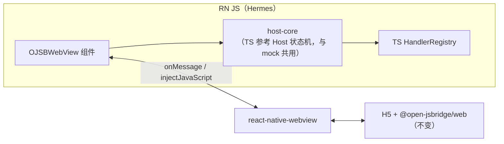

# React Native 宿主设计（`@open-jsbridge/react-native`）

> RN 在这里是 **WebView 宿主端**：RN App 用 `react-native-webview` 加载 H5，H5 使用**同一份** `@open-jsbridge/web`，**Web SDK 不做任何修改**。RN 侧实现 Host 职责并注入满足 [Host Shim 契约](protocol.md#2-host-shim-契约transport-层) 的 shim。
>
> 方案 A 计划在 M2.5 实现；RN 宿主包尚未发布。`react-native-webview` 的 API 以接入版本的官方文档为准，文中标注「需核实」的能力须在接入时通过 conformance 用例验证。

## 1. 可用的 `react-native-webview` 能力

| 需求 | 能力 | 备注 |
|------|------|------|
| document-start 注入 shim | `injectedJavaScriptBeforeContentLoaded` | 另有 main-frame-only 相关 prop（`injectedJavaScriptBeforeContentLoadedForMainFrameOnly` 等，平台支持范围需核实） |
| Web→RN | 页面 `window.ReactNativeWebView.postMessage(string)` → `onMessage(event)`，`event.nativeEvent.data` 为字符串 | 只传字符串；无返回值 |
| RN→Web | `ref.injectJavaScript(js)`；或 `ref.postMessage(string)` | `postMessage` 在页面侧派发 `message` 事件的目标对象（`window` / `document`）在不同平台/版本上有差异，**参考实现统一用 `injectJavaScript` 调用 `__OJSB_RECEIVE__`** |
| 导航控制 | `originWhitelist`、`onShouldStartLoadWithRequest` | `originWhitelist` 控制的是"允许在 WebView 内加载的 URL"，**不是**消息来源校验 |
| 生命周期 | `onLoadStart`、`onContentProcessDidTerminate`（iOS）、`onRenderProcessGone`（Android） | 用于会话失效 |

`nativeEvent.url` 的来源因平台与通道而异。方案 A 只将该字段用于诊断，调用方 origin 与 frame 保持未知。满足 §5 的启用条件时，会话使用 `trust: 'degraded'`（protocol S2）。

## 2. 架构方案：纯 TS 宿主 vs TurboModule/JSI 复用原生层

### 方案 A：纯 JS/TS 宿主（**推荐默认**）



- Host 核心使用内部 TS 模块 `host-core`，**与 `@open-jsbridge/web/mock` 共用同一个参考 Host 状态机**。它按 protocol §3 解码单条 `{jsb, meta?, rpc}` JSON-RPC 2.0 信封并拒绝批量数组。RN 平台通道须按 §6 单独验证。
- 优点：不改原生代码、可 OTA 更新 handler、与 `react-native-webview` 全部能力兼容、Expo 等托管工作流也能用。
- 缺点：trust = degraded（拿不到可信 frame origin）；消息要经过原生 WebView → RN 事件 → JS 线程，JS 线程繁忙时 bridge 延迟会上升。JSON 消息受握手上限约束。标准选图需要原生宿主管理会话媒体句柄。[会话媒体协议](protocol.md#101-原生句柄和缩略图)

### 方案 B：新架构 TurboModule / JSI 复用原生 OJSB

- 原生 OJSB（iOS/Android 实现层）直接挂在原生 WebView 上；RN 通过 **TurboModule**（Codegen 生成的类型化接口，JSI 直接调用）注册 handler、接收调用、推送事件。
- 需要控制**原生 WebView 实例**：要么写一个自己的 Fabric native component（内部创建并配置原生 WebView + 原生 OJSB），要么 patch / fork `react-native-webview` 以暴露配置钩子。两者都需要长期维护原生代码。
- 优点：可复用原生 Host 的调用方校验、frame 定向通道和媒体句柄，也可直接复用原生 handler。`trust = full` 和 iframe 能力按原生 transport 的实际能力启用（见 §5）。
- 缺点：失去纯 JS 方案的 OTA 和托管工作流便利；要跟随 RN 新架构与 WebView 组件的版本演进；自研 WebView 组件需补齐 cookie、下载、文件上传等能力。

### 推荐

- **优先采用方案 A**：仅在接入方按 §5 显式启用降级并能独立确保内容与 frame 隔离时接入。
- 以下任一条件成立时选**方案 B**：需要开放支付/账号等高敏感能力给 H5；必须支持第三方 iframe；需要复用标准选图模块；App 已有大量原生 OJSB handler（混合工程）。
- 两个方案对 H5 完全透明（同一 shim 契约），可以先 A 后 B 平滑迁移。

## 3. Shim（方案 A）

通过 `injectedJavaScriptBeforeContentLoaded` 注入：

```ts
export const OJSB_RN_SHIM = `(function () {
  if (window.__OJSB_TRANSPORT__ || !window.ReactNativeWebView) return;
  var buf = [], recv;
  function deliver(m) { recv ? recv(m) : (buf.length < 256 && buf.push(m)); }
  var t = Object.freeze({ name: 'rn', protocols: Object.freeze([1]),
    postMessage: function (s) { window.ReactNativeWebView.postMessage(s); } });
  Object.defineProperty(window, '__OJSB_TRANSPORT__', { value: t, writable: false, configurable: false });
  Object.defineProperty(window, '__OJSB_RECEIVE__', { configurable: false,
    get: function () { return deliver; },
    set: function (fn) { recv = fn; var q = buf; buf = []; q.forEach(function (m) { fn(m); }); } });
  window.dispatchEvent(new CustomEvent('ojsb:transportready'));
})(); true;`;
```

> 结尾的 `true;` 是 `react-native-webview` 文档对注入脚本的建议写法（避免部分平台上的静默失败），实现时按所用版本文档确认。

## 4. TS API 与 handler 注册示例

```tsx
import { OJSBWebView, createHostBridge, BridgeError, type HostHandler } from '@open-jsbridge/react-native';
import type { MethodMap } from '@open-jsbridge/web';     // 复用 codegen 生成的同一份类型

const deviceGetInfo: HostHandler<'device.getInfo'> = async (params, ctx) => ({
  os: Platform.OS,
  osVersion: String(Platform.Version),
  model: DeviceInfo.getModel(),
});

const host = createHostBridge({
  allowedOrigins: ['https://m.acme.com'],
  events: ['network.statusChanged', 'app.foregrounded', 'app.backgrounded'],
  handlers: {
    'device.getInfo': deviceGetInfo,
    'ui.toast.show': async ({ text }) => { Toast.show(text); },
    'acme.photos.prepare': async ({ count }, ctx) => {
      await ctx.callback({ selected: 0 });                 // 发送 bridge.progress 通知
      if (ctx.signal.aborted) throw new BridgeError(-32002, 'Cancelled');
      const picked = await pickImages(count, { signal: ctx.signal });
      if (!picked) throw new BridgeError(-32007, 'User denied');
      return { count: picked.length };
    },
  },
});

export function HybridScreen() {
  return (
    <OJSBWebView
      bridge={host}
      source={{ uri: 'https://m.acme.com/home' }}
      // 其余 props 透传给 react-native-webview
    />
  );
}

// RN → Web
host.emit('network.statusChanged', { type: 'wifi' });
// 原生进程生命周期回调收到变化时分别调用。
host.emit('app.foregrounded', null);
host.emit('app.backgrounded', null);
const share = await host.callWeb('page.getShareInfo', {}, { timeout: 3000 });
```

以下是 `OJSBWebView` 在通过 §5 的启用检查后使用的代码。接入方在渲染前验证 `source`，并持续执行内容与 frame 隔离。未通过检查时，使用普通 WebView，保持 OJSB shim、消息回调和 transport 关闭。示例中的 `deliverToDocument` 表示 transport 内部的定向投递步骤，在目标 document 内确认身份后才执行投递脚本（protocol §12.1）。

```tsx
export const OJSBWebView = forwardRef<WebView, Props>(({ bridge, onMessage, onShouldStartLoadWithRequest, ...rest }, ref) => {
  const inner = useRef<WebView>(null);
  useImperativeHandle(ref, () => inner.current!);

  // 投递前确认目标 document，脚本参数按 protocol §11.5 二次编码
  useEffect(() => bridge.attach({
    deliver(raw: string, target: DocumentRef) {
      const literal = JSON.stringify(raw).replace(/\u2028/g, '\\u2028').replace(/\u2029/g, '\\u2029');
      deliverToDocument(inner.current, target, `window.__OJSB_RECEIVE__&&window.__OJSB_RECEIVE__(${literal});true;`);
    },
  }), [bridge]);

  return (
    <WebView
      ref={inner}
      {...rest}
      injectedJavaScriptBeforeContentLoaded={OJSB_RN_SHIM}
      injectedJavaScriptBeforeContentLoadedForMainFrameOnly   // 需核实各平台支持
      onMessage={(e) => {
        bridge.receive(e.nativeEvent.data, { trust: 'degraded' });
        onMessage?.(e);
      }}
      onShouldStartLoadWithRequest={(req) => {
        // 辅助检查后续导航，初始 source 在启用前单独验证
        if (!bridge.acl.allowsOrigin(originOf(req.url))) {
          bridge.onBlockedNavigation?.(req.url);
          return false;
        }
        return onShouldStartLoadWithRequest ? onShouldStartLoadWithRequest(req) : true;
      }}
      onContentProcessDidTerminate={(e) => { bridge.invalidateAll('process_gone'); rest.onContentProcessDidTerminate?.(e); }}
      onRenderProcessGone={(e) => { bridge.invalidateAll('process_gone'); rest.onRenderProcessGone?.(e); }}
    />
  );
});
```

> M2.5 须核实生命周期信号能区分新 document 与同一 document 内的 SPA 路由，并在新 document 提交时使旧 sid 失效（protocol §12）。`onLoadStart` 的可用性与触发时机须在接入版本上验证。

## 5. 安全要点

1. **调用方身份**。仅经验证的原生 WebView 调用方信息可用于判断 origin 与 frame。WebView 当前 URL 仅用于导航检查或诊断。
2. **降级启用**。接入方 MUST 显式启用降级并独立执行内容与 frame 隔离，确保从初始加载到后续导航都只有受信的主文档可使用通道。条件不成立时，MUST 禁用 OJSB 通道和 shim，并使已有会话失效。`originWhitelist`、`onShouldStartLoadWithRequest` 和 main-frame-only shim 仅作辅助。Android 首次加载不会调用 `onShouldStartLoadWithRequest`。
3. **iframe 能力**。方案 A 只支持主文档。只有具备可验证的原生调用方 frame/document 绑定、原生失效信号以及对同一 frame/document 的定向投递时，才能宣告 iframe 能力，并按 frame 执行 ACL（protocol F5）。
4. **能力启用**。宿主注册表决定会话可以协商的能力。标记 `trust = degraded` 的可选通道需要满足独立的来源与 frame 限制（protocol S2）。支付、账号、文件系统等敏感方法应在具备可信来源校验的宿主上启用。
5. **推送防注入**：只通过 `__OJSB_RECEIVE__(<二次编码字符串>)` 推送，禁止把业务数据拼进 JS 源码。
6. **调试开关**：`webviewDebuggingEnabled` 等调试能力只在 debug 构建打开。
7. **会话与请求去重**。仅 `bridge.hello` 请求及其关联响应可省略 `meta.sid`，握手仍须通过调用者授权。入站会话消息须匹配当前 WebView、frame、document 和 `meta.sid`。规则拒绝或异常时停止分发。握手按 document、其他请求按 sid 和发起方向去重，重复项在分发前静默丢弃。响应只经满足会话校验且绑定到原 document 的通道发送。
8. **通知与响应**。显式允许的内置控制通知包括 `bridge.event`（`name`、`payload`）、`bridge.cancel`（`requestId`、可选 `reason`）和 `bridge.progress`（`requestId`、`seq`、可选 `chunk`）。通知省略 `rpc.id`，无 JSON-RPC 响应。请求响应以字符串 `rpc.id` 关联原调用，`rpc.id: null` 仅用于诊断错误。

## 6. 测试

| 层 | 工具 | 内容 |
|----|------|------|
| host-core 单测 | Jest / Vitest | 与 mock 共用的参考 Host 状态机，直接跑 conformance 消息级用例 |
| 组件测试 | Jest + `react-native-webview` mock | `OJSBWebView` 的 attach/detach、导航守卫、二次编码 |
| E2E | Detox 或 Maestro | 在 iOS/Android 真机/模拟器加载 conformance runner 页面，收集 JUnit 结果 |
