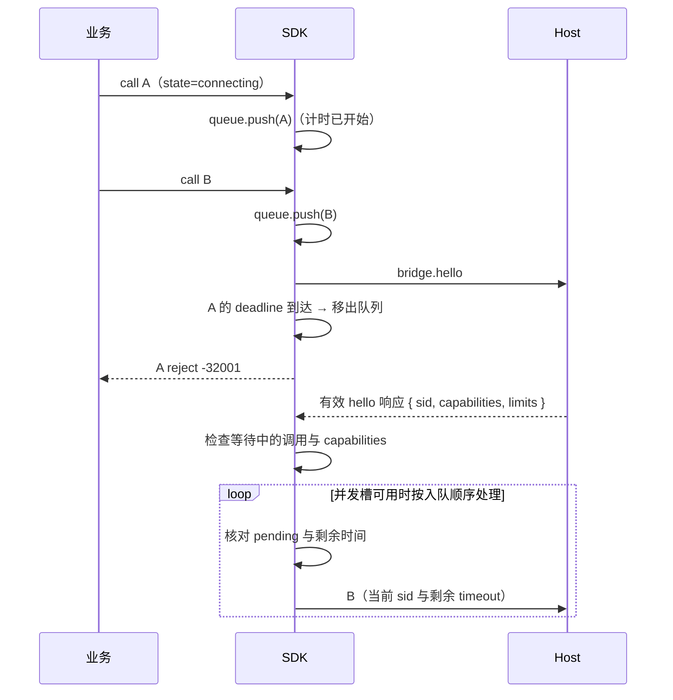

# Web SDK 设计（`open-jsbridge`）

> 目标：**一份 SDK 跑在所有宿主**（iOS / Android / Flutter / React Native / 浏览器 / mock）。SDK 只依赖 [protocol.md §2 Host Shim 契约](protocol.md#2-host-shim-契约transport-层)，不感知具体平台。

## 1. 公共 API

当前实现提供 `createBridge`、默认 `bridge`、`ready`、`has`、`call` 和事件相关的 `on`、`off`、`hasEvent`。浏览器 Mock 可用于事件联调。原生宿主的事件能力以握手声明为准。此处还展示了后续的流式回调、反向调用和 codegen 设计。

App WebView 中的业务代码可以直接用默认单例调用 `bridge.call()`。首次调用会自动等待注入通道并发起握手，握手完成后按宿主声明的并发上限发送请求。需要先读取宿主信息或用 `has()` 决定界面是否显示某项能力时，再显式调用 `ready()`。

```ts
import { bridge, BridgeError, ErrorCode } from 'open-jsbridge';

await bridge.ready();                                   // 握手完成（或降级判定完成）

if (bridge.has('device.getInfo', 1)) {
  const info = await bridge.call<{ os: string; osVersion: string }>('device.getInfo', {}, { timeout: 3000 });
}

if (bridge.hasEvent('network.changed')) {
  const off = bridge.on<{ type: string }>('network.changed', (e) => console.log(e.type));
  await off.ready;
  off();                                                 // 或 bridge.off('network.changed', handler)
}

// 取消
const ac = new AbortController();
bridge.call('media.chooseImage', { count: 3 }, { signal: ac.signal, timeout: 3000 });
ac.abort();

try { await bridge.call('acme.pay.create', { orderId }); }
catch (e) {
  if (e instanceof BridgeError && e.code === ErrorCode.PermissionDenied) { /* ... */ }
}
```

### 1.1 类型签名

```ts
// 由 codegen 从 spec/methods/**/*.json 生成（见 conformance.md §4）
export interface MethodMap {
  'device.getInfo': { params: DeviceGetInfoParams; result: DeviceGetInfoResult };
  'ui.toast.show':  { params: UiToastShowParams;  result: void };
  // ...
}
export interface EventMap {
  'network.changed': NetworkChangedEvent;
  'app.didEnterBackground': Record<string, never>;
}

export interface CallOptions<C = unknown> {
  timeout?: number;                 // ms；M1 接受正整数
  signal?: AbortSignal;
  traceId?: string;
  version?: number;                 // 显式 method 版本，等价于 'x.y@2'
  onCallback?: (chunk: C, seq: number) => void;
}

export interface EventSubscription {
  (): void;
  readonly ready: Promise<void>;
}

export interface Bridge {
  readonly state: 'idle' | 'connecting' | 'ready' | 'unavailable';
  readonly host?: HostInfo;
  ready(): Promise<HostInfo>;
  has(method: string, version?: number): boolean;

  call<M extends keyof MethodMap>(method: M, params?: MethodMap[M]['params'], opts?: CallOptions): Promise<MethodMap[M]['result']>;
  call<T = unknown>(method: string, params?: Record<string, unknown>, opts?: CallOptions): Promise<T>; // 未声明的扩展 method

  hasEvent(event: string): boolean;
  on<E extends keyof EventMap>(event: E, fn: (p: EventMap[E]) => void): EventSubscription;
  on<T = unknown>(event: string, fn: (p: T) => void): EventSubscription;
  off(event: string, fn?: (p: any) => void): void;
  emit(event: string, params?: Record<string, unknown>): void;      // Web → Host event

  handle(method: string, fn: (params: any, ctx: { signal: AbortSignal }) => unknown | Promise<unknown>): () => void;

  use(plugin: BridgePlugin): void;  // 中间件：日志、埋点、mock 覆盖
}

export function createBridge(options?: BridgeOptions): Bridge;  // 多实例/测试用
export const bridge: Bridge;                                     // 默认单例
```

设计说明：

- **为什么是 `call(method, params)` 而不是 `bridge.device.getInfo()` 代理对象**：字符串 method 便于 tree-shaking、日志与 codegen 对齐；强类型通过 `MethodMap` 获得。codegen MAY 额外生成 `api.device.getInfo()` 的薄封装（可选子路径导出 `open-jsbridge/typed`）。
- `params` 必须是 object（协议约束），SDK 在开发模式下对非 object 直接抛错。
- `BridgeError extends Error`，带 `code / data / method / traceId`，可 `instanceof` 判断。

## 2. 内部架构


### 2.1 Adapter 抽象

```ts
export interface Adapter {
  readonly name?: string;
  readonly protocols?: readonly number[];
  detect?(): boolean;
  /** 发送；若返回 Promise<string>，Core 将其视为该 request 的 response */
  send(raw: string): void | Promise<string | null>;
  /** 注册接收回调，返回注销函数 */
  listen(onMessage: (raw: string) => void): () => void;
}
```

- **平台差异全部下沉到 Host shim**：iOS 的 `webkit.messageHandlers.x.postMessage` 返回 Promise、Android `addWebMessageListener` 对象的 `postMessage + onmessage`、Flutter/RN 的通道，都由各自 shim 适配成同一个 `OJSBTransport`。因此新增宿主（如 Flutter、RN、鸿蒙 ArkWeb）**不需要改 SDK**。
- 自动选择顺序为显式 `options.adapter`、已注入的 shim、等待 `ojsb:transportready`。等待超时后 bridge 进入 unavailable，浏览器 polyfill 留待后续。
- SDK 独立跟踪当前 window 的接收器所有权。卸载时只移除该实例持有的接收器，以兼容返回缓冲转发函数的 shim getter。页面内多个 SDK 实例应各自使用显式 Adapter。

### 2.2 Core：pending、id、超时与会话

Web SDK 和 Mock 共用 [TypeScript codec](../packages/protocol/src/index.ts)。应用仍通过 `bridge.call(method, params, options)` 发起调用。发送时把 JSON-RPC 2.0 request 放进 `rpc`，由外层 `meta` 携带会话与剩余超时。

```json
{
  "jsb": "1.0",
  "meta": { "sid": "s-01", "timeout": 4800 },
  "rpc": { "jsonrpc": "2.0", "id": "w-42", "method": "conformance.echo", "params": { "text": "你好" } }
}
```

- 把请求登记到 pending 时启动基于单调时钟的超时计时，并安装 `AbortSignal` 监听。响应、发送失败、超时或取消都会移除 pending、定时器和监听。同一请求只结算一次。
- Adapter 的 Promise 回复与 push 共用接收路径。先校验信封和 RPC 结构，随后验证会话。只有当前会话中已发送、仍有效并匹配 `rpc.id` 的响应才能结算调用。`rpc.id: null` 仅用于协议诊断。
- `bridge.hello` 直接发送。握手的响应按本次尝试的 id 与 deadline 匹配。成功时校验 `rpc.result.sid`、协商版本、能力和限制，响应外层若提供 `meta.sid` 则须与结果一致。旧握手响应无法建立会话。
- 对已发出的请求，取消使用无 RPC id 的 `bridge.cancel` 通知，`rpc.params.requestId` 是原请求 id。SDK 仅向仍然有效且声明 `cancel` 能力的原会话发送取消。
- 通知分发器目前处理 `bridge.event`。后续的 `bridge.progress` 会通过 `rpc.params.requestId` 和 `seq` 关联进度，最终结果仍由一次普通 response 结束。
- SDK 按协商的 `maxMessageBytes` 检查完整信封的 UTF-8 字节数。发送端在超限时以 `-32006` 本地结算，接收端在解析前丢弃超限帧。schema 授权的无超时长任务留待后续。

### 2.3 Pre-ready 队列

等待握手和等待并发槽的调用共用一个 FIFO 队列。握手后，普通调用和订阅控制请求都按 `limits.maxInflight` 发送。



- `createBridge({ queueLimit })` 控制新调用可加入的等待队列，默认 100。队列满时，需排队的业务调用和首次订阅返回 `ErrorCode.NotReady`（`-32005`）。`queueLimit: 0` 下，这些请求需要握手完成并有可用并发槽。
- 业务调用的 deadline 包含等待握手和等待并发槽的时间。首次订阅从握手后进入队列时计时。握手后按能力过滤等待的调用。发送前再次检查剩余时间，即使定时器回调尚未运行，过期调用也立即返回 `-32001`。发出时 `meta.ts` 写入发送时刻，`meta.timeout` 写入剩余时间。
- 尚未发送的调用发生 abort 或超时，只在本地以 `-32002` 或 `-32001` 结算。若调用已经发出，且原会话仍有效并声明 `cancel`，SDK 先发取消通知。提供 Promise 回执的通道在收到传输回执后释放对应 SDK 并发槽，避免批量取消时同时积压取消和后续请求。回执等待最长为宿主的默认调用超时时长，业务 Promise 仍立即结算。返回 `void` 的通道在发出通知后即可继续发送。iOS 和 Android 参考宿主收到匹配的通知后会释放原生并发槽，并请求原生任务协作取消。
- 降级判定为 `unavailable` 时，队列中所有调用 reject `-32000`。

### 2.4 事件多路复用

```ts
const off = bridge.on<{ type: string }>('network.changed', ({ type }) => {
  console.log(type);
});

try {
  await off.ready;
} catch (error) {
  off();
  throw error;
}

// 页面组件卸载时调用 off()
```

`on()` 注册本地监听并启动握手和订阅。返回的 `off` 可以直接用来清理监听。它的 `ready` Promise 在宿主首次确认订阅后完成。宿主未声明该事件时，`ready` 以 `-32601` 拒绝。宿主明确拒绝订阅时使用 `-32003`。首次确认前调用 `off()` 会以 `-32002` 结束这次注册。

- `await bridge.ready()` 后可以用 `bridge.hasEvent(name)` 查询当前宿主声明。订阅许可仍以 `off.ready` 的结果为准。
- 同一事件的监听者共用一次远端订阅。`bridge.off(name, listener)` 移除指定监听，`bridge.off(name)` 移除该事件的全部监听。最后一个监听移除时，SDK 发送退订。
- SDK 只分发当前会话中已获确认的事件。`pagehide` 后旧会话的通知失效。页面从 bfcache 恢复并重新握手时，SDK 为仍注册的监听重新订阅。
- 自动退订和已确认监听的恢复订阅可以在队列满时入队。它们按同一队列顺序等待并发槽，从发送时开始计时，随当前会话失效一并清除。

### 2.5 生命周期处理

```ts
addEventListener('pagehide', () => core.invalidateSession());
addEventListener('pageshow', (e) => { if (e.persisted) core.rehandshake(); });
```

- `invalidateSession()` 先清除活动会话、能力和握手尝试，再用 `-32002` 结算出站 pending 和队列，并取消旧会话中的 Web handler。旧 handler 完成后不向新会话发送响应。
- `rehandshake()` 先使任何旧会话与握手失效，再发起新的 `bridge.hello`。仅在验证新尝试的响应后恢复业务消息分派，并重新订阅当前监听的事件。

## 3. 降级与 polyfill（设计）

下例展示规划中的浏览器降级接口。

```ts
import { createBridge, BrowserFallbackAdapter } from 'open-jsbridge';

const bridge = createBridge({
  fallback: new BrowserFallbackAdapter({
    polyfills: {
      'ui.toast.show': ({ text }) => { alert(text); },
    },
  }),
});
```

在普通浏览器中，`has()` 只对 polyfill 返回 true；这让同一份业务代码在 H5 外投场景可运行。

## 4. 类型生成

- 输入：`spec/methods/**/*.json`（JSON Schema 2020-12 + `x-ojsb-*` 扩展）。
- 工具：`packages/codegen`，内部可基于 `json-schema-to-typescript` 一类库生成 params/result 类型，再自行生成 `MethodMap` / `EventMap` 聚合接口。
- 产物：`packages/web-sdk/src/generated/methods.d.ts`（标准 profile），业务方可在自己仓库对自定义 schema 运行 `ojsb-codegen --target ts` 并通过 **declaration merging** 扩展：

```ts
declare module 'open-jsbridge' {
  interface MethodMap {
    'acme.pay.create': { params: { orderId: string }; result: { status: 'paid' | 'cancelled' } };
  }
}
```

- CI：codegen 结果入库，CI 运行 codegen 后 `git diff --exit-code`，防止 schema 与类型不一致。

## 5. 构建与 npm 包

`npm run build` 用 TypeScript 生成 ES2020 模块和声明文件。`npm run pack:web` 生成 `dist/open-jsbridge-0.1.0.tgz`，可以在独立项目里本地安装。

- `open-jsbridge` 提供默认 `bridge`、`createBridge`、错误类型和相关 TypeScript 声明。
- `open-jsbridge/mock` 提供 `installMockTransport`、`createMockAdapter` 和对应的类型声明。开发页显式调用 `installMockTransport()` 后开始联调。
- 包包含零运行时依赖的 ESM 模块。仓库的 `npm run demo:web` 仍直接使用本地编译产物。
- 体积目标以 min+gzip 为准，核心 ≤ 4 KB，含事件、反向调用和回调的完整形态 ≤ 6 KB。

[独立项目接入示例](../examples/web-demo/README.md#在独立-web-项目安装)

## 6. Mock 与调试工具

### 6.1 `open-jsbridge/mock`

M1 提供 `installMockTransport()`，开发环境可以在页面启动时调用一次，把 Mock 注册为 `window.__OJSB_TRANSPORT__`。业务代码使用同一个默认 `bridge`，首次调用走 SDK 的通道检测和自动握手。Node.js 或需要彼此隔离的测试也可以使用 `createMockAdapter()`。

后续完整 Mock 宿主的配置和操作设计如下。

```ts
import { installMockHost } from 'open-jsbridge/mock';

const host = installMockHost({
  platform: 'ios',
  latency: [20, 80],                                  // 随机延迟，暴露竞态
  acl: { origins: [location.origin], allow: ['*'] },
});
host.register('device.getInfo', () => ({ os: 'ios', osVersion: '27.2' }));
host.register('media.chooseImage', async (_p, ctx) => { ctx.callback({ selected: 1 }); return { images: [] }; });
host.emit('network.changed', { type: 'wifi' });
host.failNext('acme.pay.create', { code: -32007, message: 'User denied' });
```

- mock host 内部复用 conformance 套件里的"参考 Host 状态机"（TS 实现），保证 mock 行为与协议一致。
- 支持通过 URL 参数 `?ojsb_mock=1` 在开发环境自动安装。

### 6.2 Devtools

- `@open-jsbridge/devtools`：页面浮层，展示消息流（方向、method、耗时、错误码）、能力清单、会话状态；可导出 HAR-like JSON。
- SDK 的 `use(plugin)` 中间件接口：

```ts
export interface BridgePlugin {
  name: string;
  onSend?(env: Envelope): Envelope | void;
  onReceive?(env: Envelope): Envelope | void;
  onMetric?(m: { method: string; id: string; roundTripMs: number; hostHandlerMs?: number; code?: number }): void;
}
```

## 7. 单元测试

- 当前使用 Node test runner。仓库根目录执行 `npm ci`、`npm test`，编译 TypeScript 后运行 JSON 信封样例和 SDK ↔ Mock 用例。浏览器与真实 WebView 用例在对应宿主接入时加入。
- 覆盖点（与 conformance 用例 id 对应）：
  - id 唯一性、并发 1000 次调用无串号
  - 在途调用超时返回 `-32001`，向支持取消的原会话发送通知并丢弃迟到响应
  - AbortSignal 取消（调用前已 abort / 调用中 abort）
  - 调用队列：握手前后按 `maxInflight` 和入队顺序发出请求，覆盖队列满、握手失败、排队期间的超时或 abort，以及发送时的剩余 timeout
  - 能力过滤：未广告 method 不发送
  - reply 通道（send 返回 Promise）与异步通道行为一致（同一组用例参数化跑两遍）
  - 事件引用计数订阅/退订、重新握手后重新订阅
  - 握手前的会话消息、活动会话中缺少 SID 或 SID 不匹配的消息、迟到的 hello 都被丢弃
  - pagehide / bfcache 恢复
- 使用 fake timers 测试超时；用 mock host 的 `latency` 做随机化"模糊测试"。
- 覆盖率门槛：core 行覆盖 ≥ 95%。
